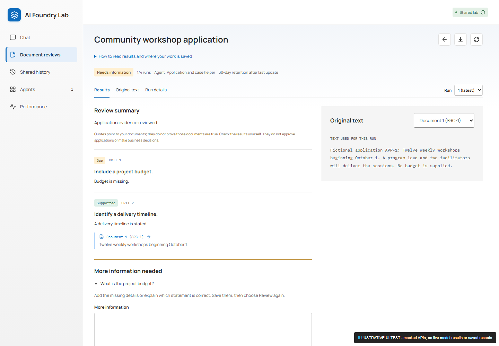
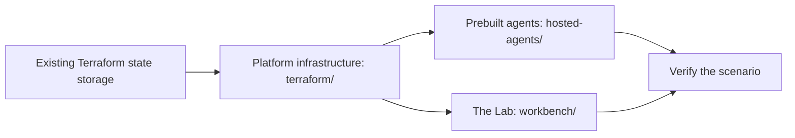

# Hosted-agent samples for Microsoft Foundry

Try AI agents that check applications and summarize case notes in
**Microsoft Foundry** (formerly Azure AI Foundry), using fictional data and a
private Azure deployment.

The repository includes prebuilt review agents, a browser app called **the Lab**,
fictional sample inputs with expected findings, and Terraform that deploys
everything privately. The samples suit public-sector, healthcare-operations, and
independent software vendor (ISV) demonstrations. Agents help people review the
supplied material. People check the findings and make every decision.

> [!WARNING]
> **Use fictional data only.** The Lab keeps a shared history and has no
> per-user authorization, so everyone with access can read every saved record.
> Private networking and managed identities don't keep one user's records
> separate from another's.

## In this guide

- [Get started](#get-started)
- [What's included](#whats-included)
- [How it works](#how-it-works)
- [Deploy to Azure](#deploy-to-azure)
- [Scope and limitations](#scope-and-limitations)
- [Documentation](#documentation)
- [Automated checks](#automated-checks)

## Get started

| I want to | Start with | What I need |
| --- | --- | --- |
| See what the agents do, without Azure | [Demo guide](docs/demos.md) | Nothing |
| Run a demo in a deployed Lab | [Run a demo](#run-a-demo) | A deployed Lab and approved private network access |
| Create and try my own agent | [Create and try a baseline agent](docs/agent-creation.md) | An operator-enabled Lab, an existing model deployment, and cost approval |
| Deploy my own environment | [Deploy to Azure](#deploy-to-azure) | Azure permissions, model quota, private network access, and cost approval |

### Demo scenarios

| Scenario | What you'll do | Status |
| --- | --- | --- |
| [Casework assistance](docs/demos.md#casework-assistance) | Summarize fictional case notes, flag missing or conflicting details, and draft follow-up questions. | **Available** |
| [Application completeness](docs/demos.md#application-completeness) | Check a sample grant or permit application against a checklist and find missing or conflicting information. | **Available** |
| [Requirements and proposal review](docs/demos.md#requirements-and-proposal-review) | Compare proposal requirements with supplied product information and flag claims that lack evidence. | **Experimental** |
| [Create and try a baseline agent](docs/demos.md#create-and-try-a-baseline-agent) | Describe a job, pick one of five reviewed templates, and publish a small agent to try in **Chat**. | **Available** |

**Available** means the code and walkthrough are included. It doesn't mean an
environment is deployed or that its answers are validated. **Experimental** means
an existing agent is adapted for another task and needs more testing.

### Run a demo

1. Open the [Lab](workbench/README.md) through approved private access, and then
   select **New chat**. The local Lab preview doesn't call a model.
2. Open **About this agent** to see what the agent needs, how it works, and what
   it can't do.
3. Select an example task and send it, or paste the complete
   [sample input](docs/demos.md) for your scenario.
4. Compare the answer with the source material and the expected findings. Check
   the citations and any verified records of which review tools ran.
5. Try the supplied missing-information, conflicting-evidence, and failure
   examples.
6. Record what worked, what didn't, and next steps in the
   [demo handoff](docs/demo-handoff.md). Start fresh without deleting anyone
   else's records.

### Check answer quality

A deployment that succeeds or answers quickly doesn't prove that its answers are
correct. For repeatable testing, use the
[evaluation suite](evaluations/README.md):

- Compare models or prompts with the **same test cases**, and record each
  version and its results.
- Offline tests use simulated responses. They check the code, not live model
  quality.
- Live evaluations are optional and billable, and they need explicit approval
  and private test access. Review their results and traces in Foundry, not in
  the Lab.
- Record token usage only when it's available. Keep measured usage, estimated
  token costs, and infrastructure costs separate.

## What's included

| Component | Folder | What it does |
| --- | --- | --- |
| The Lab | [`workbench/`](workbench/) | Private browser app for chatting with agents, running document reviews, and creating agents. Includes a React front end, a FastAPI backend, browser tests, and its own Terraform. |
| Prebuilt agents | [`hosted-agents/`](hosted-agents/) | A review coordinator and two specialists, plus scripts to publish, test, and roll them back. |
| Platform infrastructure | [`terraform/`](terraform/) | Private Foundry, networking, and a jumpbox, built on the official Azure Verified Modules (AVM) pattern for Foundry. Bastion and monitoring have separate roots. |
| Guides and sample inputs | [`docs/`](docs/) | Demo walkthroughs, fictional inputs, and architecture, deployment, and operations guides |
| Evaluations | [`evaluations/`](evaluations/) | Review test cases, offline checks, and optional live answer-quality evaluations |
| Cost comparison | [`cost-comparison/`](cost-comparison/) | A calculator that compares Azure GPU VM and Foundry hosted-runtime costs, with rates you can update |

### Inside the Lab

| Page | You give it | You get back |
| --- | --- | --- |
| **Chat** | A question plus the application, checklist, or case notes you want help with | A conversational answer from the selected agent, with references and follow-up questions |
| **Document reviews** | A checklist and pasted document text | Saved results for each checklist item, quotes you can inspect, and requests for missing information |
| **Create agent** | A job description and one of five [reviewed templates](docs/agent-creation.md#what-a-participant-can-do) | An editable setup. After operator confirmation, the Lab publishes it as a new Foundry agent. |
| **Created agents** | Nothing. It lists agents published from **Create agent**. | Publication progress, operator-confirmed deletion, and a way to open a ready agent in **Chat** |

*Illustrative UI test with mocked APIs, not a live model result.* ·
[View full size](docs/images/screenshots/lab-document-review.png) ·
[More screenshots](docs/images/README.md#lab-screenshots)

- **Creating an agent and chatting with one are separate steps.** An example
  task only fills in your message. **Chat** can't change an agent's instructions,
  tools, or model. That's a [developer or operator task](workbench/README.md#workspace-configuration).
- **Document reviews** always use the Lab's default agent, whichever agent you
  select in **Chat**. Neither page copies work into the other.
- Preparing a setup in **Create agent** doesn't call a model or create Azure
  resources. Publishing is opt-in, costs money, and needs the
  [operator setup](docs/agent-creation.md#enable-publication).

## How it works

1. **You send a request from the Lab.** The Lab's React front end calls a FastAPI
   backend. The backend runs in an internal Azure Container Apps environment and
   uses managed identities to reach Azure services.
2. **The coordinator picks a specialist.** The backend calls the coordinator
   agent in Foundry, which calls one specialist through a configured tool.
   Specialists don't message each other.
3. **The coordinator returns the findings.** The same coordinator adds a tool
   record that shows which specialist answered.
4. **You check the answer.** Compare the findings with the source. A completed
   tool call doesn't prove the findings are correct.

**What gets saved:** **Chat** saves completed messages to a shared Azure Cosmos DB
database only when you choose to save. Creating a document review saves its
checklist and document text. Running a review also saves the results and a copy
of that run's input.

The Lab isn't an unrestricted agent designer or an evaluation dashboard. For
components, data flows, and trust boundaries, see the
[architecture guide](docs/architecture.md). For the actual message shape, see
the [request and result example](docs/agent-profiles.md#example-handoff).

### Agent names

Each prebuilt agent has one name in the Lab and another in Foundry. Use the
Foundry name to find an agent or its traces in the Foundry portal. The Foundry
project that holds the agents, for example `hosted-agents-dev`, isn't an agent.

| Name in the Lab | Name in Foundry | Role |
| --- | --- | --- |
| **Application and case helper** | `customer-review-coordinator` | Default coordinator. Sends each task to one specialist. |
| **Application and case helper (base setup)** | `review-coordinator-agent` | The same jobs, using the base instructions instead of the evidence-review profile |
| **Application checker** | `application-review-agent` | Specialist for application completeness and proposal coverage |
| **Case notes summarizer** | `case-review-agent` | Specialist that summarizes case notes and flags missing or conflicting details |

By default, the Lab shows only **Application and case helper**. For catalog IDs,
source folders, and the standalone `basic-responses-agent` sample, see
[agent names](docs/README.md#agent-names).

## Deploy to Azure

This section is for the operator who deploys the environment.

> [!IMPORTANT]
> **This isn't a low-cost starter deployment.** Azure resources, model calls,
> and running agents can incur charges. Get approval, and review the saved
> Terraform plan, regional pricing, and quota before you deploy. Preserve
> existing resource names, state, permissions, and private access. Never apply
> an unexpected replacement or deletion.

### Prerequisites

- Terraform 1.16.1, and Azure CLI signed in to the intended tenant.
- Permission to deploy resources and assign roles, enough regional model quota,
  and approved private network access.
- An existing, secured Azure Storage account and blob container for Terraform
  state. Your identity needs **Storage Blob Data Contributor** on that container.
  This sample doesn't create its own state backend.

For details, see the [Terraform prerequisites and state guide](terraform/README.md).

### Deployment order

1. [Configure, validate, plan, and deploy the platform infrastructure](terraform/README.md#deploy).
   Follow the [state and migration safeguards](terraform/README.md#state).
2. [Publish and test the prebuilt agents](hosted-agents/README.md). If you need
   a separate deployment machine, use the
   [private deployment runbook](docs/private-deployment.md).
3. [Deploy or access the Lab](workbench/README.md). The Lab has its own
   Terraform state and its own application deployment steps.
4. Verify private access, agent calls, and your chosen scenario in your approved
   test environment before you present it. For a formal comparison, use the
   [quality checks](#check-answer-quality). Live evaluation needs separate
   approval.

The optional [Bastion](terraform/bastion/README.md) and
[agent monitoring](terraform/monitoring/README.md) roots are also separate, each
with its own state. Apply them after the platform infrastructure exists.

A new agent version can receive traffic before its smoke tests finish. If a
check fails, the deployer tries to restore the previous route and keeps any
version it can't safely delete. See the
[deployment and recovery steps](hosted-agents/README.md#6-verify-the-route-and-handle-failures).

## Scope and limitations

These samples are for demonstrations and technical testing. They aren't finished
customer applications. Connecting to customer systems or deploying to production
needs separate planning and agreement.

| Topic | What to expect |
| --- | --- |
| Business systems | Review agents analyze the supplied text. They don't update business systems. Any future demo of business actions must use simulated tools. |
| Integrations | The demo path doesn't include customer-system connections, Microsoft 365, Copilot, or SharePoint integrations, or education knowledge assistants. |
| Optional services | Azure API Management (APIM) is off by default, and the Lab doesn't need it. Azure AI Search is a Foundry dependency, but the review agents don't use it. Application Gateway and Front Door are [design options](docs/ingress-access.md) that this sample doesn't deploy. |
| Request triage | [Agent-assisted request triage](docs/demos.md#agent-assisted-request-triage) is planned, not implemented. Sending review tasks to specialist agents isn't a service-request routing or approval workflow. |
| Citations | A matching citation shows that text came from a supplied source, not that the source's claims are true. |
| Missing evidence | Missing evidence calls for more information, not an automatic rejection. |
| Customer information | Don't put customer names, opportunity records, commercial details, or claims of customer implementations into sample inputs, traces, or handoff examples. |
| Support | This repository isn't an officially approved or funded Microsoft service offering. Sample code, setup help, and architecture or cost advice aren't a commitment to deliver a customer integration. |

To plan further work, including user authorization and keeping users' records
separate, use the
[production checklist](terraform/README.md#separately-scoped-production-considerations).
Capture agreed next steps in the [demo handoff](docs/demo-handoff.md).

## Documentation

| Topic | Guides |
| --- | --- |
| Try the samples | [Demo guide](docs/demos.md), [demo handoff](docs/demo-handoff.md), [document reviews](docs/review-workflow.md) |
| Deploy and operate | [Infrastructure](terraform/README.md), [the Lab](workbench/README.md), [hosted agents](hosted-agents/README.md), [private deployment runbook](docs/private-deployment.md), [credentials](docs/credentials.md) |
| Architecture and security | [Architecture](docs/architecture.md), [trust boundaries](docs/architecture.md#trust-boundaries), [review storage and recovery](docs/review-workflow.md#execution-and-persistence), [diagrams](docs/images/README.md) |
| Customize and extend | [Extension guide](docs/architecture-assessment.md), [coordinator profiles](docs/agent-profiles.md), [evaluations](evaluations/README.md), [cost comparison](cost-comparison/README.md) |
| Optional integrations | [Governed review API (APIM)](docs/apim-review-api.md), [Application Gateway and Front Door](docs/ingress-access.md), [other integration options](docs/optional-integrations.md) |

When you extend the platform, keep the existing AVM foundation and add
infrastructure only for a specific need. See
[what to reuse and who owns it](docs/architecture-assessment.md#terraform-first-deployment).
For every guide and a glossary of terms, see the
[documentation index](docs/README.md).

## Automated checks

On pull requests and pushes to `main`, GitHub Actions:

- Compiles and tests the Python code.
- Checks dependencies and all four agent deployment CLIs, and tests the SDK
  integrations.
- Checks Terraform formatting and configuration.
- Tests deployment safeguards, saved-history and review behavior, and browser
  workflows at desktop and mobile sizes.

These checks don't call live agents or create Azure resources. They test the
code and how it handles simulated service responses, not the quality of a live
model's answers.

## Related content

- [AVM pattern module for Foundry (Terraform Registry)](https://registry.terraform.io/modules/Azure/avm-ptn-aiml-ai-foundry/azurerm/latest)
- [Create Microsoft Foundry with Terraform](https://learn.microsoft.com/azure/foundry/how-to/create-resource-terraform)
- [Foundry hosted agents](https://learn.microsoft.com/azure/foundry/agents/concepts/hosted-agents)
- [Foundry Agent Service pricing](https://azure.microsoft.com/pricing/details/foundry-agent-service/)