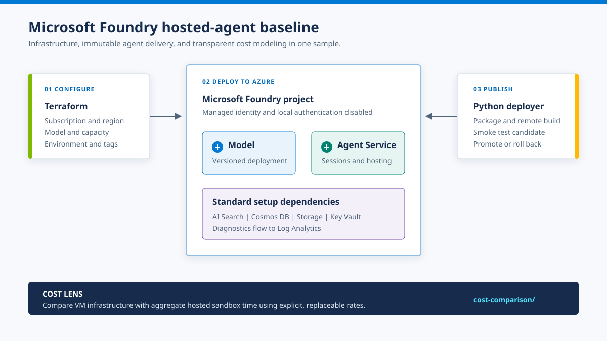

# Microsoft Foundry hosted-agent samples

[](https://github.com/michael-rechani/ai-foundry-samples/actions/workflows/validate.yml)
[](terraform/README.md)
[](hosted-agents/README.md)

Deploy a practical Microsoft Foundry baseline, publish a Responses-protocol
hosted agent, and compare its hosting costs with self-managed agents on Azure
virtual machines.



The diagram shows this repository's complete development baseline. A hosted
agent fundamentally needs a Foundry project with Agent Service, a model, agent
code, and the required identity and permissions. This sample also provisions
the AVM pattern's standard Agent Service dependencies and Log Analytics so the
environment is repeatable and observable; the calculator and CI workflow are
development tools, not runtime dependencies.

> [!IMPORTANT]
> This sample creates billable Azure resources. Review the saved Terraform
> plan, regional model pricing, and quota before applying it.

## What you get

- **Repeatable infrastructure:** an Azure Verified Module (AVM) deployment of
  a Foundry account, project, model, Agent Service dependencies, and
  diagnostics.
- **Safer agent delivery:** a Python deployer that packages an immutable
  version, waits for activation, runs a smoke test, and rolls back on failure.
- **Explicit cost assumptions:** a calculator that keeps region-specific rates
  outside the code and reports the hosted-runtime break-even point.
- **Automated validation:** GitHub Actions checks Python sources, dependencies,
  calculator behavior, Terraform formatting, and Terraform configuration.

## Repository layout

| Path | Purpose |
| --- | --- |
| [`terraform/`](terraform/) | Deploy a Foundry project, model, Agent Service dependencies, and observability with the official AVM pattern. |
| [`hosted-agents/`](hosted-agents/) | Run and deploy a Python Responses-protocol agent with immutable version promotion. |
| [`cost-comparison/`](cost-comparison/) | Compare monthly VM and Foundry hosted-agent costs using replaceable rates. |

## Quick start

### 1. Deploy the baseline

```powershell
az login
Copy-Item terraform/terraform.tfvars.example terraform/terraform.tfvars
# Set subscription_id and review the region, model, quota, and pricing.
terraform -chdir=terraform init
terraform -chdir=terraform plan -out main.tfplan
terraform -chdir=terraform apply main.tfplan
```

### 2. Publish the sample agent

Follow the [hosted-agent guide](hosted-agents/README.md) to load the Terraform
outputs, test the agent locally, and publish an immutable hosted version.

### 3. Compare hosting costs

Update the illustrative rates in `cost-comparison/scenario.example.json`, then
run:

```powershell
python cost-comparison/calculator.py cost-comparison/scenario.example.json
```

## Production considerations

The included infrastructure is a public-network starter intended for
experimentation. Before production use:

- Use the AVM pattern's BYOR path so platform-owned Key Vault, Storage,
  Cosmos DB, and AI Search resources have independent lifecycles.
- Enable private endpoints, private DNS, and network injection in accordance
  with the landing-zone network design.
- Send diagnostics to a centrally managed Log Analytics workspace.
- Assign least-privilege data-plane roles to each hosted agent's dedicated
  Microsoft Entra identity.
- Pin model versions and test Responsible AI policies before promotion.
- Store Terraform state in an Azure Storage backend with Entra ID
  authentication, locking, versioning, and restricted network access.

## Validation

Pull requests and pushes to `main` run Python compilation and tests, validate
the deployment CLI, check Terraform formatting, and run `terraform validate`.
These checks do not create Azure resources. A real plan and hosted-agent smoke
test still require an authenticated Azure subscription, regional model quota,
and the documented RBAC roles.

## References

- [Azure AI Foundry AVM pattern](https://registry.terraform.io/modules/Azure/avm-ptn-aiml-ai-foundry/azurerm/latest)
- [Create Microsoft Foundry with Terraform](https://learn.microsoft.com/azure/foundry/how-to/create-resource-terraform)
- [Foundry hosted agents](https://learn.microsoft.com/azure/foundry/agents/concepts/hosted-agents)
- [Foundry Agent Service pricing](https://azure.microsoft.com/pricing/details/foundry-agent-service/)
