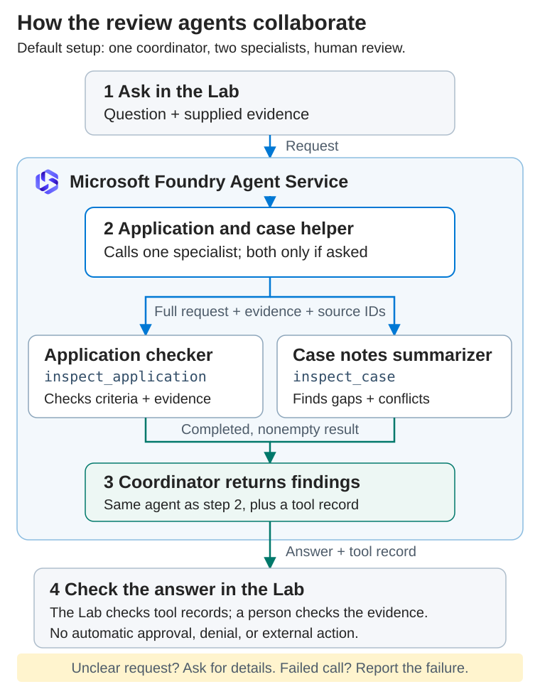
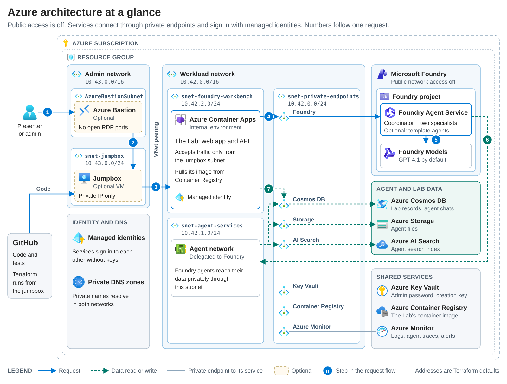

# AI Foundry Lab

**Create, deploy, and try Microsoft Foundry agents from one private web app.**

The Lab shows what agents in **Microsoft Foundry** (formerly Azure AI Foundry)
can do. Publish a new hosted agent from a reviewed template, chat with it, and
compare it with prebuilt agents that work as a team. Everything runs privately
in your Azure subscription with fictional data.

<picture>
  <source media="(prefers-color-scheme: dark)" srcset="docs/images/lab-tour-dark.svg">
  
</picture>

*A short tour of the Lab's **Create agent**, **Chat**, and **Document reviews**
pages, shown in light or dark to match your GitHub theme. Illustrative UI test
with mocked APIs; nothing was published, sent, or saved.* ·
[View full size](docs/images/screenshots/lab-create-agent.png) ·
[More screenshots](docs/images/README.md#lab-screenshots)

> [!WARNING]
> **Use fictional data only.** Saved chats, reviews, and agent setups go to a
> shared database, and everyone with access to the Lab can read them.

**Jump to:** [What you can show](#what-you-can-show) ·
[Get started](#get-started) · [How it works](#how-it-works) ·
[Deploy to Azure](#deploy-to-azure) · [Documentation](#documentation)

## What you can show

| Foundry capability | Try it | Learn more |
| --- | --- | --- |
| **Hosted agents** | In **Create agent**, pick a template and publish it as a new agent. | [Agent creation](docs/agent-creation.md) |
| **Model choice** | Each template runs on the model that suits its work: reasoning, fast extraction, or tool calling. | [How the Lab picks a model](docs/agent-creation.md#how-the-lab-picks-a-model) |
| **Agents working together** | In **Chat**, the **Application and case helper** hands each task to a specialist agent. | [Hosted agents](hosted-agents/README.md) |
| **Tool calling** | The **Service request planner** and the healthcare and public-sector templates call simulated, read-only lookup tools. | [Templates](docs/agent-creation.md#what-a-participant-can-do) |
| **Grounded answers** | In **Document reviews**, every result quotes your text, and quotes that don't match are rejected. | [Document reviews](docs/review-workflow.md) |
| **Tracing** | **Performance** shows response times. Optional agent traces appear in the Foundry portal. | [Agent monitoring](terraform/monitoring/README.md) |
| **Evaluation** | Test models or prompts against the same cases with optional live Foundry evaluations. | [Evaluations](evaluations/README.md) |
| **Private, keyless deployment** | Deploy with Terraform onto private networks. Services use managed identities, not API keys. | [Infrastructure](terraform/README.md) |

**Create agent** is off until an operator turns it on, because publishing
creates Azure resources that cost money. Until then, the Lab opens on **Chat**.
For all seven pages in the Lab, see the [Lab guide](workbench/README.md#pages).

## Get started

| I want to | Start here | What I need |
| --- | --- | --- |
| Create and deploy my own agent | [Create and try a baseline agent](docs/agent-creation.md) | An operator-enabled Lab, one or more model deployments, and cost approval |
| Demo the prebuilt agents | [Demo guide](docs/demos.md) | A deployed Lab. Reading the walkthroughs and expected findings needs nothing. |
| Check answer quality | [Evaluations](evaluations/README.md) | Nothing for offline checks. Live runs need a test environment and approval. |
| Deploy my own environment | [Deploy to Azure](#deploy-to-azure) | Azure permissions, model quota, private network access, and cost approval |

## How it works

### Agents working together

<picture>
  <source media="(prefers-color-scheme: dark)" srcset="docs/images/agent-collaboration-dark.svg">
  
</picture>

1. **You ask in the Lab.** Its backend calls the coordinator agent in Foundry by
   using a managed identity.
2. **The coordinator picks a specialist** and calls it through a tool.
   Specialists don't message each other.
3. **The coordinator returns the findings**, with a record of which specialist
   answered.
4. **You check the answer** against the source. A completed tool call doesn't
   prove the findings are correct.

### Creating your own agent

When you publish from **Create agent**, the Lab packages its reviewed agent code
with your instructions and uploads it with the Foundry SDK. Foundry Agent
Service builds it and starts a new hosted agent named `lab-demo-...` on the
model that suits the template's work. When Foundry reports the new version
active and its route is confirmed, try the agent in **Chat**.

### What runs in Azure

<picture>
  <source media="(prefers-color-scheme: dark)" srcset="docs/images/azure-architecture-dark.svg">
  
</picture>

*Logical view, not a resource inventory. Optional API Management isn't shown.*
· [View full size](docs/images/azure-architecture.svg) ·
[Edit the SVG template](docs/images/azure-architecture.template.svg)

For components, data flows, and trust boundaries, see the
[architecture guide](docs/architecture.md). For each agent's name in the Lab
and in Foundry, see [agent names](docs/README.md#agent-names).

## What's included

| Folder | What it contains |
| --- | --- |
| [`workbench/`](workbench/) | The Lab: a React front end, a FastAPI backend, browser tests, and its own Terraform |
| [`hosted-agents/`](hosted-agents/) | The prebuilt coordinator and specialist agents, with scripts to publish, test, and roll back versions |
| [`terraform/`](terraform/) | The private Foundry platform, built on Azure Verified Modules (AVM), plus optional Bastion and monitoring roots |
| [`evaluations/`](evaluations/) | Test cases, offline checks, and optional live Foundry evaluations |
| [`docs/`](docs/) | Demo walkthroughs, fictional inputs, and architecture and operations guides |
| [`cost-comparison/`](cost-comparison/) | A calculator that compares Azure GPU VM and Foundry hosted-agent costs |

## Deploy to Azure

> [!IMPORTANT]
> **This isn't a low-cost starter.** Azure resources, model calls, and running
> agents cost money. Get approval, and review every Terraform plan before you
> apply it.

You need Terraform 1.16.1, the Azure CLI, permission to deploy resources and
assign roles, model quota, approved private network access, and an existing
Azure Storage container for Terraform state.

1. **Platform:** deploy [`terraform/`](terraform/README.md#deploy).
2. **Prebuilt agents:** publish and test them from
   [`hosted-agents/`](hosted-agents/README.md).
3. **The Lab:** deploy [`workbench/`](workbench/README.md#deployment), which has
   its own Terraform state.
4. **Optional:** add [Bastion](terraform/bastion/README.md),
   [agent monitoring](terraform/monitoring/README.md), or
   [agent creation](docs/agent-creation.md#enable-publication).
5. **Verify:** run one scenario from the [demo guide](docs/demos.md) before you
   present it.

To deploy from a separate private machine, use the
[private deployment runbook](docs/private-deployment.md).

## Scope and limitations

- **For demonstrations and technical testing.** This isn't a production
  application or an officially supported Microsoft offering.
- **No business systems.** Agents work only with the text you supply. They don't
  connect to customer systems or Microsoft 365, and every template lookup tool
  uses made-up, read-only data.
- **People decide.** A matching quote shows where text came from, not that it's
  true. Missing evidence is a request for more information, not a rejection.
- **Access is by network, not by user.** The Lab has no sign-in. It accepts
  traffic only from the private admin network, such as the jumpbox reached
  through Azure Bastion, and everyone with that access shares the same saved
  records. Before you go further, see the
  [production checklist](terraform/README.md#separately-scoped-production-considerations).

## Documentation

| Topic | Guides |
| --- | --- |
| Try the samples | [Demo guide](docs/demos.md), [agent creation](docs/agent-creation.md), [document reviews](docs/review-workflow.md), [demo handoff](docs/demo-handoff.md) |
| Deploy and operate | [Infrastructure](terraform/README.md), [the Lab](workbench/README.md), [hosted agents](hosted-agents/README.md), [private deployment runbook](docs/private-deployment.md), [credentials](docs/credentials.md) |
| Architecture and security | [Architecture](docs/architecture.md), [Azure architecture diagram](docs/images/azure-architecture.svg), [trust boundaries](docs/architecture.md#trust-boundaries), [diagrams](docs/images/README.md) |
| Customize and extend | [Extension guide](docs/architecture-assessment.md), [coordinator profiles](docs/agent-profiles.md), [evaluations](evaluations/README.md), [cost comparison](cost-comparison/README.md) |
| Optional integrations | [Governed review API (APIM)](docs/apim-review-api.md), [Application Gateway and Front Door](docs/ingress-access.md), [other integration options](docs/optional-integrations.md) |

For every guide and a glossary of terms, see the
[documentation index](docs/README.md).

## Automated checks

On every pull request and push to `main`, GitHub Actions tests the Python,
TypeScript, and Terraform code, including browser tests at desktop and mobile
sizes. The checks use simulated service responses. They don't call live agents
or create Azure resources.

Dependabot alerts flag known vulnerabilities in pinned packages. Each month,
[Dependabot](.github/dependabot.yml) also opens one grouped update pull request
per ecosystem for GitHub Actions, Python, frontend, Docker, and Terraform
dependencies. Major versions and the preview agent hosting package are
upgraded by hand. Merge an update only after its checks pass. For Docker and
Terraform changes, also verify a deployment, because the checks don't build
the image or plan against live resources.

## Related content

- [Foundry hosted agents](https://learn.microsoft.com/azure/foundry/agents/concepts/hosted-agents)
- [Create Microsoft Foundry with Terraform](https://learn.microsoft.com/azure/foundry/how-to/create-resource-terraform)
- [AVM pattern module for Foundry (Terraform Registry)](https://registry.terraform.io/modules/Azure/avm-ptn-aiml-ai-foundry/azurerm/latest)
- [Foundry Agent Service pricing](https://azure.microsoft.com/pricing/details/foundry-agent-service/)
