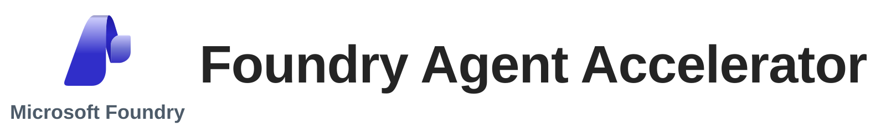
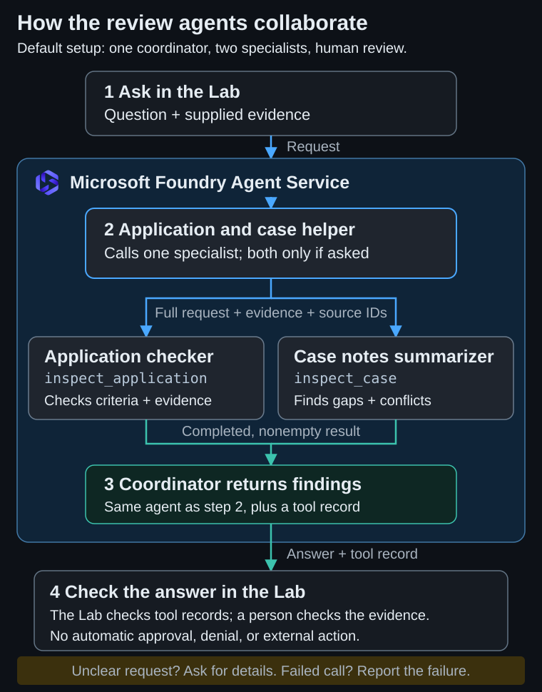

<h1>
  <picture>
    <source media="(prefers-color-scheme: dark)" srcset="docs/images/readme-header-dark.svg">
    
  </picture>
</h1>

[Validation](https://github.com/michael-rechani/foundry-agent-accelerator/actions/workflows/validate.yml) ·
[Latest release](https://github.com/michael-rechani/foundry-agent-accelerator/releases) ·
[MIT license](LICENSE)

Build, deploy, and explore agents on **Microsoft Foundry**. The Lab is a demo
and workshop app backed by reusable code. In it you can:

- browse a library of sample agents and read how each did on its test cases,
- try a ready agent with sample data and compare its answer with the source,
- talk through an agent idea in a plain chat,
  [test the draft on sample cases](docs/agent-creation.md#test-a-draft-before-you-create-it),
  and publish it from a template,
- take an agent to your own Foundry,
- watch prebuilt agents work as a team.

The Azure deployment runs privately in your subscription. Local preview makes
no model calls. This is a sample, not an official Microsoft product.

<strong>What each step of the tour shows</strong>

1. **Find an agent.** Open **All agents** and describe the job in plain words,
   such as "check a document against a checklist". You get matching ready
   agents and templates. It's plain word matching, not an AI model, and nothing
   is sent or saved.
2. **Browse agents.** The library lists the featured sample agents: the ones
   built out in depth, plus any a person has signed off. An operator can turn
   on the rest. **Start here** offers three ready-made examples.
3. **Test results.** See how many answers passed, how long they took, what they
   cost, and whether a person has signed the agent off.
4. **Chat.** Talk through an agent idea with the **Agent designer**. When the
   idea is clear, it ends with a draft spec card to download. Tools and
   document sources still need to be configured and tested in Foundry. For a
   built-in template, **Test this draft first** tries it on sample cases and
   publishes nothing. To publish from the card, you also need the operator key
   (or [presenter mode](docs/agent-creation.md#private-presenter-mode-no-operator-key))
   and a cost confirmation. **Try a pre-built agent** chats with a ready agent
   or a library preview instead.
5. **Take it to Foundry.** Download the agent definition and test requests, then
   follow the steps to create it in your own Foundry. There's no one-click move.
6. **Create agent.** Prepare an agent from a library template. It stays off
   until an operator turns it on, because publishing creates Azure resources
   that cost money.
7. **Test a draft.** In **Chat**, **Test this draft first** runs a draft built
   from a template against sample cases and shows which answers passed. The Lab
   only proposes a revision of the task instructions. A person reads it and
   chooses **Accept revision** or **Discard**. Nothing is published while you
   test, though each test and revision call uses the shared model and may cost
   money. **Start from** then opens the Create agent review step, which says the
   text is the one you accepted and lets you switch back to the template's own
   text. See [Agent creation](docs/agent-creation.md#test-a-draft-before-you-create-it).

[Open the full tour](docs/images/lab-tour-dark.svg) ·
[Create agent screenshot](docs/images/screenshots/lab-create-agent-dark.png) ·
[All screenshots](docs/images/README.md#lab-screenshots)

The sidebar has three groups: **Start here**, **Agent library**, and
**Operations** (shown when you turn on **Under the hood**). **Document reviews**
has no sidebar link, so open `/#reviews` or a saved-review link. See the
[Lab guide](docs/lab-pages-and-access.md#pages) for every page.

**On this page:**
[Get started](#get-started) · [Three stories](#explore-three-stories) ·
[How it works](#how-it-works) · [Deploy to Azure](#deploy-to-azure) ·
[Scope and limitations](#scope-and-limitations) ·
[What's included](#whats-included) · [Documentation](#documentation) ·
[Automated checks](#automated-checks)

---

## Get started

Pick what you want to do.

| I want to... | Go to | You need |
| --- | --- | --- |
| Read the demos | [Showcase and presenter guide](docs/showcase.md) | Nothing. No Azure environment. |
| Preview the Lab without installing anything | [Open in GitHub Codespaces](workbench/README.md#github-codespaces) | A GitHub account. Local preview makes no model calls and needs no Azure. |
| Browse agents and test results | [Lab guide](docs/lab-pages-and-access.md#pages) | A deployed Lab. Browsing makes no model calls. Trying an agent does. |
| Demo the prebuilt agents | [Demo guide](docs/demos.md) | A deployed Lab. Reading the walkthroughs needs nothing. |
| Create my own agent | [Create and try a baseline agent](docs/agent-creation.md) | An operator-enabled Lab, model deployments, and cost approval. |
| Check answer quality | [Evaluations](evaluations/README.md) | Offline checks: nothing. Live runs: a test environment and approval. |
| Deploy Foundry and the Lab | [Deploy to Azure](#deploy-to-azure) and the [Terraform guide](terraform/README.md#at-a-glance) | Azure permissions, model quota, private network access, and cost approval. |

Looking for early public-sector and healthcare ideas? See the
[agent drafts](docs/agent-drafts/README.md). They're documentation only, not
implemented or deployed.

---

## Explore three stories

Choose a story in **Guided demos**. Each pairs sample evidence with findings to
look for and a decision that stays with a person.

| Story | What to spot | People decide |
| --- | --- | --- |
| [Find what's missing](docs/showcase.md#find-whats-missing) | A missing budget, a named owner, and conflicting schedules. | Verify the documents and determine the application outcome. |
| [Catch what does not add up](docs/showcase.md#catch-what-does-not-add-up) | Billed quantities and prices that differ from the purchase order. | Resolve damaged items and determine what to pay. |
| [Turn scattered notes into a brief](docs/showcase.md#turn-scattered-notes-into-a-brief) | Supported facts, conflicting dates, and missing evidence. | Verify the authoritative record and determine the next steps. |

The invoice story runs on a **Supplier invoice reviewer** created from its
template, or on that template's library preview. Either way it uses built-in
lookups on sample data, with no finance integration.

[Watch all three stories](docs/images/scenario-tour-dark.svg)

---

## How it works

### What runs in Azure

The core platform runs in one subscription on private networks. Services sign
in with managed identities, not API keys.

Four optional pieces add something public: the Bastion host's static public
IP, the jump box's outbound IP, the Azure API Management gateway, and the
Azure Front Door endpoint. Each is off by default and needs its own `approve_*`
Terraform input. Read the
[Terraform guide](terraform/README.md) before you turn one on.

1. If enabled, a presenter opens Azure Bastion from the Azure portal.
2. Bastion opens a remote desktop session to the optional private jumpbox.
3. The jumpbox browser opens the Lab across the network peering. By default,
   only the management subnet, where the optional jumpbox would sit, can reach
   it. The optional Front Door route at the top of the diagram reaches the Lab
   through Private Link. [Setup](docs/ingress-access.md#draft-front-door-limited-to-your-own-ip)
4. The Lab calls Foundry Agent Service over HTTPS using the Responses API
   through the Foundry private endpoint, signing in with its managed identity.
5. Foundry hosts the agents in managed, VM-isolated session sandboxes. They call
   a Foundry Models deployment for inference, GPT-4.1 by default.
6. Foundry Agent Service connects the agents to the delegated agent network.
   From there they keep conversations, files, and search data in Cosmos DB,
   Storage, and AI Search through private endpoints.
7. The Lab saves its records in Cosmos DB through the same private endpoint.

*A logical view, not a resource inventory. Bastion, the jumpbox, and Front Door
are optional and off by default. The default ingress allow rule does not create
an access machine. API Management isn't shown.*

Wondering how customers or colleagues could reach the Lab? See
[How people reach the Lab](docs/ingress-access.md).

[Full size](docs/images/azure-architecture-dark.svg) ·
[SVG template](docs/images/azure-architecture.template.svg) ·
[Architecture guide](docs/architecture.md) ·
[Agent names](docs/README.md#agent-names)

### Agents working together

The default **Checklist and case helper** coordinates the prebuilt specialists.
You ask in the Lab, and the coordinator calls one specialist as a tool.
Specialists don't message each other. The coordinator returns the findings with
a record of which specialist answered. You still check them against the source,
because a completed tool call doesn't prove they're correct.

*It calls one specialist by default, or both only if you ask. Nothing is
approved, denied, or sent externally automatically.*

[Full size](docs/images/agent-collaboration-dark.svg) ·
[SVG template](docs/images/agent-collaboration.template.svg) ·
[Hosted agents](hosted-agents/README.md) ·
[Orchestration pattern](docs/architecture.md#orchestration-pattern)

### Creating your own agent

**Create agent** packages the Lab's reviewed agent code with your instructions
and uploads it with the Foundry SDK. Foundry Agent Service builds it and starts
a hosted agent named `lab-demo-...` on the model that suits the template. When
Foundry reports the version active and its route is confirmed, try it in
**Chat**. See [agent creation](docs/agent-creation.md).

More diagrams are in the [architecture guide](docs/architecture.md).

---

## Deploy to Azure

> [!IMPORTANT]
> **This isn't a low-cost starter.** Azure resources, model calls, and running
> agents cost money. Get approval, and review every Terraform plan before you
> apply it.

**Before you begin, you need:**

- Terraform 1.16.4 and the Azure CLI. See [tool versions](docs/tool-versions.md).
- Permission to deploy resources and assign roles.
- Model quota and approved private network access.

**One command:** [`./deploy.ps1`](deploy.ps1) runs preflight, state backend,
platform, Lab, and verify in order. It shows each Terraform plan and applies
only after you type `apply`. Start with `-Stage preflight` or `-PlanOnly`.

Terraform and [Azure Verified Modules](terraform/README.md) deploy Foundry, with
its project, model deployment, and Agent Service setup. The
[infrastructure guide](terraform/README.md#at-a-glance) lists every Terraform
root and its state. The repo uses Terraform rather than Bicep. See
[why](docs/architecture-assessment.md#terraform-first-deployment).

<strong>Or deploy stage by stage</strong>, in this order

1. **State backend:** [`terraform/bootstrap/`](terraform/bootstrap/README.md)
   creates the private state storage account. Run it once, first.
2. **Platform (Foundry):** [`terraform/`](terraform/README.md#deploy).
3. **Prebuilt agents:** publish and test them from
   [`hosted-agents/`](hosted-agents/README.md).
4. **The Lab:** [`workbench/`](docs/lab-deployment.md#deployment), which has
   its own Terraform state. After the first deploy, a Lab change merged to
   `main` can roll out the new image automatically through the
   [deploy workflow](docs/lab-deployment.md#deploy-a-new-image-from-github-actions).
5. **Optional:** [Bastion](terraform/bastion/README.md),
   [agent monitoring](terraform/monitoring/README.md),
   a [CI runner](terraform/runner/README.md),
   the [deploy identity](terraform/identity/README.md), or
   [agent creation](docs/agent-creation.md#enable-publication).
6. **Verify:** run one scenario from the [demo guide](docs/demos.md) before you
   present it.

To deploy from a separate private machine, use the
[private deployment runbook](docs/private-deployment.md).

## Scope and limitations

- **For demonstrations and technical testing.** This isn't a production
  application or an officially supported Microsoft offering.
- **No business systems.** Agents work only with the text you supply. They
  don't connect to customer systems or Microsoft 365, and every template lookup
  uses sample, read-only data.
- **People decide.** A matching quote shows where text came from, not that it's
  true. Missing evidence is a request for more information, not a rejection.
- **Test results are evidence, not a guarantee.** Each library agent was asked
  five test cases, five times each, with sample data. A case passes only if
  every answer passes. An agent shows **Waiting for a person** until someone
  reads the recorded answers and signs off; the test runner never records one.
  See [agent library scorecards](docs/library-scorecards.md).
- **Access is by network, not by user.** The Lab has no sign-in. Only the
  private admin network (such as the jumpbox reached through Azure Bastion) or
  the optional IP-limited Front Door can reach it, and everyone with that access
  shares the same saved records. Letting employees or customers in needs
  end-user sign-in first. See [How people reach the Lab](docs/ingress-access.md)
  and the
  [production checklist](terraform/README.md#separately-scoped-production-considerations).
- **Controls and gaps are mapped.** The
  [agent governance and risk map](docs/governance.md) lines up the sample's
  controls against the OWASP Top 10 for Agentic Applications and names what's
  missing.

---

## What's included

| Folder | What it contains |
| --- | --- |
| [`workbench/`](workbench/) | The Lab: React front end, FastAPI backend, browser tests, and its own Terraform |
| [`hosted-agents/`](hosted-agents/) | Coordinator and specialist agents, plus scripts to publish, test, and roll back versions |
| [`terraform/`](terraform/) | Private Foundry platform using Azure Verified Modules, with optional Bastion and monitoring roots |
| [`evaluations/`](evaluations/) | Test cases, offline checks, and optional live Foundry evaluations |
| [`addons/`](addons/) | Optional add-on manifests, their checks, and the data behind the Lab's **Add-ons** tab |
| [`docs/`](docs/) | Demo walkthroughs, sample inputs, architecture, and operations guides |
| [`cost-comparison/`](cost-comparison/) | Azure GPU VM versus Foundry hosted-agent cost calculator |

## Documentation

The [documentation index](docs/README.md) lists every guide, with a glossary.
Good places to start:

- **Present:** the [showcase](docs/showcase.md) and the [demos](docs/demos.md).
- **Deploy and operate:** [infrastructure](terraform/README.md),
  [the Lab](workbench/README.md), and [troubleshooting](docs/troubleshooting.md).
- **Build and extend:** [architecture](docs/architecture.md), the
  [extension guide](docs/architecture-assessment.md), and
  [portable agent bundles](hosted-agents/README.md#portable-agent-bundles).

## Automated checks

On every pull request and push to `main`, GitHub Actions tests the Python,
TypeScript, and Terraform code, including desktop browser tests. A docs check
rebuilds every diagram from its template, fails if the committed SVGs differ,
and checks that every relative link, image, and heading anchor in the Markdown
resolves. CodeQL and a weekly [Scorecard](.github/workflows/scorecard.yml) run
cover supply-chain practices. See
[supply-chain checks](docs/governance.md#supply-chain-checks).

The checks use mocked service responses. They don't call live agents, create
Azure resources, build the image, or plan against live resources, so verify a
deployment too for Docker and Terraform changes.

Dependency updates

Gitleaks scans every commit (see [`.gitleaks.toml`](.gitleaks.toml)).
[Dependabot](.github/dependabot.yml) opens one grouped update pull request per
ecosystem each month. Merge an update only after its checks pass. Major versions
and the preview agent hosting package are upgraded by hand. See
[tool versions and upgrades](docs/tool-versions.md#upgrade).

## License and sharing

This repository is public and released under the [MIT License](LICENSE). To
suggest a change, see [Contributing](CONTRIBUTING.md). To report a
vulnerability, see the [security policy](SECURITY.md).

- **What changed:** the [changelog](CHANGELOG.md) and
  [releases](https://github.com/michael-rechani/foundry-agent-accelerator/releases).
- **What's next:** the
  [Foundry Agent Lab roadmap](https://github.com/users/michael-rechani/projects/2)
  and [open issues](https://github.com/michael-rechani/foundry-agent-accelerator/issues).
  Look for [good first issues](https://github.com/michael-rechani/foundry-agent-accelerator/labels/good%20first%20issue).
- **Questions and ideas:** [Discussions](https://github.com/michael-rechani/foundry-agent-accelerator/discussions).
- **Citing this sample:** see [`CITATION.cff`](CITATION.cff).

## Related content

- [Foundry hosted agents](https://learn.microsoft.com/azure/foundry/agents/concepts/hosted-agents)
- [Create Microsoft Foundry with Terraform](https://learn.microsoft.com/azure/foundry/how-to/create-resource-terraform)
- [AVM pattern module for Foundry (Terraform Registry)](https://registry.terraform.io/modules/Azure/avm-ptn-aiml-ai-foundry/azurerm/latest)
- [Foundry Agent Service pricing](https://azure.microsoft.com/pricing/details/foundry-agent-service/)
