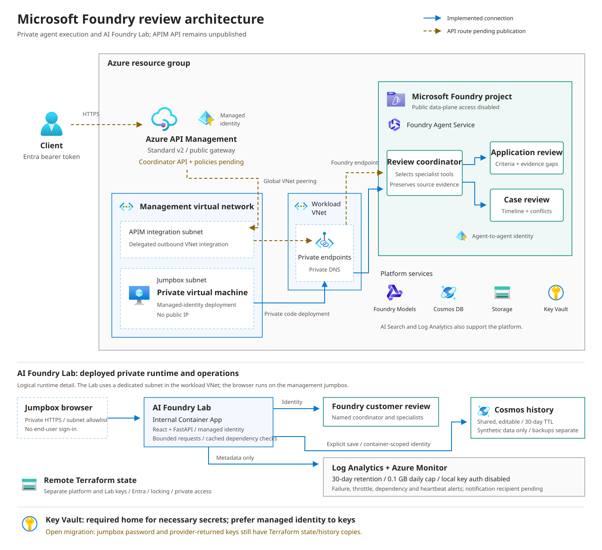

# Microsoft Foundry hosted-agent samples

[](https://github.com/michael-rechani/ai-foundry-samples/actions/workflows/validate.yml)
[](terraform/README.md)
[](hosted-agents/README.md)
[](https://learn.microsoft.com/azure/foundry/agents/concepts/hosted-agents)

Deploy a practical Microsoft Foundry baseline, publish a Responses-protocol
review coordinator and specialist agents, and compare hosted-runtime costs
with self-managed agents on Azure virtual machines. Private networking and
managed identities form the baseline; an optional APIM gateway provides the
infrastructure for a governed client entry point.

[Architecture](#architecture) · [Status](docs/status.md) · [Deploy](#quick-start) · [Review walkthrough](hosted-agents/review-coordinator-agent/README.md) · [Cost model](cost-comparison/README.md)

| Build | Ship | Measure |
| --- | --- | --- |
| Private Foundry, management network, and optional APIM through Terraform and AVM | Immutable agent versions with delegation checks and conservative rollback cleanup | Hosted sandbox break-even against self-managed Azure VMs |

## Architecture



Solid arrows show the implemented direct-agent and private deployment paths.
Dashed amber arrows show the proposed client API: APIM infrastructure exists,
but the coordinator API and policies are not yet published. The hardened
coordinator code is locally tested and awaits deployment.

See [request flow and trust boundaries](docs/architecture.md) for the target
authentication and failure paths, and the dated [delivery status](docs/status.md)
for verified results and remaining gates. This README is not a live health check.

> [!IMPORTANT]
> This sample creates billable Azure resources. Review the saved Terraform
> plan, regional model pricing, and quota before applying it.

## What you get

- **Repeatable infrastructure:** an Azure Verified Module (AVM) deployment of
  a Foundry account, project, model, Agent Service dependencies, and
  diagnostics.
- **Safer agent delivery:** a Python deployer that packages an immutable
  version, waits for activation, routes the candidate, and runs smoke tests.
  On failure it attempts route restoration and retains candidates when safe
  deletion cannot be confirmed. Promotion is not a zero-exposure canary.
- **Business workflow samples:** deployable case-review and application-review
  agents, plus a coordinator that delegates to them, with synthetic requests
  and explicit human decision boundaries.
- **Explicit cost assumptions:** a calculator that keeps region-specific rates
  outside the code, ranks Azure GPU VM scenarios, and reports each
  hosted-runtime break-even point.
- **Automated validation:** GitHub Actions checks Python sources, dependencies,
  calculator behavior, Terraform formatting, and Terraform configuration.

## Repository layout

| Path | Purpose |
| --- | --- |
| [`terraform/`](terraform/) | Deploy a Foundry project, model, Agent Service dependencies, and observability with the official AVM pattern. |
| [`hosted-agents/`](hosted-agents/) | Deploy the basic Responses agent plus case-review and application-review business samples. |
| [`hosted-agents/review-coordinator-agent/`](hosted-agents/review-coordinator-agent/) | Route reviews to specialists; test cancellation, concurrency, and delegation. |
| [`docs/`](docs/) | Architecture, delivery status, and the private deployment runbook. |
| [`cost-comparison/`](cost-comparison/) | Compare self-hosted models on Azure GPU VMs with Foundry hosted-agent costs using replaceable rates. |

## Quick start

### 1. Deploy the baseline

Use Terraform 1.16.1, Azure CLI, and a reviewed state backend. Credentials are
present in Terraform state and saved plans; follow the
[state and credential guidance](terraform/README.md) before applying.
The commands below do not overwrite an existing variables file.

```powershell
az login
$env:TF_VAR_subscription_id = "<subscription-id>"
az account set --subscription $env:TF_VAR_subscription_id
# Review the defaults in terraform/variables.tf, including region, model, quota, and pricing.
terraform -chdir=terraform init
terraform -chdir=terraform plan -var="subscription_id=$env:TF_VAR_subscription_id" -out main.tfplan
terraform -chdir=terraform apply main.tfplan
```

Review existing variable files before planning; the explicit subscription
argument takes precedence over an old subscription value in those files.
Review the saved plan before applying. Do not share it as a build artifact.

### 2. Publish a sample agent

Foundry data-plane endpoints are private. Run deployment from the jumpbox or
another machine with private DNS and network access, not an unconnected local
shell. Use the [private deployment runbook](docs/private-deployment.md) and
[hosted-agent guide](hosted-agents/README.md).

For the coordinated review scenario, inventory existing versions first, deploy
missing specialists, then deploy the coordinator. Start with the
[synthetic review walkthrough](hosted-agents/review-coordinator-agent/README.md).
There is no published APIM review URL yet.

### 3. Compare hosting costs

Update the illustrative rates in `cost-comparison/scenario.example.json`, then
run:

```powershell
python cost-comparison/calculator.py cost-comparison/scenario.example.json
```

## Production considerations

The included infrastructure disables public data-plane access and deploys
private endpoints, private DNS, and a delegated hosted-agent subnet. Before
production use:

- Use the AVM pattern's BYOR path so platform-owned Key Vault, Storage,
  Cosmos DB, and AI Search resources have independent lifecycles.
- Integrate the workload VNet and private DNS zones with the landing-zone hub,
  firewall, DNS resolver, and on-premises routing design.
- Send diagnostics to a centrally managed Log Analytics workspace.
- Assign least-privilege data-plane roles to each hosted agent's dedicated
  Microsoft Entra identity.
- Pin model versions and test Responsible AI policies before promotion.
- Store Terraform state in an Azure Storage backend with Entra ID
  authentication, locking, versioning, and restricted network access.

## Validation

Pull requests and pushes to `main` run Python compilation and tests, validate
all four deployment CLIs, exercise coordinator real-SDK contracts using an
offline HTTP transport, check publisher-variable cases, check Terraform
formatting, and run `terraform validate`.
These checks do not create Azure resources. A real plan and hosted-agent smoke
test still require an authenticated Azure subscription, regional model quota,
and the documented RBAC roles.

## References

- [Azure AI Foundry AVM pattern](https://registry.terraform.io/modules/Azure/avm-ptn-aiml-ai-foundry/azurerm/latest)
- [Create Microsoft Foundry with Terraform](https://learn.microsoft.com/azure/foundry/how-to/create-resource-terraform)
- [Foundry hosted agents](https://learn.microsoft.com/azure/foundry/agents/concepts/hosted-agents)
- [Foundry Agent Service pricing](https://azure.microsoft.com/pricing/details/foundry-agent-service/)
