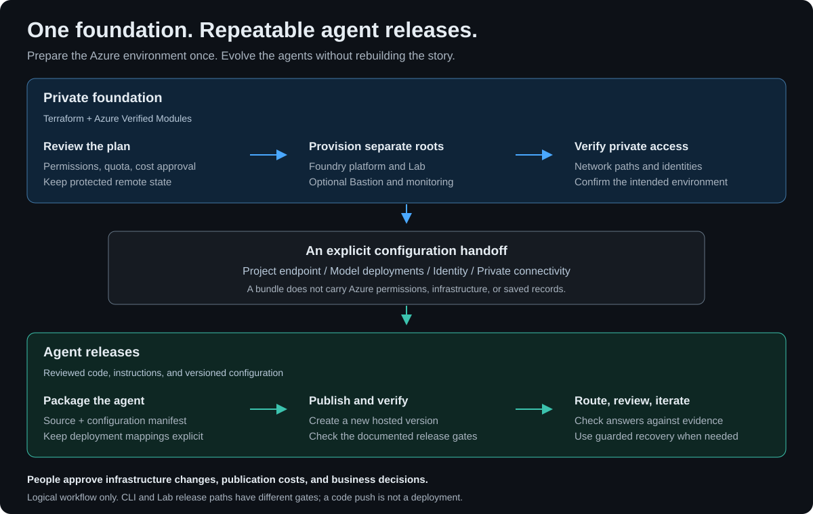
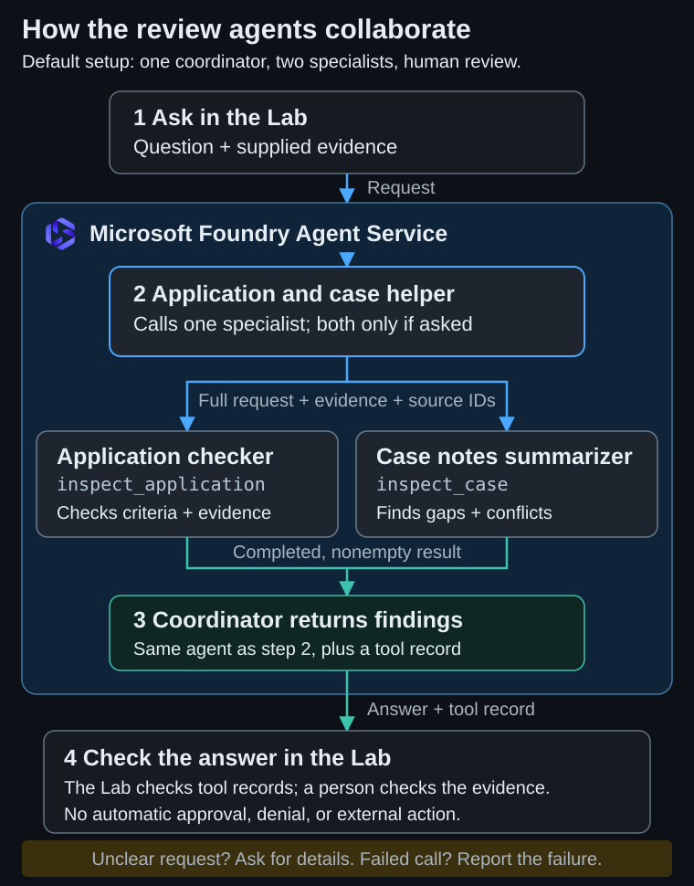

# Foundry Agent Accelerator

Build, deploy, and explore agents on **Microsoft Foundry**. The Lab is a demo
and workshop app backed by reusable code. In it you can:

- browse a library of sample agents and read how each did on its test cases,
- try an agent with sample data and compare its answer with the source,
- take an agent to your own Foundry, or publish a new one from a template,
- watch prebuilt agents work as a team.

The Azure deployment runs privately in your subscription. Local preview makes
no model calls. This is a sample, not an official Microsoft product.

**On this page:**
[Get started](#get-started) · [Take a tour](#take-a-tour) ·
[Three stories](#explore-three-stories) · [How it works](#how-it-works) ·
[Deploy to Azure](#deploy-to-azure) ·
[Scope and limitations](#scope-and-limitations) ·
[What's included](#whats-included) · [Documentation](#documentation) ·
[Automated checks](#automated-checks)

---

## Get started

Pick what you want to do.

| I want to... | Go to | You need |
| --- | --- | --- |
| Read the demos | [Showcase and presenter guide](docs/showcase.md) | Nothing. No Azure environment. |
| Browse agents and test results | [Lab guide](docs/lab-pages-and-access.md#pages) | A deployed Lab. Browsing makes no model calls. Trying an agent does. |
| Demo the prebuilt agents | [Demo guide](docs/demos.md) | A deployed Lab. Reading the walkthroughs needs nothing. |
| Create my own agent | [Create and try a baseline agent](docs/agent-creation.md) | An operator-enabled Lab, model deployments, and cost approval. |
| Check answer quality | [Evaluations](evaluations/README.md) | Offline checks: nothing. Live runs: a test environment and approval. |
| Deploy the environment | [Deploy to Azure](#deploy-to-azure) | Azure permissions, model quota, private network access, and cost approval. |

Looking for early public-sector and healthcare ideas? See the
[agent drafts](docs/agent-drafts/README.md). They're documentation only, not
implemented or deployed.

---

## Take a tour

1. **Ask the Lab.** The Lab opens here. Pick a guide question, such as which
   agent to use or build, and get an answer from the Lab's own lists. Nothing
   is sent or saved.
2. **Browse agents.** The library lists every sample agent. **Start here**
   offers three ready-made examples.
3. **Test results.** See how many answers passed, how long they took, what they
   cost, and whether a person has signed the agent off.
4. **Chat.** Talk with an agent. An example only fills the message box. You
   choose when to send it.
5. **Take it to Foundry.** Download the agent definition and test requests, then
   follow the steps to create it in your own Foundry. There's no one-click move.
6. **Create agent.** Prepare an agent from a library template. It stays off
   until an operator turns it on, because publishing creates Azure resources
   that cost money.

[Open the full tour](docs/images/lab-tour-dark.svg) ·
[Create agent screenshot](docs/images/screenshots/lab-create-agent-dark.png) ·
[All screenshots](docs/images/README.md#lab-screenshots)

The sidebar groups the pages. **Start here** has **Ask the Lab**. **Agent
library** has **All agents**, plus **Create agent** when creation is on. **Try
it** has Chat and Shared history. **Operations** (health, response times,
tokens, cost, and the request log) appears when you turn on **Under the hood**.
**Document reviews** has no sidebar link, so open `/#reviews` or a saved-review
link. See the [Lab guide](docs/lab-pages-and-access.md#pages).

---

## Explore three stories

Choose a story in **Guided demos**. Each pairs sample evidence with findings to
look for and a decision that stays with a person.

| Story | What to spot | People decide |
| --- | --- | --- |
| [Find what’s missing](docs/showcase.md#find-whats-missing) | A missing budget, a named owner, and conflicting schedules. | Verify the documents and determine the application outcome. |
| [Catch what does not add up](docs/showcase.md#catch-what-does-not-add-up) | Billed quantities and prices that differ from the purchase order. | Resolve damaged items and determine what to pay. |
| [Turn scattered notes into a brief](docs/showcase.md#turn-scattered-notes-into-a-brief) | Supported facts, conflicting dates, and missing evidence. | Verify the authoritative record and determine the next steps. |

The invoice story runs on a **Supplier invoice reviewer** created from its
template, or on the library preview of that template when library previews are
on. Either way it uses built-in lookups with sample data and no finance
integration.

[Watch all three stories](docs/images/scenario-tour-dark.svg)

---

## How it works

Terraform sets up a private foundation once. After that, you release, verify,
and revise agents on their own schedule.

### One foundation, two connected workflows

1. **Review the plan.** Confirm permissions, quota, cost approval, and
   protected remote state.
2. **Provision separate roots.** Deploy the Foundry platform and the Lab, with
   optional Bastion and monitoring.
3. **Verify private access.** Check network paths and identities.
4. **Package the agent.** Bundle its source and configuration manifest, with
   named model deployment mappings.
5. **Publish and verify.** Create a new hosted version and check the release
   gates.
6. **Route, review, and iterate.** Check answers against evidence. Use guarded
   recovery if a release misbehaves.

*A code push doesn't deploy either workflow, and a bundle carries
configuration, not Azure permissions.*

[Full size](docs/images/agent-release-journey-dark.svg) ·
[SVG template](docs/images/agent-release-journey.template.svg) ·
[Release journey](docs/showcase.md#one-foundation-repeatable-agent-releases) ·
[Portable bundles](hosted-agents/README.md#portable-agent-bundles)

### What runs in Azure

The core platform runs in one subscription on private networks. Services sign
in with managed identities, not API keys.

Four optional pieces add something public: the Bastion host's static public
IP, the jump box's outbound IP, the Azure API Management gateway, and the
Azure Front Door endpoint. Each is off by default and needs its own `approve_*`
Terraform input. Read the
[Terraform guide](terraform/README.md) before you turn one on.

1. A presenter opens Azure Bastion from the Azure portal.
2. Bastion opens a remote desktop session to the private jumpbox.
3. The jumpbox browser opens the Lab across the network peering. The Lab
   accepts traffic only from the jumpbox subnet, plus Front Door if you turn
   it on. Front Door is the optional top route in the diagram: an allowed
   client reaches its WAF-filtered endpoint, and Private Link carries the
   request to the Lab. [Setup](docs/ingress-access.md#draft-front-door-limited-to-your-own-ip)
4. The Lab calls Foundry Agent Service through the Foundry private endpoint,
   signing in with its managed identity.
5. The agents run on a Foundry Models deployment, GPT-4.1 by default.
6. Foundry Agent Service connects the agents to the delegated agent network.
   From there they keep conversations, files, and search data in Cosmos DB,
   Storage, and AI Search through private endpoints.
7. The Lab saves its records in Cosmos DB through the same private endpoint.

*A logical view with Terraform default addresses, not a resource inventory.
Bastion, the jumpbox, and Front Door are optional, and API Management isn't shown.*

[Full size](docs/images/azure-architecture-dark.svg) ·
[SVG template](docs/images/azure-architecture.template.svg) ·
[Architecture guide](docs/architecture.md) ·
[Agent names](docs/README.md#agent-names)

### Agents working together

The default **Checklist and case helper** coordinates the prebuilt specialists.
You still check the findings against the source.

1. **You ask in the Lab.** Its backend calls the coordinator agent in Foundry
   with a managed identity.
2. **The coordinator picks a specialist** and calls it as a tool. Specialists
   don't message each other.
3. **The coordinator returns the findings**, with a record of which specialist
   answered.
4. **You check the answer** against the source. A completed tool call doesn't
   prove the findings are correct.

*It calls one specialist by default, or both only if you ask. Nothing is
approved, denied, or sent externally automatically.*

[Full size](docs/images/agent-collaboration-dark.svg) ·
[SVG template](docs/images/agent-collaboration.template.svg) ·
[Hosted agents](hosted-agents/README.md) ·
[Orchestration pattern](docs/architecture.md#orchestration-pattern)

### Creating your own agent

**Create agent** packages the Lab's reviewed agent code with your instructions
and uploads it with the Foundry SDK. Foundry Agent Service builds it and starts
a hosted agent named `lab-demo-...` on the model that suits the template. When
Foundry reports the version active and its route is confirmed, try it in
**Chat**. See [agent creation](docs/agent-creation.md).

More diagrams are in the [architecture guide](docs/architecture.md). They all
share one [style guide](docs/images/README.md#diagram-style).

---

## Deploy to Azure

> [!IMPORTANT]
> **This isn't a low-cost starter.** Azure resources, model calls, and running
> agents cost money. Get approval, and review every Terraform plan before you
> apply it.

**Before you begin, you need:**

- Terraform 1.16.4 and the Azure CLI. See [tool versions](docs/tool-versions.md).
- Permission to deploy resources and assign roles.
- Model quota and approved private network access.
- An existing Azure Storage container for Terraform state.

**Deploy in this order:**

1. **Platform:** [`terraform/`](terraform/README.md#deploy).
2. **Prebuilt agents:** publish and test them from
   [`hosted-agents/`](hosted-agents/README.md).
3. **The Lab:** [`workbench/`](docs/lab-deployment.md#deployment), which has
   its own Terraform state.
4. **Optional:** [Bastion](terraform/bastion/README.md),
   [agent monitoring](terraform/monitoring/README.md),
   a [CI runner](terraform/runner/README.md), or
   [agent creation](docs/agent-creation.md#enable-publication).
5. **Verify:** run one scenario from the [demo guide](docs/demos.md) before you
   present it.

To deploy from a separate private machine, use the
[private deployment runbook](docs/private-deployment.md).

## Scope and limitations

- **For demonstrations and technical testing.** This isn't a production
  application or an officially supported Microsoft offering.
- **No business systems.** Agents work only with the text you supply. They
  don't connect to customer systems or Microsoft 365, and every template lookup
  uses sample, read-only data.
- **People decide.** A matching quote shows where text came from, not that it's
  true. Missing evidence is a request for more information, not a rejection.
- **Test results are evidence, not a guarantee.** Each library agent was asked
  five test cases, five times each, with sample data. A case passes only if
  every answer passes. An agent shows **Waiting for a person** until someone
  reads the recorded answers and signs off. The test runner never records a
  sign-off. See [agent library scorecards](docs/library-scorecards.md).
- **Access is by network, not by user.** The Lab has no sign-in. It accepts
  traffic only from the private admin network, such as the jumpbox reached
  through Azure Bastion, or from the optional IP-limited Front Door, and
  everyone with that access shares the same saved
  records. See the
  [production checklist](terraform/README.md#separately-scoped-production-considerations).

---

## What's included

| Folder | What it contains |
| --- | --- |
| [`workbench/`](workbench/) | The Lab: React front end, FastAPI backend, browser tests, and its own Terraform |
| [`hosted-agents/`](hosted-agents/) | Coordinator and specialist agents, plus scripts to publish, test, and roll back versions |
| [`terraform/`](terraform/) | Private Foundry platform using Azure Verified Modules, with optional Bastion and monitoring roots |
| [`evaluations/`](evaluations/) | Test cases, offline checks, and optional live Foundry evaluations |
| [`addons/`](addons/) | Optional add-on manifests, their checks, and the data behind the Lab's **Add-ons** tab |
| [`docs/`](docs/) | Demo walkthroughs, sample inputs, architecture, and operations guides |
| [`cost-comparison/`](cost-comparison/) | Azure GPU VM versus Foundry hosted-agent cost calculator |

## Documentation

The [documentation index](docs/README.md) lists every guide, with a glossary.
The most used:

- **Try and present:** [showcase](docs/showcase.md),
  [demos](docs/demos.md), [agent creation](docs/agent-creation.md),
  [document reviews](docs/review-workflow.md),
  [demo handoff](docs/demo-handoff.md)
- **Deploy and operate:** [infrastructure](terraform/README.md),
  [the Lab](workbench/README.md), [hosted agents](hosted-agents/README.md),
  [private deployment](docs/private-deployment.md),
  [credentials](docs/credentials.md), [permissions](docs/permissions.md),
  [troubleshooting](docs/troubleshooting.md), [security policy](SECURITY.md)
- **Build and extend:** [architecture](docs/architecture.md),
  [extension guide](docs/architecture-assessment.md),
  [coordinator profiles](docs/agent-profiles.md),
  [evaluations](evaluations/README.md),
  [cost comparison](cost-comparison/README.md),
  [optional integrations](docs/optional-integrations.md)

## Automated checks

On every pull request and push to `main`, GitHub Actions tests the Python,
TypeScript, and Terraform code, including browser tests at desktop and mobile
sizes. A docs check rebuilds every diagram from its template, fails if the
committed SVGs differ, and checks that every relative link, image, and heading
anchor in the Markdown resolves.

The checks use mocked service responses. They don't call live agents or create
Azure resources, and they don't build the image or plan against live
resources. For Docker and Terraform changes, verify a deployment too.

Dependency updates

Dependabot alerts flag known vulnerabilities in pinned packages. Each month,
[Dependabot](.github/dependabot.yml) also opens one grouped update pull request
per ecosystem: GitHub Actions, Python, frontend, Docker, and Terraform. Merge an
update only after its checks pass. Major versions and the preview agent hosting
package are upgraded by hand. See
[tool versions and upgrades](docs/tool-versions.md#upgrade).

To move agent code and configuration without copying infrastructure or saved
conversations, use the
[portable agent bundle CLI](hosted-agents/README.md#portable-agent-bundles).

## License and sharing

This repository is public and released under the [MIT License](LICENSE). To
suggest a change, see [Contributing](CONTRIBUTING.md). To report a
vulnerability, see the [security policy](SECURITY.md).

## Related content

- [Foundry hosted agents](https://learn.microsoft.com/azure/foundry/agents/concepts/hosted-agents)
- [Create Microsoft Foundry with Terraform](https://learn.microsoft.com/azure/foundry/how-to/create-resource-terraform)
- [AVM pattern module for Foundry (Terraform Registry)](https://registry.terraform.io/modules/Azure/avm-ptn-aiml-ai-foundry/azurerm/latest)
- [Foundry Agent Service pricing](https://azure.microsoft.com/pricing/details/foundry-agent-service/)
