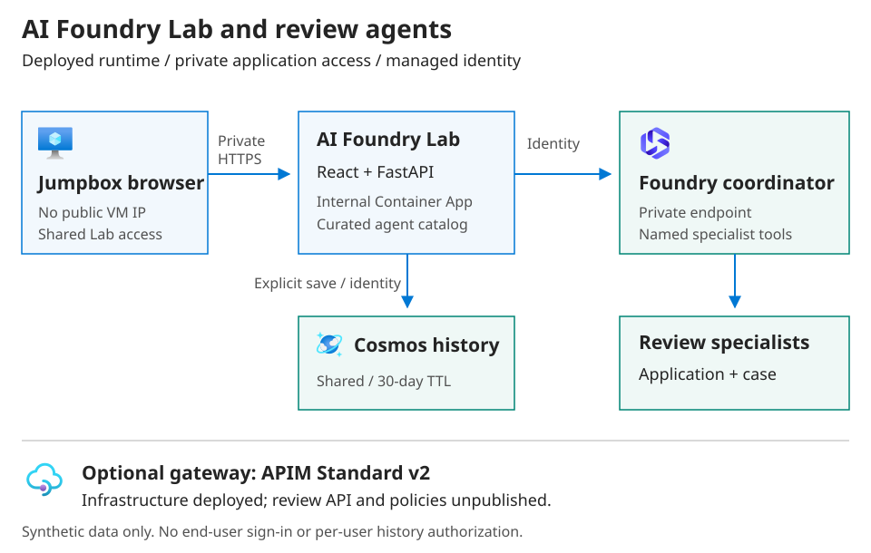

# Validate your AI use case in Foundry

**Build confidence before committing to production.**

This repository provides sample AI agents, a chat interface, and deployment
guidance for **Microsoft Foundry on Azure (formerly Azure AI Foundry)**. Use the
included fictional case notes and application materials to try document-review
tasks: summarize information, identify missing details, and flag conflicting
evidence.

Choose a scenario below, run its sample prompt, and compare the agent's response
with the expected findings in the [demo guide](docs/demos.md). These samples are
for demonstrations and technical testing, not finished customer solutions.
People must verify the findings and make any approval or denial decisions.

## Scenarios and status

Select **one scenario per engagement**, not a promise to deliver every scenario.
Status describes source implementation, not a deployed environment or a passed
live Foundry evaluation.

| Scenario | Status | Demonstration | Reused implementation |
| --- | --- | --- | --- |
| [Casework assistance](docs/demos.md#casework-assistance) | **Available** | Summarize synthetic case notes, expose gaps/conflicts, and draft follow-up questions. | Existing case-review agent |
| [Application completeness](docs/demos.md#application-completeness) | **Available** | Compare a sample grant or permit application with supplied criteria. Missing evidence is not automatic noncompliance; people decide. | Existing application-review agent |
| [Requirements and proposal review](docs/demos.md#requirements-and-proposal-review) | **Experimental** | Compare sample RFP requirements with product evidence; produce coverage, gaps, and unsupported-claim findings. | Application-review agent and optional criteria-and-evidence workspace; no new agent |
| [Agent-assisted request triage](docs/demos.md#agent-assisted-request-triage) | **Planned** | Intended: classify synthetic service requests, recommend a destination, and demonstrate human approval with simulated tools only. | Not implemented; coordinator-to-specialist routing is not business-request triage |

**Available** means the agent and supplied-input walkthrough exist; deployment
and live quality checks are still required. **Experimental** means a packaged
adaptation requires scenario-specific live validation. **Planned** means there
is no runnable demo or approval simulation to advertise.

## Engagement scope

> Engagements focus on demonstration and technical validation. Integration with customer systems and production deployment require separate scoping and agreement.

- Use synthetic inputs, supplied criteria, and sample evidence. Any future
  business-action tools in the demo must be simulated; current review tools
  only invoke review agents and do not update business systems.
- No live customer-system connections, M365/Copilot/SharePoint integration,
  education knowledge assistants, or production deployment in the primary path.
- People verify sources and make approval or other consequential decisions.
  A citation check establishes a source match, not factual truth.
- This repository is a sample accelerator, not an officially approved or funded
  Microsoft service offering. Scope-dependent code, setup guidance, or
  architecture/cost recommendations are not an integration commitment.
- Do not add customer names, opportunity records, commercial engagement details,
  or claims of customer implementations to inputs, traces, or handoff examples.

> [!WARNING]
> **Synthetic data only.** The Lab has shared history and no per-user
> authorization. Everyone with workspace access can read shared records.
> Private networking and managed identities do not provide user isolation.

## Choose a demo

**On a prepared environment, allow approximately 10-15 minutes** for one guided
demonstration; this is a presentation outline, not an execution-time guarantee.

1. Open the [Lab](workbench/README.md) through approved private access and start
   a fresh chat. Use one scenario starter prompt or the complete
   [demo inputs and facilitator guide](docs/demos.md).
2. Compare the result with the expected findings. Try the supplied missing or
   conflicting evidence and a failure case; do not script a guaranteed success.
3. Inspect source references and, where applicable, verified review-tool
   receipts. Record what actually happened.
4. Close with [What worked / What needs further validation / Recommended next
   step](docs/demo-handoff.md). Reset without deleting someone else's records.

For a disconnected walkthrough, use the sample inputs and expected findings in
the [demo guide](docs/demos.md) as examples, not live results. The local Lab
preview does not invoke a model. Preparing Azure, deploying agents, and deploying
the Lab are **separate operator activities**, not part of the short demonstration.

## Validate and compare

Use [Foundry-native evaluations and tracing](evaluations/README.md) with
source-controlled synthetic cases, expected outcomes, and acceptance criteria.
Offline fixture, protocol, and browser checks are not live model-quality proof.
Live grading is opt-in, billable, and requires explicit approval and private
staging access. Keep evaluation and trace analysis in Foundry, not a new Lab
dashboard.

Optional model/prompt comparison uses the **same evaluation set** with recorded
candidate versions and quality outcomes. Response time is not a quality score;
token usage is recorded only when available. Keep measured usage separate from
estimated token cost and allocated platform cost. The
[GPU VM versus hosted-runtime calculator](cost-comparison/README.md) remains
advanced, scope-dependent architecture analysis, not the primary value story.

[Demo guide](docs/demos.md) · [Prepare the environment](#quick-start) · [Architecture](#architecture) · [Evaluations](evaluations/README.md)

## Architecture

The [AI Foundry Lab](workbench/README.md) is a thin, chat-first React UI with a
curated catalog, session timings, and explicitly saved shared Cosmos records.
It is not an agent designer or evaluation engine. Private networking, managed
identities, deployment safeguards, and bounded API admission remain reusable
foundations; no four-agent requirement is introduced for four scenarios.

The Lab is deployed separately in an internal Container Apps environment and
does not require APIM publication. The [credential handling guide](docs/credentials.md)
covers secret ownership, keyless reads, and protection of state and backups.

[Full-size overview](docs/images/foundry-overview.svg) · [Operations and security](docs/images/foundry-operations.svg)

For a deeper view, see the [component map and request sequence](docs/architecture.md#component-interactions)
and [persisted review lifecycle](docs/review-workflow.md#execution-and-persistence).
These include editable draw.io sources with official Microsoft Azure icons;
the overview here stays focused on the platform as a whole.

For extension decisions and new customer examples, use the
[Foundry extension guide](docs/architecture-assessment.md): ownership boundaries,
native capabilities, and a checklist for adding agents.

Arrows show the Lab request and history paths. APIM is optional and disabled by
default. Use the [APIM API guide](docs/apim-review-api.md) when a governed gateway
is required, including caller authorization and private backend verification.

See [optional integrations](docs/optional-integrations.md) for restoring APIM or
adding Search-backed retrieval. Both Terraform implementations are retained;
Search remains a connected Foundry platform dependency, not a current agent tool.

For optional regional or global browser access, see the
[Application Gateway and Front Door ingress guide](docs/ingress-access.md).
Both patterns keep the application origin and Foundry private; neither gateway
is part of the default deployment.

See [operations, request flow and trust boundaries](docs/architecture.md) for
authentication, data ownership, and failure behavior.

> [!IMPORTANT]
> This sample creates billable Azure resources. Review the saved Terraform
> plan, regional model pricing, and quota before applying it.

## Reusable technical foundations

- **Repeatable infrastructure:** an Azure Verified Module (AVM) deployment of
  a Foundry account, project, model, Agent Service dependencies, and
  diagnostics.
- **Safer agent delivery:** a Python deployer that packages an immutable
  version, waits for activation, routes the candidate, and runs smoke tests.
  On failure it attempts route restoration and retains candidates when safe
  deletion cannot be confirmed. Promotion is not a zero-exposure canary.
- **Business workflow samples:** deployable case-review and application-review
  agents, plus a coordinator that delegates to them, with synthetic requests
  and explicit human decision boundaries.
- **Swappable specialist bindings:** [customer profiles](docs/agent-profiles.md)
  configure coordinator instructions, named specialists, and mandatory deployment
  checks without changing the platform or coordinator runtime code.
- **Explicit cost assumptions:** a calculator that keeps region-specific rates
  outside the code, ranks Azure GPU VM scenarios, and reports each
  hosted-runtime break-even point.
- **Automated validation:** GitHub Actions checks Python sources, dependencies,
  calculator behavior, Terraform formatting, and Terraform configuration.
- **Opt-in quality checks:** [synthetic review evaluations](evaluations/README.md)
  combine deterministic delegation checks with a hand-authored Foundry rubric.
  CI validates fixtures and SDK contracts offline; live grading is an explicit,
  billable staging operation with retained results, not automatic promotion.

## Repository layout

| Path | Purpose |
| --- | --- |
| [workbench/](workbench/) | Private chat UI, FastAPI gateway, shared Cosmos history, browser tests, and isolated deployment infrastructure. |
| [`terraform/`](terraform/) | Deploy a Foundry project, model, Agent Service dependencies, and observability with the official AVM pattern. |
| [`hosted-agents/`](hosted-agents/) | Deploy the basic Responses agent plus case-review and application-review business samples. |
| [`hosted-agents/review-coordinator-agent/`](hosted-agents/review-coordinator-agent/) | Route reviews to specialists; test cancellation, concurrency, and delegation. |
| [`docs/`](docs/) | Repeatable demos, synthetic inputs, handoff, architecture, operational guidance, and the private deployment runbook. |
| [`evaluations/`](evaluations/) | Synthetic review cases, offline contract tests, and an opt-in Foundry quality gate in an isolated SDK environment. |
| [`cost-comparison/`](cost-comparison/) | Compare self-hosted models on Azure GPU VMs with Foundry hosted-agent costs using replaceable rates. |

## Prepare the environment

Environment preparation is an operator activity, separate from the short demo.
Terraform creates the infrastructure baseline; agent publication and Lab
deployment are separate steps.

**Before you begin:** install Terraform 1.16.1, authenticate Azure CLI to the
intended tenant, and confirm deployment and role-assignment permissions, regional
model quota, and private network access. A secured Azure Storage account and blob
container for Terraform state must already exist; this configuration does not
bootstrap its own backend. Your identity needs Storage Blob Data Contributor on
that container. See [Terraform prerequisites and state guidance](terraform/README.md).

> [!IMPORTANT]
> This is not a minimal-cost configuration. Deployment creates billable resources;
> model calls and retained runtime can also incur charges. Require explicit
> approval, review the saved plan, and preserve existing names, state, permissions,
> and private access. Never apply an unexpected replacement or deletion.

Follow the operator guides in order:

1. [Configure, validate, plan, and deploy the baseline](terraform/README.md#deploy),
   including [remote state and migration safeguards](terraform/README.md#state).
2. [Publish and test the selected hosted agents](hosted-agents/README.md), using
   the [private deployment runbook](docs/private-deployment.md) for a separate runner.
3. [Deploy or access the Lab](workbench/README.md) using its separate state and
   reviewed image rollout.
4. Verify the selected scenario and approved [live evaluation](evaluations/README.md)
   before the engagement. Infrastructure outputs alone do not establish agent
   health or quality.

## Beyond the demonstration: separately scoped production considerations

The [production considerations](terraform/README.md#separately-scoped-production-considerations)
are a future design checklist, not delivered production readiness. In particular,
private networking does not replace user authorization or owner-scoped history.
Use the [handoff](docs/demo-handoff.md) to identify the next validation step.
Engagements focus on demonstration and technical validation. Integration with customer systems and production deployment require separate scoping and agreement.

## Validation

Pull requests and pushes to `main` run Python compilation and tests, validate
all four deployment CLIs, exercise coordinator real-SDK contracts using an
offline HTTP transport, check publisher-variable cases, check Terraform
formatting, and run `terraform validate`.
Workbench checks also cover API validation, saved-receipt handling, deployment
input guards, and Playwright workflows at desktop and mobile sizes. Browser
tests use synthetic mocked APIs, not Azure credentials or live agent calls.
These checks do not create Azure resources. A real plan and hosted-agent smoke
test still require an authenticated Azure subscription, regional model quota,
and the documented RBAC roles.

## References

- [Azure AI Foundry AVM pattern](https://registry.terraform.io/modules/Azure/avm-ptn-aiml-ai-foundry/azurerm/latest)
- [Create Microsoft Foundry with Terraform](https://learn.microsoft.com/azure/foundry/how-to/create-resource-terraform)
- [Foundry hosted agents](https://learn.microsoft.com/azure/foundry/agents/concepts/hosted-agents)
- [Foundry Agent Service pricing](https://azure.microsoft.com/pricing/details/foundry-agent-service/)
