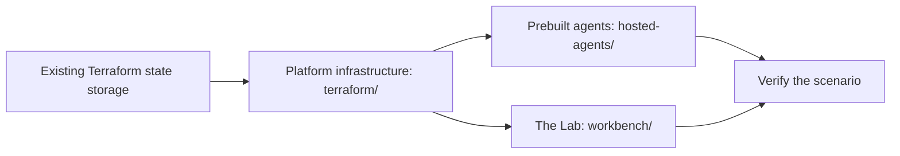

# Hosted-agent samples for Microsoft Foundry

Build, publish, and try AI agents in **Microsoft Foundry** (formerly Azure AI
Foundry) without customer data or connected business systems. This repository
includes prebuilt review agents, a browser app called **the Lab**, fictional
inputs with expected findings, and Terraform that deploys everything privately
in Azure.

The samples suit public-sector, healthcare-operations, and independent software
vendor (ISV) demonstrations. Agents help people review the supplied material.
People check the findings and make every approval or denial decision.

> [!WARNING]
> **Use fictional data only.** The Lab keeps a shared history and has no
> per-user authorization, so everyone with access can read every saved record.
> Private networking and managed identities don't keep one user's records
> separate from another's.

## In this guide

- [Start here](#start-here)
- [What you can try](#what-you-can-try)
- [Choose how to work](#choose-how-to-work)
- [Run a demo](#run-a-demo)
- [Check answer quality](#check-answer-quality)
- [Set up Azure](#set-up-azure)
- [How it works](#how-it-works)
- [Project files](#project-files)
- [Scope and limitations](#scope-and-limitations)
- [Automated checks](#automated-checks)

## Start here

| I want to | Start with | What I need |
| --- | --- | --- |
| Read through an example | [Demo guide](docs/demos.md) | Nothing. No Azure access is required. |
| Try the prebuilt agents | [Run a demo](#run-a-demo) | A deployed Lab and approved private network access. |
| Create and try my own agent | [Create and try a baseline agent](docs/agent-creation.md) | An operator-enabled private Lab, an existing model deployment, and approval for the cost. |
| Deploy my own environment | [Set up Azure](#set-up-azure) | Azure permissions, model quota, private network access, and approval for the cost. |
| Find a guide or look up a term | [Documentation index](docs/README.md) | Nothing. |

## What you can try

### Create an agent from a template

On the Lab's **Create agent** page, describe a job and choose one of five
reviewed templates.

| Template | You give it | You get back |
| --- | --- | --- |
| **Document Analyst** | Policy, notice, or product text | A sourced summary, changes, and open questions |
| **Criteria Checker** | Your checklist and a document | Supported items, missing information, and conflicts. It doesn't make an approval decision. |
| **Document Intake Assistant** | Fictional administrative intake text and the fields to extract | A field table with source references and unknown values called out |
| **Casework Assistant** | Fictional case notes | A summary, unresolved inconsistencies, and follow-up questions |
| **Workflow Coordinator** | A fictional request and service identifiers | Read-only **simulated** lookup results and proposed next steps. It doesn't carry out business actions. |

- The first four templates work only with the text you supply. They don't use
  tools or call specialist agents.
- **Workflow Coordinator** has exactly two fixed local lookup tools. They aren't
  live connectors or an approval engine.
- Healthcare examples cover administration only, not clinical advice or patient
  data.

Creating an agent has two stages:

1. **Prepare.** **Create agent** combines your job description with the template
   into a setup you can edit. This stage doesn't call a model or create any
   Azure resource. Local preview can prepare setups, but it can't publish or
   produce live answers.
2. **Publish.** In an operator-enabled private Lab, you confirm creation, and
   the Lab publishes a real, named Foundry hosted agent. **Created agents** shows
   its progress and opens it in **Chat** when its runtime and route are ready.

> [!NOTE]
> Publishing is opt-in and costs money. An operator must first complete the
> [operator setup](docs/agent-creation.md). For a guided example, see the
> [creation walkthrough](docs/demos.md#create-and-try-a-baseline-agent).

### Try the prebuilt agents

The prebuilt agents support three longer walkthroughs:

| Scenario | What you'll do | Status |
| --- | --- | --- |
| [Casework assistance](docs/demos.md#casework-assistance) | Summarize fictional case notes, flag missing or conflicting details, and draft follow-up questions. | **Available** |
| [Application completeness](docs/demos.md#application-completeness) | Check a sample grant or permit application against a supplied checklist and find missing or conflicting information. | **Available** |
| [Requirements and proposal review](docs/demos.md#requirements-and-proposal-review) | Compare proposal requirements with supplied product information and flag claims that lack supporting evidence. | **Experimental** |

- **Available** means the agent code and walkthrough are included. It doesn't
  mean an environment is deployed or that its answers are validated.
- **Experimental** means an existing agent is adapted for another task and needs
  more testing.

The [demo guide](docs/demos.md) lists the expected results and the agents each
scenario uses.

## Choose how to work

Creating an agent and talking to one are separate steps. An agent has saved
instructions and a fixed set of tools. An example task or chat starter only
fills in your message. **Chat** doesn't reconfigure the agent.

| Page | You give it | You get back |
| --- | --- | --- |
| **Create agent** | A job description, a template, and reviewed task instructions | An editable setup. After operator confirmation, a separately published Foundry agent. |
| **Chat** | A question plus the application, checklist, or case notes you want help with | A conversational answer from the selected agent, with references and follow-up questions |
| **Document reviews** | A checklist and pasted document text | Saved results for each checklist item, quotes you can inspect, and requests for missing information |

Keep these points in mind:

- The default agent, **Application and case helper**, asks an
  application-checking or case-notes specialist to do the task. Open
  **About this agent** to see what it needs, how it works, and what it can't do.
- **Document reviews** always use the Lab's default agent, whichever agent you
  select in **Chat**. Neither page copies work into the other.
- **Created agents** shows publication status and handles operator-confirmed
  deletion. Creating an agent doesn't change the prebuilt agents, hidden-agent
  access, or specialist bindings.
- Changing tools, code, model selection, permissions, or an already deployed
  setup is a developer or operator task, not a chat command. See
  [configuration ownership](workbench/README.md#workspace-configuration).

### Agent names

Each prebuilt agent has one name in the Lab and another in Foundry. Use the
Foundry name to find an agent or its traces in the Foundry portal. The Foundry
project that holds the agents, for example `hosted-agents-dev`, isn't an agent.

| Name in the Lab | Name in Foundry | Role |
| --- | --- | --- |
| **Application and case helper** | `customer-review-coordinator` | Default coordinator. Sends each task to one specialist. |
| **Application and case helper (base setup)** | `review-coordinator-agent` | The same jobs, using the base instructions instead of the evidence-review profile |
| **Application checker** | `application-review-agent` | Specialist for application completeness and proposal coverage |
| **Case notes summarizer** | `case-review-agent` | Specialist that summarizes case notes and flags missing or conflicting details |

By default, the Lab shows only **Application and case helper**. For catalog IDs,
source folders, and the standalone `basic-responses-agent` sample, see
[agent names](docs/README.md#agent-names).

## Run a demo

You need a deployed Lab for this path. If you don't have one, follow
[Set up Azure](#set-up-azure) first, or read the examples without running them.
The local Lab preview doesn't call a model.

1. Open the [Lab](workbench/README.md) through approved private access, and then
   select **New chat**.
2. Open **About this agent**. Then either select an example task and send it,
   or paste the complete [sample input](docs/demos.md) for your scenario.
3. Compare the answer with the source material and the expected findings.
   Check the citations and any verified records of which review tools ran.
4. Try the supplied missing-information, conflicting-evidence, and failure
   examples.
5. Record what worked, what didn't, and next steps in the
   [demo handoff](docs/demo-handoff.md). Start fresh without deleting anyone
   else's records.

## Check answer quality

A successful deployment or a fast response doesn't prove that an answer is
correct. For repeatable testing, use the
[Foundry evaluation suite](evaluations/README.md):

- Compare models or prompts with the **same test cases**, and record each version
  and its results.
- Offline tests use simulated responses. They check the code, not live model
  quality.
- Live evaluations are optional and billable, and they require explicit approval
  and private test access. Review their results and traces in Foundry, not the
  Lab.
- Record token usage only when it's available. Keep measured usage, estimated
  token costs, and infrastructure costs separate.

## Set up Azure

This section is for the operator who deploys the environment. The platform
infrastructure, the agents, and the Lab each have separate deployment steps.

### Prerequisites

- Terraform 1.16.1, and Azure CLI signed in to the intended tenant.
- Permission to deploy resources and assign roles, enough regional model quota,
  and approved private network access.
- An existing, secured Azure Storage account and blob container for Terraform
  state. Your identity needs **Storage Blob Data Contributor** on that container.
  This sample doesn't create its own state backend.

For details, see the [Terraform prerequisites and state guide](terraform/README.md).

> [!IMPORTANT]
> **This isn't a low-cost starter deployment.** Azure resources, model calls,
> and running agents can incur charges. Get approval, and review the saved
> Terraform plan, regional pricing, and quota before you deploy. Preserve
> existing resource names, state, permissions, and private access. Never apply
> an unexpected replacement or deletion.

### Deployment order

1. [Configure, validate, plan, and deploy the platform infrastructure](terraform/README.md#deploy).
   Follow the [state and migration safeguards](terraform/README.md#state).
2. [Publish and test the prebuilt agents](hosted-agents/README.md). If you need
   a separate deployment machine, use the
   [private deployment runbook](docs/private-deployment.md).
3. [Deploy or access the Lab](workbench/README.md). The Lab has its own
   Terraform state and its own application deployment steps.
4. Verify private access, agent calls, and your chosen scenario in your approved
   test environment before you present it. For a more formal comparison, use the
   [quality checks](#check-answer-quality). Live evaluation requires separate
   approval.

The [Bastion](terraform/bastion/README.md) and
[agent monitoring](terraform/monitoring/README.md) roots are also separate, each
with its own state. Apply them after the platform infrastructure exists.

> [!CAUTION]
> A new agent version can receive traffic before its smoke tests finish. If a
> check fails, the deployer tries to restore the previous route and keeps any
> version it can't safely delete. See the
> [deployment and recovery steps](hosted-agents/README.md#6-verify-the-route-and-handle-failures).

## How it works

The Lab is a chat app, not an agent designer or an evaluation dashboard. It runs
in an internal Azure Container Apps environment and uses managed identities to
reach Azure services.

- **Front end to agents.** The Lab's React interface sends requests to a FastAPI
  backend, which calls the hosted agents in Foundry.
- **Coordinator and specialists.** The coordinator owns the conversation. It
  calls one specialist through a configured tool and returns the findings to the
  Lab. Specialists don't message each other, and a completed tool call doesn't
  prove its findings are correct.
- **What gets saved.** **Chat** saves completed messages to a shared Azure
  Cosmos DB database only when you choose to save. Creating a document review
  saves its checklist and document text. Running a review also saves the results
  and a copy of that run's input.

### Diagrams

| Diagram | What it explains |
| --- | --- |
| [Agent collaboration](docs/images/agent-collaboration.svg) | How the coordinator delegates work and returns findings for human review |
| [Infrastructure](docs/images/foundry-overview.svg) | How the Lab reaches agents and stores records through separate paths |
| [Operations and security](docs/images/foundry-operations.svg) | How telemetry, image publishing, state, and credentials are handled |
| [Terraform deployment](docs/images/foundry-deployment.svg) | What the platform and Lab stacks own, and what stays in release workflows |

For the actual message shape, see the
[request and result example](docs/agent-profiles.md#example-handoff).

### Go deeper

| Topic | Guides |
| --- | --- |
| Components and data flow | [Architecture](docs/architecture.md#component-interactions), [review storage and recovery](docs/review-workflow.md#execution-and-persistence) |
| Access and credentials | [Authentication and service boundaries](docs/architecture.md#trust-boundaries), [credential handling](docs/credentials.md) |
| Customize the agents | [Extension guide](docs/architecture-assessment.md), [coordinator profiles](docs/agent-profiles.md) |
| Terraform and Microsoft reference architectures | [What to reuse and who owns it](docs/architecture-assessment.md#terraform-first-deployment). Keep the existing Azure Verified Modules (AVM) foundation, and add infrastructure only for a specific need. |
| Optional APIs and search | [API Management guide](docs/apim-review-api.md), [integration options](docs/optional-integrations.md). Azure API Management (APIM) is off by default, and the Lab doesn't need it. Azure AI Search is a Foundry dependency, but the current review agents don't use it. |
| Optional browser access | [Application Gateway and Front Door guide](docs/ingress-access.md). These are design options that keep the app origin and Foundry private. This sample doesn't deploy either gateway. |

## Project files

| Path | Contents |
| --- | --- |
| [`workbench/`](workbench/) | The Lab: chat UI, FastAPI backend, shared history and reviews, browser tests, and its own deployment setup |
| [`terraform/`](terraform/) | Platform infrastructure built on the official Azure Verified Modules (AVM) pattern for Foundry, plus separate Bastion and monitoring roots |
| [`hosted-agents/`](hosted-agents/) | The prebuilt agents, including the review coordinator, and scripts to publish and test them |
| [`docs/`](docs/) | Demo instructions, fictional inputs, architecture, deployment, and operations guides. Start at the [documentation index](docs/README.md). |
| [`evaluations/`](evaluations/) | Review test cases, offline checks, and optional live answer-quality evaluations |
| [`cost-comparison/`](cost-comparison/) | A calculator that compares Azure GPU VM and Foundry hosted-runtime costs, with rates you can update |

## Scope and limitations

These samples are for demonstrations and technical testing. They aren't finished
customer applications. Connecting to customer systems or deploying to production
requires separate planning and agreement.

| Topic | What to expect |
| --- | --- |
| Business systems | Review agents analyze the supplied text. They don't update business systems. Any future demo of business actions must use simulated tools. |
| Integrations | The demo path doesn't include customer-system connections, Microsoft 365, Copilot, or SharePoint integrations, or education knowledge assistants. |
| Citations | A matching citation shows that text came from a supplied source, not that the source's claims are true. |
| Missing evidence | Missing evidence calls for more information, not an automatic rejection. |
| Customer information | Don't put customer names, opportunity records, commercial details, or claims of customer implementations into sample inputs, traces, or handoff examples. |
| Support | This repository isn't an officially approved or funded Microsoft service offering. Sample code, setup help, and architecture or cost advice aren't a commitment to deliver a customer integration. |

> [!NOTE]
> **Not implemented:** [agent-assisted request triage](docs/demos.md#agent-assisted-request-triage)
> is planned work, not an available demo. Sending review tasks to specialist
> agents isn't a service-request routing or approval workflow.

To plan further work, including user authorization and keeping users' records
separate, use the
[production checklist](terraform/README.md#separately-scoped-production-considerations).
Capture agreed next steps in the [demo handoff](docs/demo-handoff.md).

## Automated checks

On pull requests and pushes to `main`, GitHub Actions runs these checks:

- Compiles and tests the Python code.
- Checks dependencies and all four agent deployment CLIs, and tests the SDK
  integrations.
- Checks Terraform formatting and configuration.
- Tests deployment safeguards, saved-history and review behavior, and browser
  workflows at desktop and mobile sizes.

These checks don't call live agents or create Azure resources. They test the
code and how it handles simulated service responses, not the quality of a live
model's answers.

## Related content

- [AVM pattern module for Foundry (Terraform Registry)](https://registry.terraform.io/modules/Azure/avm-ptn-aiml-ai-foundry/azurerm/latest)
- [Create Microsoft Foundry with Terraform](https://learn.microsoft.com/azure/foundry/how-to/create-resource-terraform)
- [Foundry hosted agents](https://learn.microsoft.com/azure/foundry/agents/concepts/hosted-agents)
- [Foundry Agent Service pricing](https://azure.microsoft.com/pricing/details/foundry-agent-service/)
