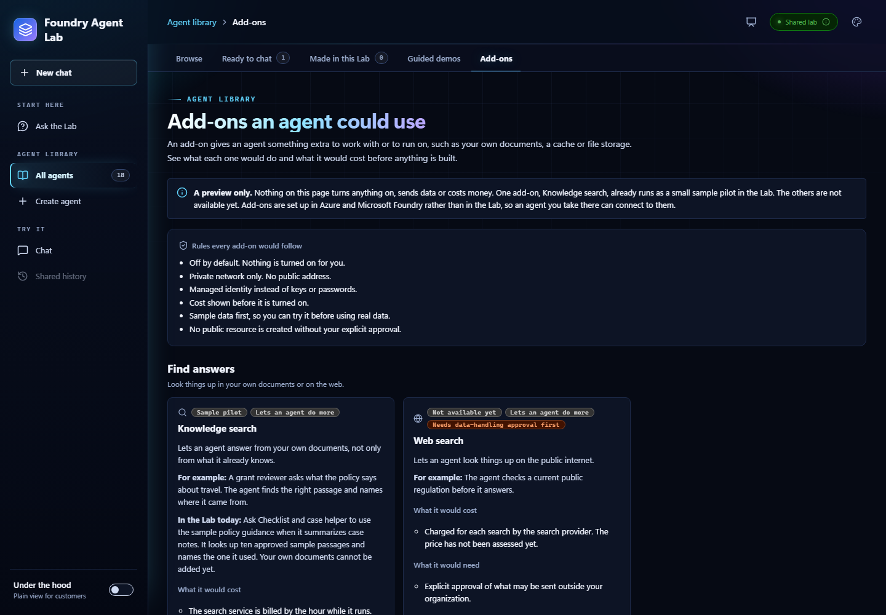

# Add-on package format

[Home](../README.md) / [Docs](README.md) / Add-on package format

An add-on is an optional tool or skill an agent could use, such as knowledge
search. Each one is described by a manifest in
[`addons/<id>/addon.json`](../addons/). The manifest holds the card the Lab's
**Add-ons** tab shows and, once someone has built the add-on, a deployment
package: a runbook, an acceptance case, a Terraform module, and the roles that
module may grant.



[View full size](images/screenshots/lab-addons-dark.png)

> [!IMPORTANT]
> **Nothing in `addons/` deploys anything, and no check contacts Azure.** The
> format makes a package reviewable before anyone runs it. A person approves
> the saved Terraform plan and runs the apply. An agent never applies a plan.
> A package can't ask for public network access, keys, shared-key or anonymous
> access, admin users, or public IP addresses. See
> [Fixed guardrails](#fixed-guardrails).

The roadmap for add-ons is in
[#54](https://github.com/michael-rechani/foundry-agent-accelerator/issues/54).
The work to build and deploy one from the repository is in
[#121](https://github.com/michael-rechani/foundry-agent-accelerator/issues/121).
For how an add-on fits with the rest of the platform, see
[Optional integrations](optional-integrations.md).

## In this guide

- [Folder layout](#folder-layout)
- [The manifest](#the-manifest)
- [The deployment package](#the-deployment-package)
- [Fixed guardrails](#fixed-guardrails)
- [What the check enforces](#what-the-check-enforces)
- [Check a saved plan](#check-a-saved-plan)
- [The knowledge search pilot](#the-knowledge-search-pilot)
- [How the Add-ons tab uses the manifests](#how-the-add-ons-tab-uses-the-manifests)
- [Add or change an add-on](#add-or-change-an-add-on)
- [Not done yet](#not-done-yet)

## Folder layout

```text
addons/
  addon_manifest.py        Reads and checks the manifests
  check_addons.py          The check CI runs
  build_catalog.py         Writes the Add-ons tab's data from the manifests
  plan_check.py            Checks a saved Terraform plan against a manifest
  test_addon_manifest.py   Offline tests for the manifests
  test_plan_check.py       Offline tests for the plan check
  testdata/plans/          Hand-written plan JSON the plan check's tests read
  <id>/
    addon.json             The manifest. The folder name is the add-on's id.
    DEPLOY.md              Package only: the runbook
    bootstrap.md           Package only: how to prepare the add-on's data
    acceptance.json        Package only: the acceptance case
    terraform/             Package only: the Terraform module
```

The tooling uses only the Python standard library, so it needs no install.

## The manifest

`addon.json` has these fields. Every field is required unless it says
otherwise, and an unknown field is an error.

| Field | What it holds |
| --- | --- |
| `schema_version` | `1`. |
| `id` | Lowercase words joined by hyphens. Must match the folder name. |
| `name` | The card's title. |
| `order` | Position on the **Add-ons** tab, from 1. No two add-ons share one. |
| `kind` | `built-in-tool` (a Foundry tool, nothing to deploy), `existing-service` (uses a service the platform already has), or `new-service` (needs a service the platform doesn't have yet). |
| `tracking` | The issue numbers that follow the add-on. |
| `card` | What the tab shows: `icon`, `group`, `job`, `summary`, `example`, `cost` (a list), `needs` (a list), `safety`, `service`, `billing`, and optionally `pilot`, `approval`, and `note`. An add-on with a `pilot` description shows a **Sample pilot** badge instead of **Not available yet**. |
| `package` | Optional. The [deployment package](#the-deployment-package). Leave it out until someone builds the add-on. |

Add-ons without a `package` are previews. The card says what the add-on would
do, cost, and need, and nothing about how to deploy it.

## The deployment package

A manifest with a `package` points at four files in its own folder. A file name
can't contain a folder, so a manifest can't point at another add-on's files or
at anything outside its folder.

| Field | What it holds |
| --- | --- |
| `runbook` | `DEPLOY.md`. It needs the sections **Plan**, **Cost and diff**, **Approval**, **Apply**, **Verify**, **Wire the agent**, and **Tear down**, and must say that a person approves the saved plan. |
| `bootstrap` | A file that says how to prepare the add-on's data or access before the first use. It can't be empty. |
| `acceptance_case` | A JSON file of cases. Each case has an `id`, a `summary`, `live`, `steps`, and `expect`. A `live` case needs a deployed add-on and may make billable calls, so it needs approval. At least one case must be offline. |
| `terraform` | `module`, the folder holding the module's `.tf` files, and `resource_types`, the only resource types its plan may create or change. |
| `approval` | Always `person-approves-saved-plan`. |
| `approval_gates` | Approvals beyond the plan: `billable-calls`, `shared-data`, and `data-handling`. |
| `roles` | Every role assignment the module may make: `role`, `role_id`, `principal_type`, and a `scope` that names a resource type and, optionally, a child collection such as `indexes`. Empty when the package grants nothing. |
| `cost_lines` | What the package adds to the bill, in the shape the [cost comparison](../cost-comparison/README.md) uses: `name` and `basis` with either `monthly_cost`, or `quantity`, `unit_rate`, and `unit`. Use `0` with a basis when the package adds nothing. Don't estimate a price that hasn't been checked. |
| `guardrails` | Must match [Fixed guardrails](#fixed-guardrails) exactly. |

## Fixed guardrails

Every package declares the same three guardrails, and the check rejects any
other value. A guardrail isn't an option. Loosening one is a code change that
reviewers see, not a manifest edit.

| Guardrail | Value |
| --- | --- |
| `public_network_access` | `disabled` |
| `local_auth` | `disabled` |
| `public_ip` | `none` |

This matches the platform's existing stance in
[Private networking](knowledge-retrieval.md#private-networking) and the
[permissions reference](permissions.md): private access only, managed identity
instead of keys, and no public resource without explicit approval.

## What the check enforces

`python addons/check_addons.py` reads every manifest and reports each problem
with the file it's in. It checks that:

- Each field has the right shape, no field is unknown, and no key appears
  twice.
- The folder name matches `id`, and no two add-ons share an `order`.
- Every file the package names exists in the add-on's folder, the runbook has
  its sections, the acceptance case names the add-on, and the module has `.tf`
  files.
- Role IDs are role definition GUIDs, resource types are valid, and the
  guardrails and plan approval are the fixed values.
- Every folder under `addons/` has a manifest.
- The Add-ons tab's data is up to date (see
  [How the Add-ons tab uses the manifests](#how-the-add-ons-tab-uses-the-manifests)).

CI runs the check, and its offline tests, in the **python** job of
[`validate.yml`](../.github/workflows/validate.yml). Its **terraform** job
formats, initializes without a backend, validates, and tests the pilot module
with a mocked provider, so no step reaches Azure. Run the Python steps
yourself from the repository root:

```powershell
python addons/check_addons.py
python -m unittest discover -s addons -p "test_*.py" -v
```

## Check a saved plan

`python addons/plan_check.py <add-on id> <plan JSON>` reads the JSON of a saved
Terraform plan and fails when the plan goes beyond the add-on's manifest. It
never runs Terraform, never contacts Azure, and approves nothing. Pipe the plan
in, or name a file:

```powershell
terraform show -json add-on.tfplan | python addons/plan_check.py knowledge-search -
```

The check reads every create, update, replace, and delete in the plan. It
exits `0` when the plan passes, `1` when it has findings (one line each, with
the resource's address), and `2` when the input isn't a plan or the add-on has
no package.

| Rule | Fails when a created or changed resource |
| --- | --- |
| `public-network-access` | Enables public network access, sets a firewall that allows by default, opens public blob access, or has an IP allow list. |
| `keys-or-local-auth` | Turns on local authentication, shared-key access, an admin user, or key authentication. |
| `public-ip` | Is a public IP address or prefix, or points a network interface at one. |
| `role-assignment` | Grants a role the manifest doesn't list, at a scope its entry doesn't allow, or to a principal type it doesn't name. |
| `resource-type` | Isn't in the manifest's `terraform.resource_types`. A delete is held to this list too, so a plan that removes the platform's Search service fails. |
| `unknown-value` | Has something the plan can't show: a guarded setting, role, or scope that isn't known until apply, a block that is unknown as a whole, an azapi `sensitive_body`, or an action or deferred change anywhere in the plan. |

It reads Terraform's own resource types and, for `azapi_resource` and
`azapi_update_resource`, the Azure type and `body` too, so the same rules
apply to what either provider sets. If a guarded setting, a role, or a scope is
computed from another resource, the plan shows it as unknown and the check
fails until the module sets it from a value the plan knows. Use the JSON of a
saved plan, not of the state: the check rejects input that has no
`planned_values`.

An azapi body shows only what the author wrote. It leaves out the service's
defaults, so the check can't tell that an omitted setting is closed. Add an azapi type to
`resource_types` only after reading its defaults, and set the guarded
properties in the body.

> [!IMPORTANT]
> A passing check isn't an approval. A person reads the saved plan, approves
> that file, and runs `terraform apply` on it. The check, an agent, and CI never
> apply a plan. A plan that also changes the rest of the platform fails the
> check by design, so check a plan from a root that calls only the add-on's
> module.

The [tests](../addons/test_plan_check.py) prove the check offline with plan JSON
written by hand in [`addons/testdata/plans/`](../addons/testdata/plans/). Some
plans pass, and others fail on public access, keys, public IP addresses, extra
roles, unknown values, and deleting the Search service. The fixtures use
placeholder IDs and aren't output from a real plan.

The Terraform guardrails the check enforces are also declared as code in each
module. The pilot module fixes its role, principal type, and scope instead of
taking them as inputs, and its [tests](../addons/knowledge-search/terraform/tests/grant.tftest.hcl)
reject a bad Search service ID or principal ID.

## The knowledge search pilot

[`addons/knowledge-search/`](../addons/knowledge-search/) is the first package,
and a draft. It holds:

- [`DEPLOY.md`](../addons/knowledge-search/DEPLOY.md), the runbook.
- [`bootstrap.md`](../addons/knowledge-search/bootstrap.md), how to prepare the
  sample index with the existing index script.
- [`acceptance.json`](../addons/knowledge-search/acceptance.json), five cases,
  two of them offline.
- A [Terraform module](../addons/knowledge-search/terraform/) that grants
  **Search Index Data Reader** on one index to one agent identity, and does
  nothing else.

The platform's root already makes the same grant for the dev pilot
(`knowledge_search_access`, see the
[Terraform README](../terraform/README.md#knowledge-search-access)). The module
isn't wired into the root, so adopting the grant into the module is a later
change with its own reviewed plan. Nothing in the package has been planned or
applied against Azure.

## How the Add-ons tab uses the manifests

The tab imports
[`workbench/frontend/src/add-on-catalog.json`](../workbench/frontend/src/add-on-catalog.json),
which `python addons/build_catalog.py --write` generates from the manifests.
Keeping the generated file inside `workbench/frontend` means the Lab's image
builds without the `addons` folder, and the page still makes no API call. The
check fails when the file is out of date, the way the
[catalog snapshot](../workbench/frontend/README.md#library-performance-and-log-coverage)
test does for the agent library.

Each card's `group` decides which heading it sits under and its badge:
`abilities` (**Lets an agent do more**) for something the agent can do, and
`support` (**Supports the agent**) for something it runs on, such as memory,
storage or a cache. The **Common questions** answers on **Ask the Lab** read the same file, so a new
add-on appears there with no other change.

Each card's job decides which heading the Add-ons tab lists it under:
nswers (**Find answers**), documents (**Work with documents**), memory`n(**Remember and reuse**) or work (**Do the work and tell people**). Within a
heading, cards follow order. The summary says what the add-on does in one
sentence.

Each card also has a **Copy request for your coding agent** button, shown with
Under the hood on. It copies a request built from the manifest. The request asks
the agent to draft this add-on's package under `addons/<id>/` in a pull request,
keep it private and keyless, and run the check and tests. It also says to never
run `terraform apply`, deploy, make a billable call or create anything public,
and to leave the saved plan for a person to approve. An add-on marked as needing
approval gets a request for that approval only. The button copies text and calls
nothing. The wording lives in `codingAgentRequest` in
[`add-on-catalog.ts`](../workbench/frontend/src/add-on-catalog.ts).

## Add or change an add-on

1. Add `addons/<id>/addon.json`, or edit the existing one.
2. Run `python addons/build_catalog.py --write`.
3. Run the check and tests in [What the check enforces](#what-the-check-enforces),
   then the frontend unit tests (`npm --prefix workbench/frontend run test:unit`).

A new add-on needs no edit to a list in the frontend or in CI.

## Not done yet

- Only knowledge search has a package, and it's a draft. Deploying the pilot,
  running its live acceptance cases, and testing teardown need approval and
  haven't happened.
- The platform's own grant isn't moved into the module yet.
- The plan check doesn't see Azure defaults for azapi resources, and it can't
  tell what an unlisted provider setting does. A person still reads the plan.
- Nothing runs the plan check in a pipeline. Today a person runs it on a plan
  they saved, then reads the plan.
- An Azure Policy that denies public access as a backstop isn't written.
- The Lab has no button that deploys an add-on. A person deploys one from a
  saved, reviewed plan, outside the Lab.
- Tracked in
  [#121](https://github.com/michael-rechani/foundry-agent-accelerator/issues/121).
