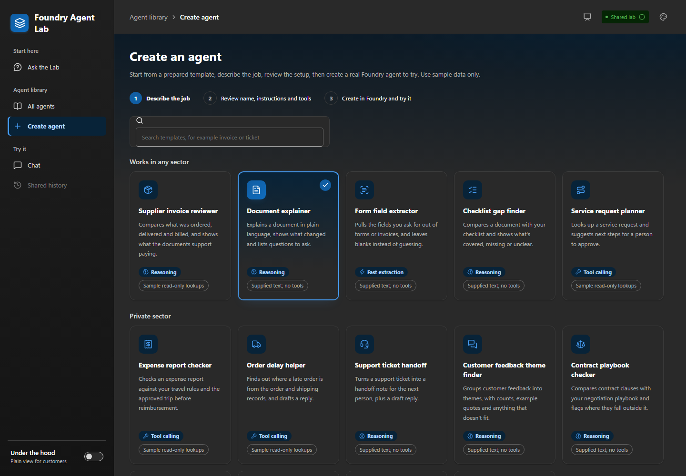

# Create and try a baseline Microsoft Foundry agent

[Home](../README.md) / [Docs](README.md) / [Demo guide](demos.md) / Agent creation

The Lab can prepare a task setup from a built-in template, publish a real named
Microsoft Foundry hosted agent after operator confirmation, and open that agent
in **Chat**. It's written for operators and demo leads who need to enable and
try the feature without overstating what it does. The result is a small
demonstration path. It isn't an unrestricted agent designer or a production
agent-management service.

## In this guide

- [What a participant can do](#what-a-participant-can-do)
- [How the Lab picks a model](#how-the-lab-picks-a-model)
- [Enable publication](#enable-publication)
- [Configuration ownership](#configuration-ownership)
- [Publication, recovery, and deletion](#publication-recovery-and-deletion)
- [Troubleshooting](#troubleshooting)
- [Verification and honest status](#verification-and-honest-status)
- [Related content](#related-content)

## What a participant can do

**Describe the job -> prepare a setup -> review and confirm -> create in Foundry
-> try it in Chat.**

The Create page lists the Lab's 18 templates in three groups, named and ordered
the same as the sectors in the **Agent library**: **Works in any sector** (five
jobs), **Private sector** (nine jobs), and **Healthcare and public sector**
(four jobs). The tables below describe the **Works in any sector** and
**Healthcare and public sector** groups. Every template is marked **Not yet
reviewed** until a person has read its recorded test answers and signed off
(see **Test results** in the **Agent library**). They pass offline contract and
acceptance tests but aren't yet validated live. Open the **Agent library** to
see what each one does.

The fictional examples in the healthcare and public-sector group suit
public-sector, healthcare-operations, and independent software vendor (ISV)
conversations. They don't reproduce any customer's work or implementation
claims. Healthcare examples cover paperwork only. They don't give clinical
advice or use real patient data.

**Works in any sector**

| Template | You give it | You get back |
| --- | --- | --- |
| **Document explainer** | Policy, notice, or product text | A sourced summary, changes, and open questions |
| **Checklist gap finder** | Your checklist and a document | Supported items, missing information, and conflicts. It doesn't make an approval decision. |
| **Form field extractor** | A fictional form or invoice and the fields to pull out | A field table with source references and unknown values called out |
| **Service request planner** | A fictional request and service identifiers | Read-only **simulated** lookup results and proposed next steps. It doesn't carry out business actions. |
| **Supplier invoice reviewer** | A fictional supplier invoice and the purchase order number | A line-by-line comparison of what was ordered, delivered, and billed, and the amount the documents support. It doesn't approve payment. |

**Healthcare and public sector**

| Template | You give it | You get back |
| --- | --- | --- |
| **Case summary writer** | Fictional case notes and any messages | A summary, a timeline, anything that conflicts or is missing, and draft follow-up questions |
| **Medical bill reviewer** | A fictional hospital bill and the insurer's statement for the same visit | Likely mistakes (math errors, duplicate charges, amounts above the plan's allowed price) with the math shown, an estimate of what the documents support owing, and an unsent dispute letter. It doesn't contact anyone or pay or refuse the bill. |
| **Insurance pre-approval helper** | A fictional pre-approval request packet | Each required document marked present, missing, or out of date, plus a network check and a draft note to the ordering office. It doesn't approve or submit the request. |
| **Benefits renewal helper** | A family's fictional renewal form and supporting paperwork | What's missing, too old, or doesn't match, what's already on file, and a friendly draft note to the family. It doesn't decide eligibility. |

The Medical bill reviewer, Insurance pre-approval helper, and Benefits renewal
helper each use two fixed, sample, read-only lookups (for example, plan
benefits and usual prices for the medical bill reviewer).

Each template card shows the [model profile](#how-the-lab-picks-a-model) the
job uses and whether it has sample lookups.



[View full size](images/screenshots/lab-create-agent-dark.png)

| Stage | What happens | What doesn't happen |
| --- | --- | --- |
| Prepare a draft | The Lab uses deterministic templates and the supplied description. | It doesn't ask a model to design an agent, save a resource, or spend model tokens. An ambiguous description asks for a template instead of guessing. |
| Review setup | You can edit the display name and task instructions before creation. | The selected template fixes the tools and runtime policy, and a prompt can't add any. Eleven of the 18 templates have no tools, and no template uses specialist delegation. |
| Create in Foundry | Confirming creation publishes a new generated `lab-demo-...` named agent using the Foundry software development kit (SDK). Progress follows the actual application stages. | Progress isn't a timer pretending to be deployment progress. |
| Try the agent | Ready means the hosted version is active and its Responses route was checked. Send the fictional sample in **Chat** to see its first actual answer and check quality yourself. | No hidden billable model smoke test runs. |

Templates with tools have exactly two fixed, local, **simulated read-only**
lookups each:

| Template | Lookups |
| --- | --- |
| Service request planner | `lookup_demo_request`, `lookup_demo_service` |
| Medical bill reviewer | `lookup_plan_benefits`, `lookup_usual_price` |
| Insurance pre-approval helper | `lookup_preapproval_rules`, `lookup_facility` |
| Benefits renewal helper | `lookup_renewal_rules`, `lookup_documents_on_file` |
| Supplier invoice reviewer | `lookup_purchase_order`, `lookup_delivery_record` |
| Expense report checker (private sector) | `lookup_expense_policy`, `lookup_trip_request` |
| Order delay helper (private sector) | `lookup_order`, `lookup_shipment` |

They can propose next steps and draft letters or notes, but can't open a ticket,
approve a request or payment, decide eligibility, send a message, or connect to
a customer application. Letters and notes are unsent drafts for a person to
review.

**Chat** can use this ready agent or an enabled prebuilt agent. A chat prompt
doesn't edit either setup, and there's no in-place editor for deployed
instructions.

**Document reviews** works independently. Its saved checklist/results workflow
uses the existing Lab default agent, not whichever created agent is in **Chat**.
Nothing transfers automatically between the two.

The local disconnected preview supports draft preparation only. It can't
publish, persist a created agent, or produce a live model answer.

## How the Lab picks a model

Each template names the kind of work it does. The Lab runs the new agent on the
model deployment that the operator set for that kind of work, so different
agents can use different models. Participants don't choose a model, and a chat
prompt can't change it.

| Kind of work | Templates | What the model needs to do |
| --- | --- | --- |
| **Reasoning** | Document explainer, Checklist gap finder, Case summary writer, Medical bill reviewer, Insurance pre-approval helper, Benefits renewal helper, Supplier invoice reviewer, Support ticket handoff, Customer feedback theme finder, Contract playbook checker, RFP answer drafter, IT incident timeline writer, Maintenance work order planner | Compare sources step by step and keep gaps and conflicts visible |
| **Fast extraction** | Form field extractor, Payment matcher | Copy stated values into a fixed structure, where speed and cost matter more than deep reasoning |
| **Tool calling** | Service request planner, Expense report checker, Order delay helper | Call lookup tools in the right order and report exactly what they return |

The review step shows the chosen deployment and the reason for it. Any kind of
work without its own deployment uses the default one, so a Lab with a single
model still works. Each agent keeps the model it was created with; changing the
settings later affects only new agents.

## Enable publication

Creation is **disabled by default**. Keep the existing private access boundary
and single worker/replica. Before enabling, complete these checks.

1. Confirm an approved Foundry project, existing model deployments with quota,
   working private connectivity, and the Lab's shared Cosmos container. Check
   the pinned SDK/remote-build combination in an approved staging environment.
   To add deployments for the other kinds of work, set
   `additional_model_deployments` in the
   [platform Terraform](../terraform/README.md#1-configure-inputs-and-state).
   Use chat models that support the Responses API and tool calling.
1. Review the Lab managed identity's ability to read, publish, route, and delete
   the new hosted agents. Lab Terraform gives it Foundry User on the project
   (`azurerm_role_assignment.foundry` in
   [`workbench/infra/main.tf`](../workbench/infra/main.tf)). Microsoft Learn's
   deployment guide asks for Foundry Project Manager to publish, and Learn's
   pages disagree on whether Foundry User is enough. Foundry User alone hasn't
   been tested here, and the dev Lab identity also got Foundry Project Manager
   by hand; see
   [Foundry User and Foundry Project Manager](permissions.md#foundry-user-and-foundry-project-manager).
   Creation doesn't grant roles or alter existing identities or permissions.
   The only role Lab Terraform can add for it is the optional Key Vault grant
   in step 4.
1. Create a strong, randomly generated operator key of at least 32 characters,
   preferably through an approved password manager. Store only its lowercase
   SHA-256 UTF-8 verifier in an existing Azure Key Vault secret. Give the raw
   key separately to approved operators. Don't commit it or put it in
   Terraform.

   In the Lab, the **Operator key** box describes the key as a shared password
   for whoever runs the Lab. It isn't a personal sign-in. Whoever has it can
   create and delete real agents in Foundry.

   The dev Lab also keeps the raw key in the Key Vault secret
   `lab-creation-operator-key`, created together with the verifier. An owner
   with read access to that secret can copy it without displaying it, paste it
   into the **Operator key** box, then clear the clipboard:

   ```powershell
   az keyvault secret show --vault-name <vault> --name lab-creation-operator-key --query value -o tsv | Set-Clipboard
   # Paste into the Operator key box, then clear the clipboard:
   Set-Clipboard -Value ' '
   ```

   The Lab identity can't read that secret. It can read only the verifier.
1. If using Lab Terraform, configure these nonsecret inputs through the normal
   reviewed rollout:

   ```hcl
   agent_creation_enabled = true
   agent_creation_model   = "gpt-4.1" # default for any kind of work not listed below
   agent_creation_models = {
     reasoning    = "gpt-5.4"
     extraction   = "gpt-5.4-mini"
     tool_calling = "gpt-4.1"
   }
   agent_creation_key_secret_id = "https://your-vault.vault.azure.net/secrets/lab-creation-key-verifier"
   # Optional: have Lab Terraform give the Lab identity Key Vault Secrets User on that one secret.
   # agent_creation_key_secret_resource_id = "/subscriptions/<subscription ID>/resourceGroups/<vault resource group>/providers/Microsoft.KeyVault/vaults/your-vault/secrets/lab-creation-key-verifier"
   ```

   These names are examples, so use deployment names that exist in your Foundry
   project. `agent_creation_models` is optional.

   The secret must contain the **verifier**, not the raw key. The Lab identity
   needs Key Vault Secrets User on that one secret. Either the environment owner
   provisions it, or you set `agent_creation_key_secret_resource_id` and Lab
   Terraform assigns it. If that assignment already exists, [import it
   first](permissions.md#adopt-the-key-vault-grant). The reference creates no
   vault, secret, or model deployment, and no role assignment unless you set the
   resource ID.
1. Rebuild the Lab image so it includes the reviewed runtime bundle, then use
   the existing approved deployment process. The source-code and test changes
   don't perform a deployment or permission change by themselves.
1. In the private UI, prepare one fictional setup, verify its tools and limits,
   confirm costs/shared visibility, and provide the operator key. Check real
   publication, send its sample, then verify cleanup before inviting an
   audience. Repeat once for each model deployment you use, because models
   differ in how they follow instructions and call tools.

For non-Terraform operators, the equivalent server configuration is:

| Environment variable | Meaning |
| --- | --- |
| `WORKBENCH_AGENT_CREATION_ENABLED` | Exactly `true` to allow new publication/resume. Defaults to `false` |
| `WORKBENCH_AGENT_CREATION_MODEL` | Default existing model deployment, used for any kind of work without its own entry. Not editable in the browser |
| `WORKBENCH_MODEL_LIMITS` | Optional JSON object that maps each model deployment name to its `requests_per_minute` and `tokens_per_minute`, so the Lab answers busy before a chat turn would pass that deployment's limit. Set by `model_limits` in Terraform. See [Model limits](lab-configuration-and-cost.md#model-limits) |
| `WORKBENCH_AGENT_CREATION_MODELS` | Optional JSON object that maps `reasoning`, `extraction`, and `tool_calling` to existing model deployments, for example `{"reasoning":"gpt-5.4","extraction":"gpt-5.4-mini"}` |
| `WORKBENCH_CREATION_KEY_SHA256` | Lowercase, 64-character verifier from a secret reference. Never the raw key |
| `WORKBENCH_MAX_CREATED_AGENTS` | Defaults to 5. Allowed range 1-20. Failed or unconfirmed attempts still count |
| `WORKBENCH_PUBLICATION_TIMEOUT_SECONDS` | Defaults to 600. Allowed range 30-900 |
| `WORKBENCH_LIBRARY_PREVIEW_ENABLED` | `true` (default) or `false`. When `true` in private mode with a creation model configured, **Chat** can run library definitions as unsaved previews on that model without publishing an agent. Previews use only simulated read-only lookups, and each message may incur model cost. Other values fail startup. |

The existing `WORKBENCH_MODE=private`, Foundry endpoint, managed identity,
trusted hosts/origins, and Cosmos configuration still apply. Invalid opt-in
settings fail startup rather than enabling an unprotected creation endpoint.

> [!IMPORTANT]
> The operator key travels only to this backend over the private HTTPS session,
> in `X-Workbench-Creation-Key`. It is not sent to the model, written to Cosmos,
> included in chat exports, or stored in browser persistent storage.

This is a **shared operator gate**, not Microsoft Entra ID sign-in or per-user
resource ownership. Anyone with Lab access can read the shared created-agent
setups and use ready agents. Publication and deletion require the key. Don't
use confidential data.

Disabling new creation doesn't stop or hide ready created agents. Keep the
valid verifier configured to allow operator deletion while creation is disabled.

## Configuration ownership

| Source | Owns |
| --- | --- |
| [`agent_templates`](../workbench/agent_templates) | One JSON file per library agent in `agents/`: job description, prepared instructions, examples, conservative matching, fixed public tool metadata, each template's kind of work, its readiness and its place in the library |
| [`agent_runtime`](../workbench/agent_runtime) | Reviewed runtime code, immutable policy, allowed tools, and pinned remote-build requirements |
| [`agent_package.py`](../workbench/agent_package.py) | Deterministic runtime packaging shared by publication and the offline export CLI |
| Creation request and saved record | Chosen template metadata snapshot, edited name/instructions, model deployment chosen for the template's kind of work, generated resource identity, and setup/runtime hashes |
| [`agent_publisher.py`](../workbench/agent_publisher.py) | SDK publication, version/ownership checks, activation polling, route verification, and retirement |
| Server environment / [Lab Terraform](../workbench/infra/main.tf) | Enablement, the default and per-kind model deployments, operator-key verifier, and operational limits |
| Existing [`agents.json`](../workbench/agents.json) and coordinator profiles | Unchanged prebuilt agent catalog, visibility, and specialist bindings. Creation doesn't overwrite them |

`GET /api/agent-templates` is also the browser's library contract. The response
keeps `templates` and `draft_mode` for existing clients, adds
`schema_version: 1`, and derives stable `facets` from the same template data.
Each template includes its sector, industry, tasks, readiness, tool mode,
prerequisites, relative runtime hint, expected behavior, required human
decision, search keywords, and export status. Facet counts are derived rather
than maintained separately.

Readiness and runtime hints are bounded labels, not service-level claims.
`Not yet reviewed` (the `sample` level) means the definition has deterministic
contract tests and recorded answers that pass the automatic checks. A person
hasn't signed those answers off, and it still needs customer policy review.
`Reviewed` means a person has signed off the recorded answers and every run
passed. `evaluations/test_scorecards.py` fails if the label and the recorded
sign-offs disagree. Current tool modes are only `Text only` and
`Sample lookups`. Neither means a customer system is connected. Cost and latency are relative
model-profile hints, not prices or performance guarantees.

Every listed agent's instructions end with the same answer layout: **Result**,
**Why**, **What to check** and **Next step**, then who makes any decision the
agent is asked to make. The layout is appended in `agent_templates/catalog.py`, so the
served `instructions` field keeps its shape.

The proposed task-sized layout and terminology alignment for **Checklist gap
finder** are deferred until its sample answers can be re-recorded through the
existing private Foundry endpoint (see
[#244](https://github.com/michael-rechani/foundry-agent-accelerator/issues/244)).
Its current instructions and recorded evidence remain unchanged.

`GET /api/agent-scorecards` serves each template's recorded test results
(`schema_version: 1`), kept separate so the catalog response stays unchanged.
The file behind it, `workbench/agent_scorecards.json`, is generated offline by
[`evaluations/scorecards.py`](../evaluations/scorecards.py) from recorded
acceptance answers, response times and token counts. The endpoint never calls a
model or storage. All 18 listed templates have a scorecard; a template without a
recorded run would show no results. Every case is recorded several times, and it
passes only when every run passes. Each case carries `runs` and `runs_passed`,
and each summary carries `runs_per_case`, `runs` and `runs_passed`. Each recorded
answer also carries a fingerprint of the instructions its agent had when it ran.
The build fails when an agent's instructions change afterwards, so the results
can't describe instructions the Lab no longer uses. Each case includes the
request that was sent, which the library's **Take it to Foundry** tab turns into
a downloadable evaluation file.

Only `main.py`, `demo_tools.py`, and `requirements.txt` enter the deterministic
ZIP package. Prompts can't upload source, install dependencies, select
endpoints, change the model, or register tools. Hosted allocation is fixed at
0.5 CPU / 1 GiB. Remote build uses `python_3_14`, matching the existing
deployer and the Lab container's Python 3.14 version.

Changing templates, code, tools, permissions, or model configuration requires a
developer/operator rollout. It doesn't mutate already published agents.
Created-agent guidance, starter text, and expected tool receipts use the saved
template snapshot, not whichever template definitions a later Lab image
contains. The `created-<UUID>` identifier namespace belongs to saved created
agents, and prebuilt catalog entries can't reuse it.

### Add a library agent

Each library agent is one JSON file, `workbench/agent_templates/agents/<id>.json`,
and the file name is the agent's id. It holds the agent's `template` (label,
description, instructions, example, sample input and any sample-lookup `tools`),
its catalog `metadata` (sector, industry, tasks, summary, readiness and so on), the
`match` patterns that choose it from a described task, and an `order` number for its
place in the library. The Lab reads every file when it starts and refuses to start
if one has a missing or unknown field, a repeated `order`, an id that isn't its file
name, or a sector, industry, task, readiness or model profile it doesn't know. The
message names the file.

1. Copy a similar file in `agents/`, rename it to the new id and edit it. Give it an
   `order` no other agent uses. The library lists agents in `order`, and a task that
   matches more than one agent's trigger words gets them as `template_required`
   candidates in the same order. To retire an agent, replace `order` with
   `"retired": true`.
2. From the `workbench` directory, run `python -m agent_templates.runtime_ids`. It
   rewrites `TEMPLATE_IDS` in `agent_runtime/demo_tools.py` from the agent files.
   That file ships inside the created agent's package and can't read the catalog, so
   it keeps its own list of the ids it accepts, and the command is the only thing
   that edits it. `--check` reports a stale list without changing anything, and a
   test runs it. An agent that uses lookups also needs its sample records and
   functions in `demo_tools.py`.
3. Add its acceptance cases to `evaluations/library-cases.json` (see
   [library scorecards](library-scorecards.md)).
4. Regenerate the frontend's catalog snapshot with the command in
   [the frontend README](../workbench/frontend/README.md#library-performance-and-log-coverage).

The image build ships the new file by pattern, so nothing else needs an edit. The
tests name any step that's missed.

## Publication, recovery, and deletion

For a source/configuration export, see
[portable agent bundles](../hosted-agents/README.md#portable-agent-bundles).
The saved-agent API exposes its `runtime_hash` so the exporter can require the
exact matching runtime source. In the Lab, a library entry's **Export and
deploy** tab downloads a ready agent's saved record (`GET /api/agents/{id}`) and
shows the `bundle.py export-created`, `inspect`, and `deploy` commands; building
and deploying the bundle remain CLI steps in your own environment.
Library templates are marked exportable only through the `after_creation`
path: first create and publish a saved Lab agent, then export its ready record.
Browsing a template alone doesn't produce a bundle.
Redeployed bundles are independent agents. They don't copy this Lab's records,
ownership, chat history, or automatic lifecycle management.

The API saves a typed Cosmos record **before** scheduling remote work. It then
checks that the chosen model deployment exists and uploads the reviewed ZIP
package. Next it records the returned version, waits for activation, and sets a
100% Responses route. It reads the route and version back before marking the
agent ready. If the deployment doesn't exist, publication stops
before anything is uploaded and the record shows as failed. The API doesn't use
browser-supplied endpoint names or change prebuilt agents.

| Situation | Required behavior |
| --- | --- |
| Repeated creation request | A client universally unique identifier (UUID) identifies one creation request. Repeating the same setup with the same UUID returns the same operation. Changing its setup is a conflict. An uncertain browser response must not trigger a new UUID or automatic retry. |
| Resume after uncertainty | Once submission may have started, **Resume** reconciles the named resource. It never uploads another version merely because a status check returns 404. If submission was definitely never started, **Resume** may perform that original first submission. The record keeps showing a missing or unconfirmed cloud outcome as such. |
| Timeout or restart | Timeout, process restart, or an unsuccessful final status write can leave an interrupted record. Refresh checks status and isn't another publication. A failed poll doesn't mean the hosted operation stopped. |
| Concurrent operations | Creation and deletion are serialized in one process. Conditional Cosmos updates reject stale operators. Multiple Lab workers or replicas would need distributed admission and job ownership, so don't enable them here. |
| Ownership checks | Versions must carry this operation's ownership/setup/runtime metadata. Foreign or extra versions and inconsistent routes block automatic promotion or deletion. An owned but unrouted endpoint can be connected without replacing its existing authorization schemes or other protocol configuration. An absent activation status remains pending under the same bounded publication deadline. |
| Deletion | Delete requires the operator key, confirmation of the shared impact, and the current ETag. It retires only this created resource after ownership checks and confirms absence. An interrupted deletion must be retried as deletion, not resumed as setup. A 404 after an unconfirmed submission isn't enough to claim the resource was safely removed. A deleted record can't be resumed (409 `agent_not_resumable`); repeating the deletion returns the same record without a second operation. |

Don't edit generated resources through a second control plane during an
operation. Investigate unexpected changes in Foundry with an operator.

Active, failed, and unconfirmed records don't expire while a hosted resource
might still exist. After confirmed deletion, the saved display name and task
instructions are cleared. A small, nonexpiring ID/hash/status tombstone prevents
an old creation request from silently republishing the same agent. Cosmos
backups follow the account policy and aren't immediate secure erasure.

Chats and reviews keep their existing 30-day retention and shared access
rules. Export needed conversations **before** deleting their created agent. An
agent that is no longer ready is no longer selectable, and its saved chats
aren't available through the active-agent history list. Deleting an agent isn't
a blanket deletion of other users' chat documents.

> [!WARNING]
> There is no automatic idle shutdown. Hosted runtime/build costs can continue
> after a browser closes, a request times out, or new creation is disabled.

A maximum record count and publication deadline aren't a spending cap. Confirm
cleanup and investigate every uncertain outcome before declaring a demo over.

## Troubleshooting

The browser shows a short message for each error code. The Lab log adds the
agent ID, the operation, and, when Foundry reports one, a short `service_error`
code. It never logs the Foundry error text, prompts, or instructions. To find
failed publications in the Lab's Log Analytics workspace, run this query:

```kusto
ContainerAppConsoleLogs
| where ContainerAppName == "<lab-container-app-name>"
| extend payload = parse_json(extract(@"(\{.*\})", 1, Log))
| where payload.event == "agent_publication_failed"
| project TimeGenerated, payload.agent_id, payload.operation, payload.error, payload.service_error
```

| Code | What it means | What to do |
| --- | --- | --- |
| `model_unavailable` | The template's model deployment doesn't exist in the Foundry project. Nothing was uploaded. | Deploy the model or change `agent_creation_models`. Then delete the failed record and create the agent again. |
| `operator_permissions_required` | Foundry returned 401 or 403 to the Lab's managed identity. | Review the identity's role on the Foundry project. The Lab never grants roles itself. Whether Foundry User alone is enough isn't confirmed; see [Test whether the Lab needs Foundry Project Manager](permissions.md#test-whether-the-lab-needs-foundry-project-manager). |
| `runtime_failed` | The hosted version was built but didn't become active. | Check `service_error` in the log and open the version in the Foundry portal. `CodeError` means the uploaded package was rejected. For example, Foundry reports "No Python dependency manifest found" when the ZIP entries have no regular-file mode bits. Delete the record, then create the agent again. |
| `publication_timeout` or `publication_unconfirmed` | The Lab couldn't confirm the outcome. Foundry work may still be running. | Select **Refresh status**, then **Resume setup** on the same record. Don't start a new creation. |
| `resource_changed` | The Foundry agent, its versions, or its route no longer match this record, often after a change made outside the Lab. | Inspect the agent in Foundry with an operator. The Lab stops making automatic changes. |
| `runtime_changed` | The runtime bundle changed, usually after a new Lab image, before this setup was published. | Delete the unused record and prepare a new setup. |
| `deletion_unconfirmed` | The Lab couldn't confirm that the hosted agent was removed. | Select **Delete created agent** again on the same record. If Foundry is still building or provisioning, it rejects deletion with 409 `agent_operation_running`, so wait a few minutes first. |

## Verification and honest status

Offline tests cover drafts, model choice for each template, strict inputs,
operator/origin checks, idempotency, single-flight/quota behavior,
persistence-before-mutation, restart recovery, owned routing/deletion, SDK
model/ZIP contracts, created-agent chat/history, and desktop/mobile UI flows.
Continuous integration (CI) includes the runtime and API checks.

Those tests don't prove live Azure permissions, private connectivity,
remote-build support, model availability, answer quality, or actual charges.
Complete the approved staging checks above and record the difference between
source availability, enabled configuration, and observed execution in the
[demo handoff](demo-handoff.md).

One private dev environment ran a live check with the pinned SDK.
Three templates, each on a different model deployment (`gpt-5.4`,
`gpt-5.4-mini`, and `gpt-4.1`), were published, answered a sample review, and
were deleted. In a second pass, the Medical bill reviewer, Insurance pre-approval
helper, Benefits renewal helper, and Supplier invoice reviewer templates
were published the same way. Each called its simulated lookups, the Lab
verified every tool call, each answer found the main problems planted in its
fictional sample, and all four agents were deleted. That shows the flow can
work there. It doesn't prove it works in another environment, subscription,
region, or SDK version.

On 2026-10-14, `workbench/live-check-creation.ps1 -Execute` ran against the
Lab's direct Container Apps address from a jump box, with one Insurance
pre-approval helper agent on `gpt-5.4`. The agent was ready in about
50 seconds, its sample answered in 27 seconds with both simulated lookups
verified, and 0 created agents remained after deletion. The script's delete
step returned `agent_changed` under Windows PowerShell 5.1, which dropped the
quotes around the `If-Match` value. The script now escapes them there, and a
retried delete with the fresh `_etag` succeeded. A second run the same day
repeated the flow over the API, saved the sample chat once to shared history,
re-opened it, then deleted the chat and the agent, which left 0 created
agents. That run didn't click through the browser UI.

## Related content

- [Terms used in these guides](README.md#terms-used-in-these-guides)
- [Agent names](README.md#agent-names)
- [The Lab](../workbench/README.md)
- [Document reviews](review-workflow.md)
