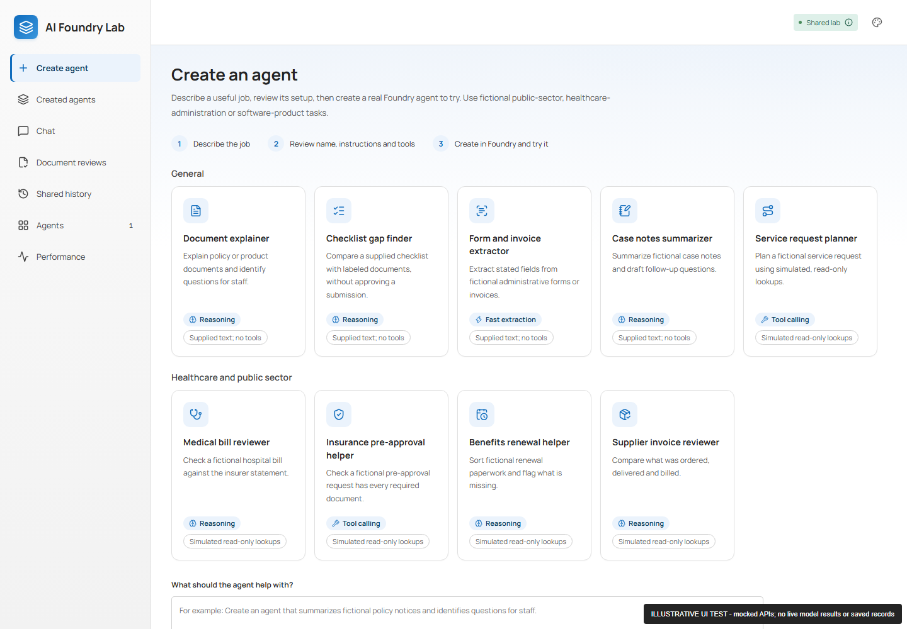

# Create and try a baseline Microsoft Foundry agent

[Home](../README.md) / [Docs](README.md) / [Demo guide](demos.md) / Agent creation

The Lab can prepare a task setup from a reviewed template, publish a real named
Microsoft Foundry hosted agent after operator confirmation, and open that agent
in **Chat**. This guide is for operators and demo leads who need to enable and
try the feature without overstating what it does. The result is a small
demonstration path, not an unrestricted agent designer or production
agent-management service.

## In this guide

- [What a participant can do](#what-a-participant-can-do)
- [How the Lab picks a model](#how-the-lab-picks-a-model)
- [Enable publication](#enable-publication)
- [Configuration ownership](#configuration-ownership)
- [Publication, recovery, and deletion](#publication-recovery-and-deletion)
- [Troubleshooting](#troubleshooting)
- [Verification and honest status](#verification-and-honest-status)
- [Related content](#related-content)

## What a participant can do

**Describe the job -> prepare a setup -> review and confirm -> create in Foundry
-> try it in Chat.**

Nine templates are shown in two groups. The **General** group covers
everyday document jobs. The **Healthcare and public sector** group covers four
common paperwork jobs: checking a hospital bill, preparing an insurance
pre-approval request, sorting a benefits renewal, and checking a supplier
invoice. Their fictional examples suit public-sector, healthcare-operations,
and independent software vendor (ISV) conversations without reproducing any
customer's work or implementation claims. Healthcare examples cover paperwork
only, not clinical advice or real patient data.

**General**

| Template | You give it | You get back |
| --- | --- | --- |
| **Document explainer** | Policy, notice, or product text | A sourced summary, changes, and open questions |
| **Checklist gap finder** | Your checklist and a document | Supported items, missing information, and conflicts. It doesn't make an approval decision. |
| **Form and invoice extractor** | A fictional form or invoice and the fields to pull out | A field table with source references and unknown values called out |
| **Case notes summarizer** | Fictional case notes | A summary, unresolved inconsistencies, and follow-up questions |
| **Service request planner** | A fictional request and service identifiers | Read-only **simulated** lookup results and proposed next steps. It doesn't carry out business actions. |

**Healthcare and public sector**

| Template | You give it | You get back |
| --- | --- | --- |
| **Medical bill reviewer** | A fictional hospital bill and the insurer's statement for the same visit | Likely mistakes (math errors, duplicate charges, amounts above the plan's allowed price) with the math shown, an estimate of what the documents support owing, and an unsent dispute letter. It doesn't contact anyone or pay or refuse the bill. |
| **Insurance pre-approval helper** | A fictional pre-approval request packet | Each required document marked present, missing, or out of date, plus a network check and a draft note to the ordering office. It doesn't approve or submit the request. |
| **Benefits renewal helper** | A family's fictional renewal form and supporting paperwork | What's missing, too old, or doesn't match, what's already on file, and a friendly draft note to the family. It doesn't decide eligibility. |
| **Supplier invoice reviewer** | A fictional supplier invoice and the purchase order number | A line-by-line comparison of what was ordered, delivered, and billed, and the amount the documents support. It doesn't approve payment. |

Each healthcare and public-sector template uses two fixed, simulated,
read-only lookups (for example, plan benefits and usual prices for the medical
bill reviewer). The lookup data is made up for the demo.

Each template card shows the [model profile](#how-the-lab-picks-a-model) the
job uses and whether it has simulated lookups.



*Illustrative UI test with mocked APIs; nothing was published.* ·
[View full size](images/screenshots/lab-create-agent.png)

| Stage | What happens | What does not happen |
| --- | --- | --- |
| Prepare a draft | The Lab uses deterministic templates and the supplied description. | It does not ask a model to design an agent, save a resource, or spend model tokens. An ambiguous description asks for a template instead of guessing. |
| Review setup | You can edit the display name and task instructions before creation. | Tools and runtime policy are fixed by the selected template and cannot be added by a prompt. The first four General templates have no tools, and no template uses specialist delegation. |
| Create in Foundry | Explicit creation publishes a new generated `lab-demo-...` named agent using the Foundry software development kit (SDK). Progress represents actual application stages. | Progress is not a timer pretending to be deployment progress. |
| Try the agent | Ready means the hosted version is active and its Responses route was checked. Send the fictional sample in **Chat** to observe its first actual answer and check quality yourself. | No hidden billable model smoke test runs. |

Templates with tools have exactly two fixed, local, **simulated read-only**
lookups each:

| Template | Lookups |
| --- | --- |
| Service request planner | `lookup_demo_request`, `lookup_demo_service` |
| Medical bill reviewer | `lookup_plan_benefits`, `lookup_usual_price` |
| Insurance pre-approval helper | `lookup_preapproval_rules`, `lookup_facility` |
| Benefits renewal helper | `lookup_renewal_rules`, `lookup_documents_on_file` |
| Supplier invoice reviewer | `lookup_purchase_order`, `lookup_delivery_record` |

They can propose next steps and draft letters or notes, but can't open a ticket,
approve a request or payment, decide eligibility, send a message, or connect to
a customer application. Letters and notes are unsent drafts for a person to
review.

**Chat** can use this ready agent or an enabled prebuilt agent. A chat prompt
does not edit either setup. There is no in-place editor for deployed
instructions.

**Document reviews** remains independent. Its saved checklist/results workflow
uses the existing Lab default agent, not whichever created agent is in **Chat**.
There is no automatic transfer between the two.

The local disconnected preview supports draft preparation only. It cannot
publish, persist a created agent, or produce a live model answer. Browser-test
screenshots with mocked APIs must be visibly labeled as illustrative.

## How the Lab picks a model

Each template names the kind of work it does. The Lab runs the new agent on the
model deployment that the operator set for that kind of work, so different
agents can use different models. Participants don't choose a model, and a chat
prompt can't change it.

| Kind of work | Templates | What the model needs to do |
| --- | --- | --- |
| **Reasoning** | Document explainer, Checklist gap finder, Case notes summarizer, Medical bill reviewer, Benefits renewal helper, Supplier invoice reviewer | Compare sources step by step and keep gaps and conflicts visible |
| **Fast extraction** | Form and invoice extractor | Copy stated values into a fixed structure, where speed and cost matter more than deep reasoning |
| **Tool calling** | Service request planner, Insurance pre-approval helper | Call lookup tools in the right order and report exactly what they return |

The review step shows the chosen deployment and the reason for it. Any kind of
work without its own deployment uses the default one, so a Lab with a single
model still works. Each agent keeps the model it was created with; changing the
settings later affects only new agents.

## Enable publication

Creation is **disabled by default**. Keep the existing private access boundary
and single worker/replica. Before enabling, complete these checks.

1. Confirm an approved Foundry project, existing model deployments with quota,
   working private connectivity, and the Lab's shared Cosmos container. Check
   the pinned SDK/remote-build combination in an approved staging environment.
   To add deployments for the other kinds of work, set
   `additional_model_deployments` in the
   [platform Terraform](../terraform/README.md#1-configure-inputs-and-state).
   Use chat models that support the Responses API and tool calling.
1. Review the Lab managed identity's ability to read, publish, route, and delete
   the new hosted agents. Invocation access alone may be insufficient. This
   feature does not grant roles or alter existing identities or permissions.
1. Create a strong, randomly generated operator key of at least 32 characters,
   preferably through an approved password manager. Store only its lowercase
   SHA-256 UTF-8 verifier in an existing Azure Key Vault secret. Give the raw
   key separately to approved operators; do not commit it or put it in
   Terraform.
1. If using Lab Terraform, configure these nonsecret inputs through the normal
   reviewed rollout:

   ```hcl
   agent_creation_enabled = true
   agent_creation_model   = "gpt-4.1" # default for any kind of work not listed below
   agent_creation_models = {
     reasoning    = "gpt-5.4"
     extraction   = "gpt-5.4-mini"
     tool_calling = "gpt-4.1"
   }
   agent_creation_key_secret_id = "https://your-vault.vault.azure.net/secrets/lab-creation-key-verifier"
   ```

   Use deployment names that exist in your Foundry project; these are
   examples. `agent_creation_models` is optional.

   The secret must contain the **verifier**, not the raw key. Key Vault access
   for the existing Lab identity must already be provisioned by the environment
   owner. The optional reference creates no vault, secret, role assignment, or
   model deployment.
1. Rebuild the Lab image so it includes the reviewed runtime bundle, then use
   the existing approved deployment process. The source-code and test changes do
   not perform a deployment or permission change by themselves.
1. In the private UI, prepare one fictional setup, verify its tools and limits,
   confirm costs/shared visibility, and provide the operator key. Check real
   publication, send its sample, then verify cleanup before inviting an
   audience. Repeat once for each model deployment you use, because models
   differ in how they follow instructions and call tools.

For non-Terraform operators, the equivalent server configuration is:

| Environment variable | Meaning |
| --- | --- |
| `WORKBENCH_AGENT_CREATION_ENABLED` | Exactly `true` to allow new publication/resume; defaults to `false` |
| `WORKBENCH_AGENT_CREATION_MODEL` | Default existing model deployment, used for any kind of work without its own entry; not editable in the browser |
| `WORKBENCH_AGENT_CREATION_MODELS` | Optional JSON object that maps `reasoning`, `extraction`, and `tool_calling` to existing model deployments, for example `{"reasoning":"gpt-5.4","extraction":"gpt-5.4-mini"}` |
| `WORKBENCH_CREATION_KEY_SHA256` | Lowercase, 64-character verifier from a secret reference; never the raw key |
| `WORKBENCH_MAX_CREATED_AGENTS` | Defaults to 5; allowed range 1-20; failed/unconfirmed attempts still count |
| `WORKBENCH_PUBLICATION_TIMEOUT_SECONDS` | Defaults to 600; allowed range 30-900 |

The existing `WORKBENCH_MODE=private`, Foundry endpoint, managed identity,
trusted hosts/origins, and Cosmos configuration still apply. Invalid opt-in
settings fail startup rather than enabling an unprotected creation endpoint.

> [!IMPORTANT]
> The operator key travels only to this backend over the private HTTPS session,
> in `X-Workbench-Creation-Key`. It is not sent to the model, written to Cosmos,
> included in chat exports, or stored in browser persistent storage.

This is a **shared operator gate**, not Microsoft Entra ID sign-in or per-user
resource ownership. Anyone with Lab access can read the shared created-agent
setups and use ready agents. Publication and deletion require the key. Do not
use confidential data.

Disabling new creation does not stop or hide ready created agents. Keep the
valid verifier configured to allow operator deletion while creation is disabled.

## Configuration ownership

| Source | Owns |
| --- | --- |
| [`agent_templates.py`](../workbench/agent_templates.py) | Job descriptions, prepared instructions, examples, conservative matching, fixed public tool metadata, and each template's kind of work |
| [`agent_runtime`](../workbench/agent_runtime) | Reviewed runtime code, immutable policy, allowed tools, and pinned remote-build requirements |
| Creation request and saved record | Chosen template metadata snapshot, edited name/instructions, model deployment chosen for the template's kind of work, generated resource identity, and setup/runtime hashes |
| [`agent_publisher.py`](../workbench/agent_publisher.py) | SDK publication, version/ownership checks, activation polling, route verification, and retirement |
| Server environment / [Lab Terraform](../workbench/infra/main.tf) | Enablement, the default and per-kind model deployments, operator-key verifier, and operational limits |
| Existing [`agents.json`](../workbench/agents.json) and coordinator profiles | Unchanged prebuilt agent catalog, visibility, and specialist bindings; not overwritten by creation |

Only `main.py`, `demo_tools.py`, and `requirements.txt` enter the deterministic
ZIP package. Prompts cannot upload source, install dependencies, select
endpoints, change the model, or register tools. Hosted allocation is fixed at
0.5 CPU / 1 GiB. Remote build uses `python_3_14`, matching the existing
deployer. This runtime identifier is separate from the Lab container's Python
3.13 version.

Changing templates, code, tools, permissions, or model configuration requires a
developer/operator rollout. It does not mutate already published agents.
Created-agent guidance, starter text, and expected tool receipts use the saved
template snapshot, not whichever template definitions a later Lab image
contains. The `created-<UUID>` identifier namespace belongs to saved created
agents; prebuilt catalog entries cannot reuse it.

## Publication, recovery, and deletion

The API saves a typed Cosmos record **before** scheduling remote work. It then
checks that the chosen model deployment exists, uploads the reviewed ZIP
package, records the returned version, waits for activation, sets a 100%
Responses route, and reads the route/version back before marking the agent
ready. If the deployment doesn't exist, publication stops
before anything is uploaded and the record shows as failed. The API does not use
browser-supplied endpoint names or change prebuilt agents.

| Situation | Required behavior |
| --- | --- |
| Repeated creation request | A client universally unique identifier (UUID) identifies one creation request. Repeating the same setup with the same UUID returns the same operation. Changing its setup is a conflict. An uncertain browser response must not trigger a new UUID or automatic retry. |
| Resume after uncertainty | Once submission may have started, **Resume** reconciles the named resource. It never uploads another version merely because a status check returns 404. If submission was definitely never started, **Resume** may perform that original first submission. A missing or unconfirmed cloud outcome stays explicit. |
| Timeout or restart | Timeout, process restart, or an unsuccessful final status write can leave an interrupted record. Refresh checks status; it is not another publication. A failed poll does not mean the hosted operation stopped. |
| Concurrent operations | Creation and deletion are serialized in one process. Conditional Cosmos updates reject stale operators. Multiple Lab workers or replicas would need distributed admission and job ownership; do not enable them here. |
| Ownership checks | Versions must carry this operation's ownership/setup/runtime metadata. Foreign or extra versions and inconsistent routes block automatic promotion or deletion. An owned but unrouted endpoint can be connected without replacing its existing authorization schemes or other protocol configuration. An absent activation status remains pending under the same bounded publication deadline. |
| Deletion | Delete requires the operator key, explicit shared-impact confirmation, and the current ETag. It retires only this created resource after ownership checks and confirms absence. An interrupted deletion must be retried as deletion, not resumed as setup. A 404 after an unconfirmed submission is not sufficient to claim the resource was safely removed. |

Do not edit generated resources through a second control plane during an
operation. Investigate unexpected changes in Foundry with an operator.

Active, failed, and unconfirmed records do not expire while a hosted resource
might still exist. After confirmed deletion, the saved display name and task
instructions are cleared. A small, nonexpiring ID/hash/status tombstone prevents
an old creation request from silently republishing the same agent. Cosmos
backups follow the account policy and are not immediate secure erasure.

Chats and reviews retain their existing 30-day retention and shared access
rules. Export needed conversations **before** deleting their created agent. An
agent that is no longer ready is no longer selectable, and its saved chats are
not available through the active-agent history list. Deleting an agent is not a
blanket deletion of other users' chat documents.

> [!WARNING]
> There is no automatic idle shutdown. Hosted runtime/build costs can continue
> after a browser closes, a request times out, or new creation is disabled.

A maximum record count and publication deadline are not a spending cap. Confirm
cleanup and investigate every uncertain outcome before declaring a demo over.

## Troubleshooting

The browser shows a short message for each error code. The Lab log adds the
agent ID, the operation, and, when Foundry reports one, a short `service_error`
code. It never logs the Foundry error text, prompts, or instructions. To find
failed publications in the Lab's Log Analytics workspace, run this query:

```kusto
ContainerAppConsoleLogs
| where ContainerAppName == "<lab-container-app-name>"
| extend payload = parse_json(extract(@"(\{.*\})", 1, Log))
| where payload.event == "agent_publication_failed"
| project TimeGenerated, payload.agent_id, payload.operation, payload.error, payload.service_error
```

| Code | What it means | What to do |
| --- | --- | --- |
| `model_unavailable` | The template's model deployment doesn't exist in the Foundry project. Nothing was uploaded. | Deploy the model or change `agent_creation_models`. Then delete the failed record and create the agent again. |
| `operator_permissions_required` | Foundry returned 401 or 403 to the Lab's managed identity. | Review the identity's role on the Foundry project. The Lab never grants roles itself. |
| `runtime_failed` | The hosted version was built but didn't become active. | Check `service_error` in the log and open the version in the Foundry portal. `CodeError` means the uploaded package was rejected. For example, Foundry reports "No Python dependency manifest found" when the ZIP entries have no regular-file mode bits. Delete the record, then create the agent again. |
| `publication_timeout` or `publication_unconfirmed` | The Lab couldn't confirm the outcome. Foundry work may still be running. | Select **Refresh status**, then **Resume setup** on the same record. Don't start a new creation. |
| `resource_changed` | The Foundry agent, its versions, or its route no longer match this record, often after a change made outside the Lab. | Inspect the agent in Foundry with an operator. The Lab stops making automatic changes. |
| `runtime_changed` | The runtime bundle changed, usually after a new Lab image, before this setup was published. | Delete the unused record and prepare a new setup. |
| `deletion_unconfirmed` | The Lab couldn't confirm that the hosted agent was removed. | Select **Delete created agent** again on the same record. If Foundry is still building or provisioning, it rejects deletion with 409 `agent_operation_running`, so wait a few minutes first. |

## Verification and honest status

Offline tests cover drafts, model choice for each template, strict inputs,
operator/origin checks, idempotency, single-flight/quota behavior,
persistence-before-mutation, restart recovery, owned routing/deletion, SDK
model/ZIP contracts, created-agent chat/history, and desktop/mobile UI flows.
Continuous integration (CI) includes the runtime and API checks.

Those tests do not establish live Azure permissions, private connectivity,
remote-build support, model availability, answer quality, or actual charges.
Complete the approved staging checks above and record the difference between
source availability, enabled configuration, and observed execution in the
[demo handoff](demo-handoff.md). This is not an officially approved Microsoft
offering or an implemented customer solution.

On 2026-09-23, one private dev environment ran a live check with the pinned SDK.
Three templates, each on a different model deployment (`gpt-5.4`,
`gpt-5.4-mini`, and `gpt-4.1`), were published, answered a sample review, and
were deleted. Later that day, the four healthcare and public-sector templates
were published the same way. Each called its simulated lookups, the Lab
verified every tool call, each answer found the main problems planted in its
fictional sample, and all four agents were deleted. That shows the flow can
work there; it doesn't prove it works in another environment, subscription,
region, or SDK version.

## Related content

- [Terms used in these guides](README.md#terms-used-in-these-guides)
- [Agent names](README.md#agent-names)
- [The Lab](../workbench/README.md)
- [Document reviews](review-workflow.md)
