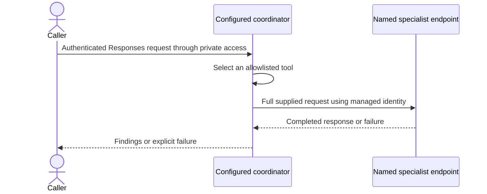

# Coordinator profiles

[Home](../README.md) / [Docs](README.md) / Coordinator profiles

Use coordinator profiles to point the review coordinator at a reviewed set of
instructions, specialist bindings, and smoke checks. Profiles let an operator
swap a bounded use case without changing Terraform or editing coordinator
Python. They configure hosted agents in Microsoft Foundry.

## In this guide

- [Ownership boundaries](#ownership-boundaries)
- [How profiles appear in the Lab](#how-profiles-appear-in-the-lab)
- [Runtime flow](#runtime-flow)
- [Specialist contract](#specialist-contract)
- [Select a use case](#select-a-use-case)
- [Swap lifecycle](#swap-lifecycle)
- [Isolation and remaining gates](#isolation-and-remaining-gates)

## Ownership boundaries

| Layer | Owns | Changes when the use case changes? |
| --- | --- | --- |
| Terraform platform | Foundry, model deployment, private networking, identities, observability, optional Azure API Management (APIM), and administration. | Only for different capacity, tools, regions, or isolation requirements. |
| Hosted specialist | Runtime code, pinned dependencies, instructions, tool permissions, and Responses contract. | Yes, independently versioned. |
| Coordinator profile | Coordinator name and instructions, allowed specialist bindings, and mandatory smoke prompts. | Yes, without editing coordinator Python. |
| Client entry point | Authentication, caller authorization, request limits, and error contract. | Usually stable; APIM route remains unpublished. |

The existing review coordinator is the default sample, not a platform
dependency. No graphical user interface (GUI), Teams channel, Redis, dynamic
plugin installer, or tenant-wide identity changes are required by this profile
mechanism.

## How profiles appear in the Lab

The Lab has two explicit paths: prebuilt agents and
[opt-in creation from prepared templates](agent-creation.md). A coordinator
profile remains a developer configuration input, not proof that a runtime
exists. Preparing a template draft also does not create a resource; the
operator-confirmed publication action does that.

**Chat uses the selected configured agent**; it does not create or configure
one. A scenario starter is a task and sample message, not a new profile or
runtime. Only explicitly enabled prebuilt agents and ready agents created in
this Lab can be used in Chat. New creation does not expose hidden catalog
entries.

| Display name | Unchanged catalog ID | Runtime configuration source |
| --- | --- | --- |
| **Application and case helper** | `customer-review` | [Example coordinator profile](../hosted-agents/review-coordinator-agent/profiles/evidence-review.example.json), published as `customer-review-coordinator`. |
| **Application and case helper (base setup)** | `review-coordinator` | [Base instructions](../hosted-agents/review-coordinator-agent/instructions.md) and [runtime defaults](../hosted-agents/review-coordinator-agent/main.py), published as `review-coordinator-agent`. |
| **Application checker** | `application-review` | [Application instructions](../hosted-agents/application-review-agent/instructions.md) and that specialist's deployment. |
| **Case notes summarizer** | `case-review` | [Case instructions](../hosted-agents/case-review-agent/instructions.md) and that specialist's deployment. |

The two coordinator entries offer the **same application and case review jobs**.
The example uses `inspect_application` and `inspect_case`; the base setup uses
`review_application` and `review_case`. Both call the same two specialists and
can ask what input is needed. Keeping both IDs preserves existing routes and
visibility choices, not a claim that they are different scenarios.

The deployed version's instructions and environment settings govern runtime
behavior. Profile publication captures its instructions and `SPECIALIST_CONFIG`.
Without a profile, the base files and defaults apply unless the deployed
environment explicitly overrides them. Changing source files alone does not
update a running agent. Runtime-instruction changes require publication and live
acceptance checks under the existing deployment process.

[`workbench/agents.json`](../workbench/agents.json) owns display names,
getting-started guidance, starters, the Lab's endpoint map, and the expected
receipt map. It does **not** register tools or change agent instructions.
Rebuild and redeploy the Lab for those changes, and keep its map aligned with
the runtime. [Lab settings](../workbench/README.md#workspace-configuration)
separately own the visible entries, default agent, and title. Neither selection
nor prompt editing is an administrative control.

The new templates do not modify these profiles or specialist bindings. Document
explainer, Checklist gap finder, Form and invoice extractor, and Case notes
summarizer are single-agent supplied-text jobs without tools. Service request
planner, Medical bill reviewer, Insurance pre-approval helper, Benefits renewal
helper, and Supplier invoice reviewer each have two local fictional-data
lookups, not specialist delegation or live integration. The
saved creation setup owns its task instructions; [`agent_runtime`](../workbench/agent_runtime)
owns the immutable policy and tool allowlist. Each is published as its own
generated `lab-demo-...` runtime name. Created-agent display names are
independent of that runtime name.

## Runtime flow



The coordinator owns the conversation; specialists are tools, not
conversational handoffs. Profiles change the tool set, not the orchestration
algorithm. Explicit deterministic routing, sequential workflows, and background
jobs remain separate future features. Arbitrary endpoints and caller-supplied
tool registrations are not supported.

See the [agent-collaboration view](architecture.md#agent-collaboration) for the
default roles and the distinction between agent output and human review.

## Specialist contract

- A deployed named agent in the same Foundry project exposes the Responses
  protocol.
- It accepts a string request containing the required evidence and context.
- It returns a completed response with nonempty text or fails explicitly.
- The coordinator wraps successful output in a receipt containing `status`,
  `agent`, and `output`, correlated to the function call by `call_id`.
- Default calls use a 90-second deadline, no transport retries, and a shared
  four-call concurrency limit per coordinator process. Cancellation does not
  guarantee remote execution stops.

This is an invocation contract, not a structured findings schema or evidence
accuracy guarantee. New specialists need their own evaluations and reviewed
permissions. Do not assume the default review prompts are suitable for a new
domain.

### Example handoff

This illustrates the existing default `review_application` tool, not a captured
model response or a new message schema. Its `request` argument is one text
string. A clear request carries the task, all supplied evidence, source IDs, and
the decision boundary together:

```text
Task: Check application completeness against the supplied criterion.
Criterion: CRIT-1 requires a project budget.
Evidence: APP-1 describes three workshops with two facilitators.
          No budget or costs are supplied.
Return: Findings tied to the source IDs, gaps, and a follow-up question.
Boundary: Do not approve or deny the application.
```

The specialist returns text. Only after its response completes successfully and
contains nonempty output does the coordinator's tool wrapper produce this shape:

```json
{
  "status": "succeeded",
  "agent": "application-review-agent",
  "output": "CRIT-1 is not demonstrated by APP-1. Ask for the project budget."
}
```

`call_id` belongs to the surrounding Responses `function_call` and
`function_call_output`, not to this JSON object. The Lab matches that ID, the
configured tool name, and the expected agent. The example profile below uses
`inspect_application` instead; verification must follow the configured binding,
not assume every profile uses the default tool name.

> [!IMPORTANT]
> Completed execution is not verified truth. The `output` field is text, not a
> strict findings schema. Source references and factual claims still need
> review.

The optional structured-review workflow adds its own
[schema, coverage, and quote checks](review-workflow.md#execution-and-trust).
In the Lab this is **Document reviews**. The backend supplies its JSON schema;
coordinators pass the schema, checklist, and text to the specialist. Specialist
instructions use that requested format instead of ordinary Chat prose sections.
Offline schema tests do not establish live model adherence to the instructions.

| Situation | Expected handling |
| --- | --- |
| The request type is unclear | Ask one concise question before delegating. |
| Evidence is missing or contradictory | Preserve the gap or conflict and ask for clarification; do not invent a source or choose an unsupported fact. |
| A specialist fails, times out, or returns empty output | No successful tool receipt is produced. The coordinator is instructed to report an incomplete review, not replace the specialist with its own answer. |
| A response names a specialist but has no matching tool record | Do not present that name alone as proof of delegation. |

The [tool implementation](../hosted-agents/review-coordinator-agent/main.py)
defines the invocation and result wrapper. Each call uses the configured
deadline and shared process-local concurrency limit, with no automatic transport
retries. Specialists do not inherit shared conversation memory; the coordinator
must pass the context they need in each request.

## Select a use case

This is Python agent publication, not a Terraform deployment. Complete each
step before continuing; offline validation does not authorize a live mutation.

### 1. Choose and review the profile

The [example profile](../hosted-agents/review-coordinator-agent/profiles/evidence-review.example.json)
binds differently named tools to the two existing review specialists. It uses a
separate coordinator name so trying the example does not overwrite the default
coordinator's route. It creates another billable agent only when deployed.

### 2. Validate offline

Run from the repository root without Azure access or runtime software
development kit (SDK) packages:

```powershell
python hosted-agents/review-coordinator-agent/deploy.py --profile hosted-agents/review-coordinator-agent/profiles/evidence-review.example.json --validate-profile
```

### 3. Prepare and inventory the private deployment

Follow steps 1 through 4 of the [private deployment runbook](private-deployment.md).
Stage the selected profile with the coordinator, install its requirements, and
set the verified project and model inputs. Confirm every bound specialist is
active and independently tested; record the current coordinator route before
mutation.

### 4. Deploy the reviewed profile

From the staged `hosted-agents` directory, use the runbook's `$python`
executable:

```powershell
& $python review-coordinator-agent/deploy.py --profile review-coordinator-agent/profiles/evidence-review.example.json
if ($LASTEXITCODE -ne 0) { throw 'Profile deployment or specialist verification failed' }
```

This creates a version and changes routing. Require all mandatory checks and
verify the new route using runbook steps 6 and 7; inspect failures before
retrying.

Without `--profile`, the existing review coordinator behavior is preserved. With
a profile, name and instructions belong in the profile; CLI overrides and
`FOUNDRY_HOSTED_AGENT_NAME` are rejected. The validated registry is captured in
the immutable version's `SPECIALIST_CONFIG` environment variable. This takes
precedence over the legacy application/case agent-name environment variables.
Profiles contain configuration and smoke-test prompts, never credentials or
customer records. They do not create specialists or grant role-based access
control (RBAC) automatically.

## Swap lifecycle

1. Deploy and independently test the replacement specialist. Verify its named
   endpoint, active version, model access, and downstream permissions privately.
2. Edit the profile's specialist binding, description, routing instructions, and
   smoke-test prompts together. Every tool needs at least one smoke test.
3. Run offline validation and the local tests. Duplicate tools, malformed names,
   unknown test tools, missing coverage, and direct self-delegation are rejected.
4. Serialize deployment per coordinator. Stage `deployment.py`, coordinator
   `deploy.py`, `main.py`, `configuration.py`, both requirements files, default
   `instructions.md`, and the selected profile. Do not stage the full
   repository.
5. Deploy a new coordinator version. Before creating it, the deployment tool
   reads each profile-bound specialist's named endpoint and verifies Responses
   configuration, fixed-ratio traffic totaling 100 percent, and active versions
   for every nonzero traffic rule. Missing endpoints, unsupported routes, or
   read failures stop deployment without creating a coordinator version. This
   check uses the deployment identity; it does not prove runtime identity
   permissions. After promotion, every mandatory smoke check verifies the tool,
   correlated successful output, and expected agent name. Generic smoke-test
   overrides cannot disable these checks.
6. Confirm the new route. Failure triggers conservative restoration and cleanup;
   candidate traffic is exposed during checks. Retain recovery dependencies.
7. Retire an old specialist deliberately only after all consumers and recovery
   versions stop depending on it. Removing a binding does not delete an agent.

Bindings point to named endpoints, not pinned specialist versions. Updating a
specialist's route affects every coordinator bound to that name. Use a different
specialist name for incompatible changes. Rolling back a coordinator alone does
not roll back its dependencies. Preflight is a point-in-time read, not a lock on
specialist routes. Serialize dependent changes and retain live delegation
checks. Indirect delegation cycles are not detected; keep specialist graphs
bounded and avoid coordinator-to-coordinator cycles.

## Isolation and remaining gates

A profile is not an authorization or tenancy boundary. Use separate Foundry
projects and scoped identities for independent customer trust boundaries;
separate networks and resources where required. Do not let an end user select a
profile, agent name, or record they are not authorized to access.

Keep APIM publication gated on a reviewed audience and caller authorization. The
[opt-in APIM API](apim-review-api.md) can select the coordinator by name; no
public review API is published by this work. The
[platform-aware cost calculator](../cost-comparison/README.md) lists missing
platform prices explicitly. Review [credential handling](credentials.md) and
follow the [private deployment runbook](private-deployment.md).
