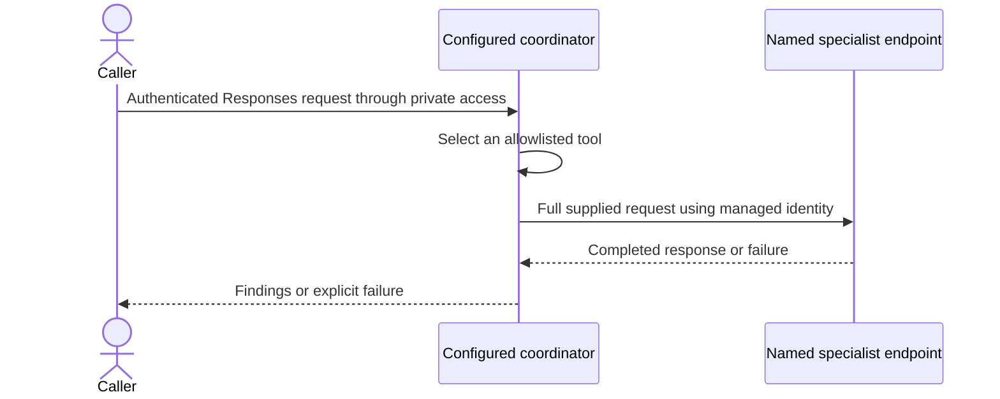

# Platform and swappable agent profiles

[Overview](../README.md) / Agent profiles

## Ownership boundaries

| Layer | Owns | Changes when the use case changes? |
| --- | --- | --- |
| Terraform platform | Foundry, model deployment, private networking, identities, observability, optional APIM and administration | Only for different capacity, tools, regions, or isolation requirements |
| Hosted specialist | Runtime code, pinned dependencies, instructions, tool permissions, Responses contract | Yes, independently versioned |
| Coordinator profile | Coordinator name and instructions, allowed specialist bindings, mandatory smoke prompts | Yes, without editing coordinator Python |
| Client entry point | Authentication, caller authorization, request limits, error contract | Usually stable; APIM route remains unpublished |

The existing review coordinator is the default sample, not a platform dependency.
No GUI, Teams channel, Redis, dynamic plugin installer, or tenant-wide identity
changes are required by this profile mechanism.

## Runtime flow



The coordinator owns the conversation; specialists are tools, not conversational
handoffs. Profiles change the tool set, not the orchestration algorithm. Explicit
deterministic routing, sequential workflows, and background jobs remain separate
future features. Arbitrary endpoints and caller-supplied tool registrations are
not supported.

## Specialist contract

- A deployed named agent in the same Foundry project exposes the Responses protocol.
- It accepts a string request containing the required evidence and context.
- It returns a completed response with nonempty text or fails explicitly.
- The coordinator wraps successful output in a receipt containing `status`,
  `agent`, and `output`, correlated to the function call by `call_id`.
- Default calls use a 90-second deadline, no transport retries, and a shared
  four-call concurrency limit per coordinator process. Cancellation does not
  guarantee remote execution stops.

This is an invocation contract, not a structured findings schema or evidence
accuracy guarantee. New specialists need their own evaluations and reviewed
permissions. Do not assume the default review prompts are suitable for a new domain.

## Select a use case

This is Python agent publication, not a Terraform deployment. Complete each
step before continuing; offline validation does not authorize a live mutation.

### 1. Choose and review the profile

The [example profile](../hosted-agents/review-coordinator-agent/profiles/evidence-review.example.json)
binds differently named tools to the two existing review specialists. It uses a
separate coordinator name so trying the example does not overwrite the default
coordinator's route. It creates another billable agent only when deployed.

### 2. Validate offline

Run from the repository root without Azure access or runtime SDK packages:

```powershell
python hosted-agents/review-coordinator-agent/deploy.py --profile hosted-agents/review-coordinator-agent/profiles/evidence-review.example.json --validate-profile
```

### 3. Prepare and inventory the private deployment

Follow steps 1 through 4 of the [private deployment runbook](private-deployment.md).
Stage the selected profile with the coordinator, install its requirements, and
set the verified project/model inputs. Confirm every bound specialist is active
and independently tested; record the current coordinator route before mutation.

### 4. Deploy the reviewed profile

From the staged `hosted-agents` directory, use the runbook's `$python` executable:

```powershell
& $python review-coordinator-agent/deploy.py --profile review-coordinator-agent/profiles/evidence-review.example.json
if ($LASTEXITCODE -ne 0) { throw 'Profile deployment or specialist verification failed' }
```

This creates a version and changes routing. Require all mandatory checks and
verify the new route using runbook steps 6 and 7; inspect failures before retrying.

Without `--profile`, the existing review coordinator behavior is preserved.
With a profile, name and instructions belong in the profile; CLI overrides and
`FOUNDRY_HOSTED_AGENT_NAME` are rejected. The validated registry is captured in
the immutable version's `SPECIALIST_CONFIG` environment variable. This takes
precedence over the legacy application/case agent-name environment variables.
Profiles contain configuration and synthetic prompts, never credentials or
customer records. They do not create specialists or grant RBAC automatically.

## Swap lifecycle

1. Deploy and independently test the replacement specialist. Verify its named
   endpoint, active version, model access, and downstream permissions privately.
2. Edit the profile's specialist binding, description, routing instructions, and
   synthetic smoke prompts together. Every tool needs at least one smoke test.
3. Run offline validation and the local tests. Duplicate tools, malformed names,
   unknown test tools, missing coverage, and direct self-delegation are rejected.
4. Serialize deployment per coordinator. Stage `deployment.py`, coordinator
   `deploy.py`, `main.py`, `configuration.py`, both requirements files, default
   `instructions.md`, and the selected profile. Do not stage the full repository.
5. Deploy a new coordinator version. Before creating it, the deployment tool
   reads each profile-bound specialist's named endpoint and verifies Responses
   configuration, fixed-ratio traffic totaling 100 percent, and active versions
   for every nonzero traffic rule. Missing endpoints, unsupported routes, or read
   failures stop deployment without creating a coordinator version. This check
   uses the deployment identity; it does not prove runtime identity permissions.
   After promotion, every mandatory smoke check verifies the tool, correlated
   successful output, and expected agent name. Generic smoke-test overrides
   cannot disable these checks.
6. Confirm the new route. Failure triggers conservative restoration/cleanup;
   candidate traffic is exposed during checks. Retain recovery dependencies.
7. Retire an old specialist deliberately only after all consumers and recovery
   versions stop depending on it. Removing a binding does not delete an agent.

Bindings point to named endpoints, not pinned specialist versions. Updating a
specialist's route affects every coordinator bound to that name. Use a different
specialist name for incompatible changes. Rolling back a coordinator alone does
not roll back its dependencies. Preflight is a point-in-time read, not a lock on
specialist routes. Serialize dependent changes and retain live delegation checks.
Indirect delegation cycles are not detected;
keep specialist graphs bounded and avoid coordinator-to-coordinator cycles.

## Isolation and remaining gates

A profile is not an authorization or tenancy boundary. Use separate Foundry
projects and scoped identities for independent customer trust boundaries;
separate networks/resources where required. Do not let an end user select a
profile, agent name, or record they are not authorized to access.

Keep APIM publication gated on a reviewed audience and caller authorization.
The [opt-in APIM API](apim-review-api.md) can select the coordinator by name;
no public review API is published by this work. The
[platform-aware cost calculator](../cost-comparison/README.md) lists missing
platform prices explicitly. Review [credential handling](credentials.md)
and follow the [private deployment runbook](private-deployment.md).