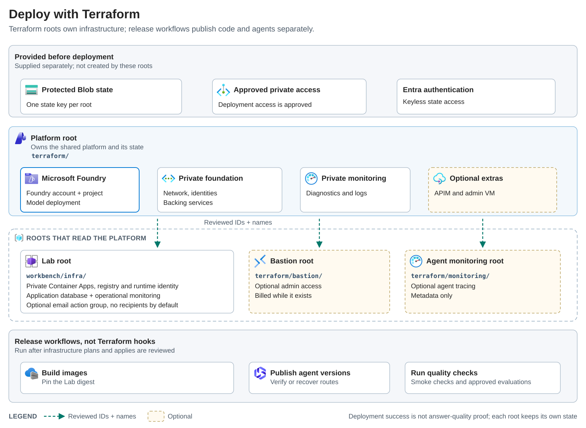

# Microsoft Foundry extension guide

[Home](../README.md) / [Docs](README.md) / [Architecture](architecture.md) / Extension guide

Use this guide to add independent agent examples without rebuilding the
platform. You will compare Foundry capabilities, confirm the Terraform,
software development kit (SDK), and networking fit, and complete an onboarding
checklist before you publish a new example.

> [!IMPORTANT]
> This guide is optional engineering guidance. It is not an engagement
> deliverable, an approved or funded service offering, or a production-readiness
> claim. Integration with customer systems and production deployment require
> separate scoping and agreement.

## At a glance

| Decision | Recommendation | Why it matters |
| --- | --- | --- |
| Demonstration scope | Start with one fictional scenario, expected findings, and a human-decision boundary. | Four scenarios do not require four independent agents. |
| Agent type | Choose the least complex supported Foundry capability that meets the example requirement. | A hosted coordinator is useful for custom code and delegation, but it should not be the default for every agent. |
| Platform ownership | Keep infrastructure declarative and keep agent releases separate from Terraform. | The sample already has separate platform, Lab, Bastion, and monitoring roots with their own state. |
| Data and identity | Validate permissions, retention, tracing content, and private connectivity before adopting a capability. | A working connection or public service feature does not prove this repository has validated it. |
| Quality | Use reviewed inputs, expected outcomes, smoke checks, and versioned evaluation cases. | A nonempty answer alone does not pass. |

## In this guide

- [Demonstration first](#demonstration-first)
- [Design principles](#design-principles)
- [Terraform-first deployment](#terraform-first-deployment)
- [Capability comparison](#capability-comparison)
- [Ownership and fit](#ownership-and-fit)
- [Boundaries to preserve](#boundaries-to-preserve)
- [Acceptance criteria for extensions](#acceptance-criteria-for-extensions)
- [Capability and compatibility baseline](#capability-and-compatibility-baseline)
- [Public service and SDK guidance](#public-service-and-sdk-guidance)
- [Onboarding checklist for each customer example](#onboarding-checklist-for-each-customer-example)
- [Features to evaluate only when needed](#features-to-evaluate-only-when-needed)
- [Related content](#related-content)

## Demonstration first

Start with [one scenario](demos.md), fictional inputs, expected findings, and a
clear human-decision boundary. Casework and application completeness reuse the
prebuilt agents. **Preview** proposal coverage reuses application review and
Document reviews. Business-request triage isn't included;
review-specialist routing is not a substitute for simulated request routing and
human approval.

The primary path excludes live customer-system connections, Microsoft 365,
Copilot, SharePoint integration, education knowledge assistants, and production
deployment. Finish with the [evidence-based handoff](demo-handoff.md), not a
production-readiness claim.

## Design principles

Keep the existing foundation. Make independent agents easy to add, deploy,
evaluate, and demonstrate on Microsoft Foundry. Keep the Lab a bounded
create-and-try client; Document reviews is one optional workflow, not the
platform's purpose.

Let concrete agent requirements drive extensions. The implemented, opt-in
[creation flow](agent-creation.md) publishes prepared hosted-agent templates,
then opens ready agents in Chat. It is not an unrestricted agent designer:
fixed code and tools, strict inputs, a shared operator-key gate, explicit cost
confirmation, and persisted publication status limit its scope. Preparing a
setup or choosing **New chat** is not resource creation. The source adds the
publication API and optional configuration, but does not grant permissions or
deploy resources. Operators must validate their private project, managed
identity, model availability, and quota before enabling it.

## Terraform-first deployment

Use the Microsoft references as design guidance, not as a replacement for the
working foundation. This repository already uses the Foundry Azure Verified
Module (AVM), with AzureRM and AzAPI for the surrounding resources. Keep
infrastructure declarative; keep image builds, agent releases, and quality
checks as explicit delivery steps.

<picture>
  <source media="(prefers-color-scheme: dark)" srcset="images/foundry-deployment-dark.svg">
  
</picture>

[View full size](images/foundry-deployment.svg) · [Edit the SVG template](images/foundry-deployment.template.svg)

### Microsoft references to reuse carefully

| Reference | Useful guidance | Fit for this repository |
| --- | --- | --- |
| [Microsoft Foundry baseline sample](https://github.com/Azure-Samples/microsoft-foundry-baseline) | Separate private infrastructure, application publishing, and agent deployment. | Its infrastructure implementation is Bicep, not Terraform. Reuse the design decisions, not a second competing deployment. |
| [Foundry architecture](https://learn.microsoft.com/azure/foundry/concepts/architecture) | Accounts, projects, and connected Azure services have distinct responsibilities and access boundaries. | Keep resource ownership clear. A project connection does not transfer ownership of the connected service. |
| [Baseline chat architecture](https://learn.microsoft.com/azure/architecture/ai-ml/architecture/baseline-microsoft-foundry-chat) | Private endpoints and DNS, scoped identities, controlled egress, monitoring, and recovery planning. | Use it as a hardening checklist. The Lab does not implement the full gateway, firewall, or availability design. |
| [Basic chat architecture](https://learn.microsoft.com/azure/architecture/ai-ml/architecture/basic-microsoft-foundry-chat) | A simpler learning application with a clear browser-to-backend-to-model path. | Borrow the clarity, not its public-network defaults. Its linked sample is also Bicep; it is not a production baseline. |
| [Build and deploy custom models](https://learn.microsoft.com/azure/architecture/ai-ml/architecture/build-deploy-custom-models) | A document-processing design that separates ingestion, storage, model training, and inference. | Relevant only when a later scenario needs extraction or a trained model. It supplies no Terraform implementation and is not a reason to add training infrastructure to this review demo. |
| [AI Landing Zones](https://azure.github.io/AI-Landing-Zones/#extensible-implementations) | Reusable Foundry and AI gateway foundations, with separate platform and workload responsibilities. | The strongest Terraform starting point. It links to the Foundry AVM already used here, a broader landing-zone module, and a separate gateway implementation. |

The [Foundry AVM](https://registry.terraform.io/modules/Azure/avm-ptn-aiml-ai-foundry/azurerm/latest)
is the closest fit for this sample. For a separately scoped enterprise
deployment, also consider the
[AI landing-zone Terraform module](https://github.com/Azure/terraform-azurerm-avm-ptn-aiml-landing-zone)
and [AI Gateway Terraform implementation](https://github.com/Azure/terraform-ai-gateway-landing-zone).
They are alternatives to assess, not dependencies to add automatically.

The landing-zone project is marked preview and does not claim complete
[Bicep/Terraform runtime parity](https://github.com/Azure/AI-Landing-Zones/blob/main/docs/terraform-parity.md).
Module and provider constraints differ across the implementations. Keep this
repository's pins until a coordinated upgrade is tested. Do not merge example
roots or point a new module at existing resources without an ownership and state
migration plan. Review deletion and purge behavior as well as creation.

### What Terraform owns here

| Owner | Resources or work | Boundary |
| --- | --- | --- |
| [Platform Terraform](../terraform/) | Foundry account, Foundry project, model deployment, agent backing services, workload and management networks, private endpoints and DNS, identities and role-based access control (RBAC), and private diagnostics. Azure API Management (APIM) and the admin virtual machine are optional. | Keep existing resource names, protected resources, and the platform state key. Azure AI Search is a backing service, not an implemented review-agent retrieval tool. |
| [Lab Terraform](../workbench/infra/) | Internal Container Apps hosting, private registry, runtime identity, application Cosmos DB database and containers, private logs, and operational alert rules. Optional email action group. | Separate state. Reference platform resources without managing them a second time. Application records stay separate from Agent Service's internal data structures. |
| Existing environment owners | Protected Terraform backend, approved deployment access, any organization-owned hub, central DNS, policy, and existing notification groups. | The sample does not deploy an enterprise landing zone or automatically integrate with one. Reuse shared services only through a reviewed integration. |
| [Application and agent release workflows](../hosted-agents/README.md) | Build and publish images, select an immutable Lab digest, publish agent versions, verify routing, and recover failed releases. | Terraform sets the Lab's image reference; release scripts produce and verify the artifact. Do not hide these steps in Terraform `local-exec` hooks. |
| [Quality checks](../evaluations/README.md) | Offline tests, approved private smoke checks, and optional paid model evaluations. | Successful resource deployment does not establish agent quality or trace coverage. |

The AVM bring-your-own-resources (BYOR) path is already enabled with Agent
Service: the platform root owns Cosmos DB and agent storage, and the AVM creates
Azure AI Search and Key Vault. BYOR does not mean these resources already have
separate Terraform state. Moving them to a central owner would need an explicit
migration.

### A small implemented improvement: alert delivery

The Lab can now
[create an optional email action group with Terraform](../workbench/README.md#terraform-managed-alert-delivery)
instead of requiring every notification group to be created elsewhere. It can
also continue to reference existing groups, or use both. Defaults stay unchanged:
no recipients, no extra action group, and no public ingress. These are
operational alerts, not a new email tool for agents.

### Extensions to scope separately

- **Private tracing:** verify project-linked Application Insights, agent support,
  retention, and content-capture policy before adding resources or
  instrumentation. Log Analytics diagnostics alone do not prove end-to-end agent
  tracing.
- **Enterprise networking:** agree who owns the hub, egress firewall, DNS,
  routes, and deployment runners before connecting this workload. Do not
  duplicate central services or enable a costly firewall only to match a
  reference diagram.
- **Broader application access:** use the [ingress guide](ingress-access.md) for
  a separately reviewed gateway. User authentication and record authorization
  remain separate application work.
- **Resilience or custom-model processing:** choose these for an actual
  availability, recovery, or document-processing requirement. They add
  resources, operating costs, and validation work; they are not prerequisites for
  this demo.

## Capability comparison

Choose the simplest supported capability that satisfies the example. Use this
comparison before adding a new service, custom orchestration layer, or
integration.

| Capability | Good fit | Boundary to check |
| --- | --- | --- |
| Prompt agent | Configuration-led use cases that do not need custom code. | Prompt-agent delivery would need a small separate path; the existing deployer publishes hosted code. |
| Hosted agent | Custom Python code, validated packaging, or controlled specialist tools. | Preserve immutable versions, deployment preflight, private ingress checks, and route verification. |
| Coordinator with specialists | Independently useful specialists with explicit handoffs. | More agents add latency, cost, and failure modes. Do not use a hosted coordinator for every example by default. |
| Direct Responses call from the Lab | App-owned logic where the Lab should own prompts, records, and controls. | Keep Responses as the current contract. Add an adapter only for a concrete example needing a different contract. |
| Native retrieval or toolboxes | Approved data sources or tools that multiple examples need. | A Search connection alone is not retrieval or document authorization. Validate identity, private routing, versioning, and freshness. See the [knowledge retrieval design](knowledge-retrieval.md). |
| Managed conversations, background work, or resilience | Examples that need native recovery or state after retention requirements are clear. | Background acceptance alone is not durable recovery or exactly-once side effects. Test against pinned SDK and runtime versions. |
| Customer channels or Azure API Management (APIM) | A specific governed API or supported channel requirement. | APIM stays disabled unless its cost, policy, authorization, and networking are reviewed. Native publishing can fit some channels better. |

## Ownership and fit

| Concern | What this repository has | What Foundry provides | Recommended boundary |
| --- | --- | --- | --- |
| Platform | Terraform, private networking, model deployment, managed identities, separate platform and Lab state. | Agent hosting, endpoints, identities, model access, and managed runtime lifecycle. | Keep Terraform for infrastructure and permissions; keep agent publication separate. |
| Agent implementation | Python hosted samples and a shared version deployer. | Prompt agents for configuration-led use cases; hosted agents for custom code; direct Responses calls for app-owned logic. | Choose the least complex supported type per example. Do not require a hosted coordinator for every agent. |
| Invocation | The Lab calls configured named agent Responses endpoints by using managed identity. | Responses protocol and additional protocols for other client needs. | Keep Responses as the current Lab contract. Add an adapter only for a concrete example needing a different contract. |
| Tools and knowledge | Custom specialist function tools; connected backing Search, but no deployed retrieval tool. An optional, flag-gated case-agent lookup is designed but off by default ([knowledge retrieval design](knowledge-retrieval.md)). | Managed tools, versioned toolboxes, Model Context Protocol (MCP) or OpenAPI integrations, and Search retrieval. | Prefer a supported native integration when permissions and private connectivity fit; keep domain-specific code in the agent. |
| Conversation state | Explicitly saved shared Cosmos DB transcripts; bounded history resubmitted with `store=False`. | Managed conversations and sessions. | Preserve current behavior until retention and authorization are decided. Avoid silently enabling a second transcript store. |
| Long-running work | Optional review records with local background tasks and interruption reporting. | Background Responses and separately configured resilient execution. | Evaluate native recovery first when an example needs it. Background acceptance alone is not durable recovery or exactly-once side effects. |
| Quality and diagnostics | Unit and browser tests, deployment smoke checks, opt-in fictional Foundry evaluations, metadata logs, and session timings. | Agent tracing, Application Insights integration, and evaluations. | Keep test cases and acceptance thresholds in source; use Foundry for evaluation and diagnostic analysis, not a new Lab dashboard. |
| Customer access | Private Lab with shared records and no end-user sign-in. | Agent Entra identities, RBAC, supported publishing, and channel integrations. | Agent identity does not authorize individual Lab users. Add user authorization before confidential multi-user use. |

The existing [component map](architecture.md#component-interactions) remains the
implementation reference.

## Boundaries to preserve

- **Infrastructure:** network, identities, service dependencies, capacity, and
  operational controls. Adding another agent should not require rebuilding the
  infrastructure unless the agent introduces new access, isolation, region, or
  capacity needs.
- **Agent sample:** instructions, model choice, custom code when needed,
  approved tools, example inputs, expected behavior, and evaluation cases.
- **Delivery:** immutable versions, dependency preflight, approved promotion,
  verified invocation, and a recorded recovery target.
- **Lab:** select an allowed agent, submit input, display its answer, and
  optionally save or export the conversation. Agent internals should not dictate
  the shell.
- **Example-specific state:** review criteria, evidence snapshots, and findings
  belong to that example. Other agents do not need to emit the review JSON schema
  or custom specialist success receipts.

The [catalog](../workbench/agents.json) already separates display names, named
endpoints, and starter prompts. Its `tools` bindings describe custom specialist
receipt verification, not a universal registry for every Foundry tool. Preserve
that distinction when adding retrieval or action agents.

The [profile mechanism](agent-profiles.md) configures one coordinator pattern.
It is neither a generic agent definition format nor a customer isolation
boundary. Reuse it for examples that actually need that delegation pattern, not
by default.

## Acceptance criteria for extensions

| Area | Requirement |
| --- | --- |
| Sample onboarding | A new example can be deployed and demonstrated without editing the Lab's chat logic or unrelated platform resources. Reuse the deployer where compatible and configure catalog visibility explicitly. |
| Quality | Use reviewed inputs, expected outcomes, and failure cases. Record dataset and agent/model versions with evaluation thresholds; a nonempty answer alone does not pass. |
| Tracing | A controlled request can be followed from Lab request ID to agent/tool execution through the private setup, with approved content capture. |
| Reproducibility | Record source revision, dependencies, agent/model versions, tool bindings, and environment in non-secret deployment records. Preserve an identifiable recovery target. |
| Workflow compatibility | Plain chat agents must not require review-specific JSON or specialist receipts. Offer evidence-review actions only for compatible agents. |

Generalize behavior only when another example demonstrates a real shared need.

The [evaluation suite](../evaluations/README.md) implements the first
quality-gate slice: versioned fictional inputs, deterministic delegation checks,
a hand-authored Foundry rubric, and metadata-only local receipts. Live evaluation
is opt-in on a staging stack; it does not change production routes.

## Capability and compatibility baseline

### Repository configuration and validation boundary

These are repository pins and implementation choices, not a claim that every
live combination has been validated in every region. Offline tests exercise
fixtures, API contracts, and mocked transports. They do not prove model quality,
live routing, permissions, trace collection, or production suitability.

| Surface | Repository baseline | Evidence and remaining validation |
| --- | --- | --- |
| Hosted agents | Responses 2.0.0, `python_3_14` remote build. | Packaging and deployment safeguards have offline tests. Verify private ingress, agent outbound access, deployment access, and live delegation on the selected staging environment. |
| Agent runtime | `agent-framework-foundry==1.13.1`; `agent-framework-foundry-hosting==1.0.0b260918`. | The pinned hosting package is beta. Offline SDK contracts are covered; upgrades still require runtime, delegation, and private deployment checks. |
| Deployment and Lab clients | `azure-ai-projects==2.6.1`; `openai==3.19.2`. | Preserve the pinned pair and its offline transport tests. A newer public release is not an instruction to upgrade without coordinated validation. |
| Evaluation client | Separate environment with the same `azure-ai-projects==2.6.1`; `openai==3.19.2` pins. | Hand-authored rubric creation uses `.beta.evaluators`. Offline contracts are tested; live evaluation needs explicit approval and private-project, permissions, region, and judge-model verification. |
| Tracing | Operational metadata logs and private Azure Monitor connectivity. | Verify project-linked Application Insights server-side traces before claiming end-to-end trace coverage or adding client instrumentation. Content capture requires explicit review. |
| Tools and retrieval | Custom specialist tools; Search connected but not used for retrieval. `azure-search-documents==12.0.0` is pinned only for the optional, off-by-default case-agent lookup. | A Search connection alone is not retrieval or document authorization. Native toolboxes and new integrations need their own identity and network validation. See the [knowledge retrieval design](knowledge-retrieval.md). |
| Default model | GPT-4.1, with its version set in the [Terraform inputs](../terraform/variables.tf). | A configured model is not a quality result. Compare alternatives against the same evaluation set before an approved change. |

## Public service and SDK guidance

Use the following sources to check service availability and compatibility.
Public documentation is **not evidence that this repository has been tested
against every feature**. Support can differ by SDK operation, integration,
region, and deployment path. Check the relevant source before changing a
deployment or presenting a capability as supported.

| Topic | What to check | Source |
| --- | --- | --- |
| Hosted agents and tools | Verify support for the chosen hosting and tool features. A generally available service does not change the repository's beta hosting-package pin. | [Hosted-agent concepts](https://learn.microsoft.com/azure/foundry/agents/concepts/hosted-agents) |
| Tracing | Check the support level and setup for your agent type. Project-linked Application Insights is required for server-side tracing. | [Tracing setup](https://learn.microsoft.com/azure/foundry/observability/how-to/trace-agent-setup) |
| Python Projects SDK | Since 2.5.0 it requires OpenAI 3.x, which uses `httpx2` and the operating-system TLS trust store. The repository pins 2.6.1 because `agent-framework-foundry` 1.13.x caps it below 2.7. | [Projects SDK changelog](https://github.com/Azure/azure-sdk-for-python/blob/main/sdk/ai/azure-ai-projects/CHANGELOG.md) |
| Configured model | Confirm availability, support status, and retirement policy for the configured model version and deployment region. | [Model lifecycle guidance](https://learn.microsoft.com/azure/foundry/openai/concepts/model-retirement-schedule) |

Private-registry support has project-eligibility requirements, and hosted-agent
network injection must be configured when creating the account. Do not infer
hosted image-pull compatibility from the Lab's Azure Container Registry (ACR)
configuration or replace the existing remote-build path without a separate
connectivity check. Do not remove `allow_preview=True` wholesale: the pinned
named-agent client and selected beta operations still need preview-aware
handling.

Consult the [private networking limitations](https://learn.microsoft.com/azure/foundry/agents/how-to/virtual-networks#limitations)
for the intended project and deployment method. Reading public guidance does not
verify the existing environment's connectivity or authorize changes to it.

## Onboarding checklist for each customer example

Use a short README plus existing code, configuration, and test conventions. No
new manifest schema or scaffold generator is required yet.

1. [ ] **Define the purpose.** Name the audience, task, and concrete successful
   outcome. Include what the agent must not decide or do.
2. [ ] **Prepare inputs and demonstrations.** Include a realistic fictional
   input, expected result, and one missing-information or failure case. Never
   commit customer records.
3. [ ] **Choose the Foundry capability.** Decide between prompt agent, hosted
   agent, direct Responses call, or another supported type. Document model or
   deployment requirements and why custom orchestration is necessary if you use
   it.
4. [ ] **Describe tools and data.** List sources, citations, permissions,
   freshness, network access, and whether any tool has side effects. Start
   actions read-only where possible; specify approval and idempotency
   requirements for writes.
5. [ ] **Set identity and retention rules.** Distinguish agent access from
   user-delegated access. Record project isolation, data retention, and allowed
   tracing content. Prefer managed identity; unavoidable secrets belong in Key
   Vault.
6. [ ] **Document delivery and verification.** Include dependencies,
   deployment steps, smoke checks, quality tests, expected failures, recovery
   target, and demo reset or cleanup.
7. [ ] **Add the Lab entry.** Provide a clear name, short purpose, starter
   prompts, and the supported named Responses endpoint. Confirm visibility and
   default-agent settings explicitly.
8. [ ] **Set cost boundaries.** Record model, tool, hosting, deadline, and
   concurrency assumptions. Distinguish estimated cost from measured usage.

Initial information from the owner can be simpler: **what the agent does, what
it can access, an example request, and what a good answer or action looks like**.
The remaining architecture decisions can be worked out from those examples.

## Features to evaluate only when needed

- **Knowledge retrieval:** try the supported Foundry tool against the existing
  approved Search setup before writing a bespoke retrieval service. The backing
  Search connection alone does not establish retrieval or document authorization.
  The [knowledge retrieval design](knowledge-retrieval.md) compares the Foundry
  tool with a flag-gated, read-only function tool for the case agent. The
  function tool is off by default and not deployed; a staging comparison with the
  Foundry tool remains open.
- **Native state and recovery:** test managed conversations, background work,
  and resilience against pinned SDK and runtime versions and retention
  requirements. The current `store=False` gateway and local review task are not
  automatically durable because Foundry supports those features. Preserve
  existing records during any migration. Documented resilient execution is
  public preview without a service-level agreement (SLA); Responses crash
  recovery requires stored background responses and server opt-in. Handler
  reentry does not restore local variables or guarantee side effects happen only
  once. Treat this as a bounded evaluation, not a production commitment.
- **Shared toolboxes:** use when multiple examples need the same approved tools.
  Check versioning, identity propagation, and private routing before replacing
  working custom bindings.
- **Multi-agent coordination:** add only when independently useful specialists
  justify it. More agents can add latency, cost, and failure modes without
  improving the result. Preserve recoverable dependency versions and bounded
  delegation.
- **Customer channels and APIM:** use native publishing where it fits the
  intended channel. Retain the thin Lab for controlled demonstrations. APIM
  stays disabled unless a specific governed API requirement warrants its cost
  and configuration.
- **Production scaling:** user authorization, delivered alerts, durable work
  ownership where required, and restore tests remain gates. They do not all need
  to become prerequisites for a fictional-data demonstration.

## Related content

- [Architecture](architecture.md)
- [Staff workflow assistant](staff-workflow-assistant.md), a proposed example
  that isn't implemented
- [Coordinator profiles](agent-profiles.md)
- [Optional integrations](optional-integrations.md)
- [Knowledge retrieval design](knowledge-retrieval.md)
- Implementation code: [gateway and catalog validation](../workbench/app.py),
  [shared deployer](../hosted-agents/deployment.py),
  [coordinator configuration](../hosted-agents/review-coordinator-agent/configuration.py),
  and [review execution](../workbench/review_runs.py)
- [Foundry Agent Service overview](https://learn.microsoft.com/azure/foundry/agents/overview):
  agent choices, tools and toolboxes, evaluation and tracing lifecycle, and
  security.
- [Hosted agents](https://learn.microsoft.com/azure/foundry/agents/concepts/hosted-agents):
  managed endpoints and identities, sessions and conversations, protocols,
  hosting, tracing, and private-network considerations.
- [Agent development lifecycle](https://learn.microsoft.com/azure/foundry/agents/concepts/development-lifecycle):
  versioning, tracing, evaluations, and publication identity checks. Use the
  feature-specific status above rather than treating all tracing and evaluation
  capabilities as preview.
- [Long-running agent resilience](https://learn.microsoft.com/azure/foundry/agents/concepts/long-running-agent-resilience):
  preview status, stored-background prerequisites, handler reentry, and
  application responsibility for durable progress and side effects.
