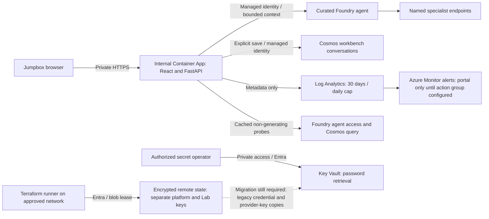

# Architecture

[Overview](../README.md) / Architecture


The diagram uses [official Microsoft Azure architecture icons](images/README.md)
with separate resource-group, virtual-network, subnet, and managed-service
boundaries. Custom review agents are labeled components, not Microsoft products.

The image shows the platform, deployed Lab, and proposed APIM path. The Lab uses
its own remote state key and the following private runtime path:



The workbench accepts only the configured agent catalog, uses no browser Azure
credentials, and does not publish APIs through APIM. Cosmos permissions are
container-scoped. Saved history is shared, not per-user private, and is not an
audit trail. See the [workbench runbook](../workbench/README.md).

Reviews admit four concurrent requests and 20/minute; history separately admits
four and 60/minute. Review uploads expire after five seconds, model calls after
180 seconds, and complete history operations after 35 seconds. These controls
are process-local and require one worker/replica. Dependency probes are cached,
bounded, and separate from process liveness. Logs contain request metadata, not
prompts or transcripts; action groups are needed for delivered notifications.

## Secret ownership

Managed identity is preferred to storing service keys. Key Vault is the required
home for necessary passwords, API keys, tokens, and certificates. Do not add
secret values to environment files, Terraform variables, source, diagrams,
browser storage, or deployment arguments. A Key Vault reference is non-secret;
fetching its value into a normal Terraform attribute still persists a copy.

Transcripts belong in access-controlled Cosmos, operational metadata in Log
Analytics, and Terraform state in its encrypted/locked backend, not in Key Vault.
These stores can contain sensitive data and require their own access and
retention policies. Network identifiers and managed-identity client IDs are
configuration, not credentials.

**Current exception:** platform state retains jumpbox credentials and
provider-returned Cosmos/Storage/Log Analytics keys. Current Lab state no longer
fetches Cosmos account keys; its AzureRM Log Analytics ownership transfer is
staged but blocked by backend network access. Historical state remains protected
and must not be purged indiscriminately. See the [migration inventory](credential-migration.md).

## Trust boundaries

| Boundary | Current implementation | Publication requirement |
| --- | --- | --- |
| Browser to workbench | Internal environment, jumpbox subnet allowlist, same-origin request checks | Entra identity and owner-scoped history authorization before real user data |
| Workbench to Foundry/Cosmos | Managed identity, curated agents, container-scoped Cosmos role, periodic dependency checks | Approve data/backup retention before real data |
| Client to APIM | Public Standard v2 gateway; no review API | Validate Entra issuer, audience, and authorized caller claims; do not equate authentication with permission |
| APIM to Foundry | VNet integration, peering, private DNS, managed identity role | Exact backend path, managed-identity policy, request limits, and correlation IDs |
| Coordinator to specialists | Named Foundry endpoints with managed identity; v2 passed both live delegation checks | Profile-based bindings require a new deployment and per-tool target checks |
| Administration to private data plane | Private jumpbox and project-scoped deployment identity | Inventory before mutation; serialize deployment per agent |
| Terraform to Azure | ARM provisioning; distinct remote state keys with Entra authentication and locking | Use approved private backend connectivity; migrate remaining secret-bearing resource ownership |

The workload and management networks may be in different regions. APIM's
integration subnet is in the management network and must be in APIM's region.
Outbound VNet integration does not make the public gateway private.

## Review request

This is the **target** request flow. The APIM API and policy steps remain
unpublished. The timeout and success-receipt behavior passed live checks in
coordinator v2. [Customer profiles](agent-profiles.md) separate specialist
selection from the shared platform and have passed a separate live deployment.

```mermaid
sequenceDiagram
    autonumber
    actor Client
    participant Gateway as APIM (API pending)
    participant Coordinator as Review coordinator
    participant Specialist as Application or case specialist
    Client->>Gateway: Review request + Entra bearer token
    alt Caller is not authorized
        Gateway-->>Client: Reject before contacting Foundry
    else Authorized request within limits
        Gateway->>Coordinator: Responses request using gateway managed identity
        Coordinator->>Coordinator: Select tool; acquire concurrency slot
        Coordinator->>Specialist: Full supplied request via managed identity
        alt Completed nonempty specialist response
            Specialist-->>Coordinator: Evidence-grounded findings
            Coordinator->>Coordinator: Emit structured successful tool result
            Coordinator-->>Gateway: Review response
            Gateway-->>Client: Result + correlation ID
        else Deadline or specialist failure
            Coordinator->>Coordinator: Cancel local request; release slot
            Note over Coordinator,Specialist: Remote work may continue after local cancellation
            Coordinator-->>Gateway: Review could not be completed
            Gateway-->>Client: Failure response under published API contract
        end
    end
```

The [APIM request and error contract](apim-review-api.md) is defined in code but
still requires live gateway acceptance tests. A tool timeout must not be
presented as a completed review, even if the agent returns explanatory text.
Ambiguous requests can result in a clarifying question without a specialist call.

## Delivery is separate from runtime

Terraform provisions the platform; a private deployment runner uploads agent
code and manages version routing. CI uses local tests and mocked HTTP, without
creating Azure resources. The cost calculator is an analysis tool, not an agent
dependency. Redis and semantic caching are intentionally absent.

See [delivery status](status.md) for remaining gates and
[private deployment](private-deployment.md) for the operational sequence.