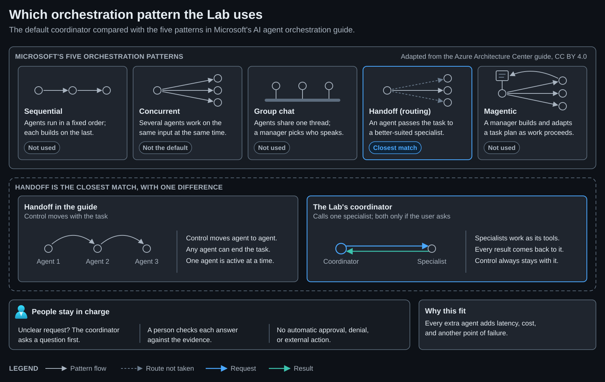
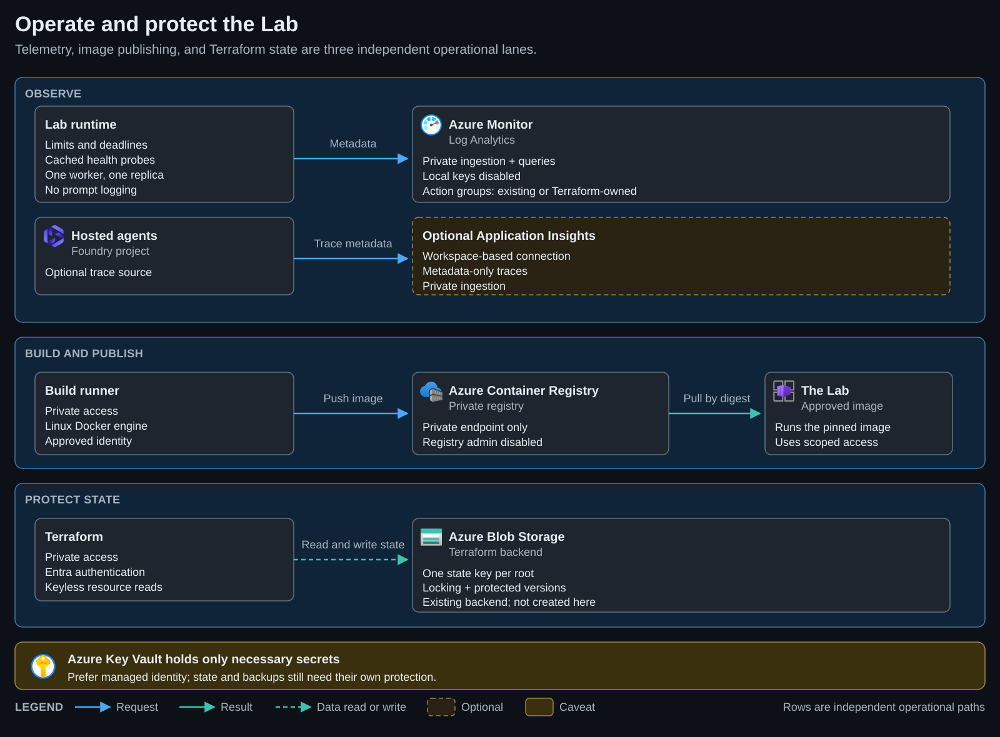
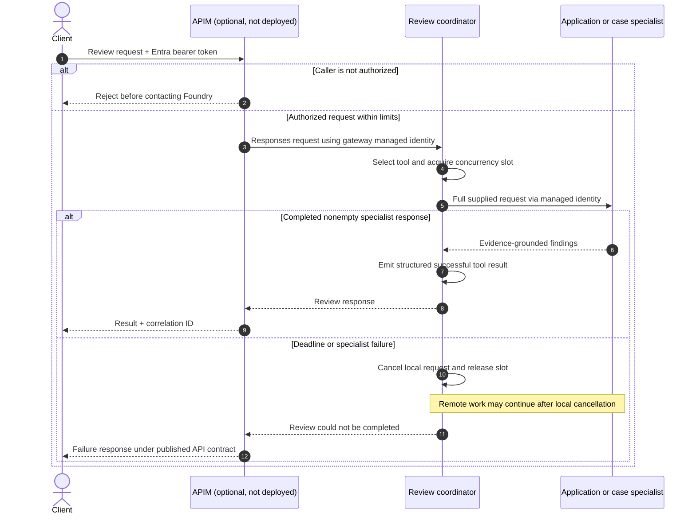

# Architecture

[Home](../README.md) / [Docs](README.md) / Architecture

Microsoft Foundry hosts the prebuilt agents, the Lab runs on Azure Container
Apps, Azure Cosmos DB stores application-owned records, and private networking
controls access. This page walks through the default data flows, trust
boundaries, operational paths, optional Azure API Management (APIM) gateway,
jumpbox access through Azure Bastion, and monitoring design. Read it before you
extend or operate the sample.

> [!NOTE]
> The diagrams describe the implemented sample. Optional browser ingress through
> Application Gateway Web Application Firewall (WAF) v2 or Front Door Premium
> with Private Link is documented in the [application ingress guide](ingress-access.md).
> Front Door has optional, off-by-default Terraform in the Lab root and appears in the
> Azure architecture diagram as an optional route. This repository doesn't deploy
> Application Gateway.

## Components at a glance

| Component | What it does | Important boundary |
| --- | --- | --- |
| Foundry project | Holds the model deployment, connections, and prebuilt agent endpoints in `hosted-agents-dev`. | A Foundry project isn't an agent. The endpoint route decides which hosted-agent version receives traffic. |
| Prebuilt agents | The coordinator calls one specialist, such as `application-review-agent` or `case-review-agent`, and returns findings. | Specialists receive complete text requests. They don't call each other or write to business systems. |
| The Lab | Provides the browser chat, Document reviews workflow, and optional **Create agent** page from `workbench/`. | The Lab accepts only the configured catalog, uses no browser Azure credentials, and has shared records without per-user authorization. |
| Azure Cosmos DB | Stores Lab-owned conversations, review drafts, review results, and created-agent metadata in a dedicated `workbench` database and `conversations` container. | Foundry-owned data is separate. Saved Lab records expire through a 30-day time to live (TTL). |
| Private network | Uses workload and management virtual networks, private endpoints, private DNS, and an approved source subnet. | Managed services are reached through private endpoints. Diagram boxes don't place those services inside a virtual network. |
| Jumpbox and Bastion | The optional Windows jumpbox is reached through the separately managed Standard Azure Bastion host. | The jumpbox is optional platform Terraform. The separate Bastion root and state manage the Standard Bastion host. The jumpbox's outbound public IP and administrator account, and Bastion's public IP, each need their own `approve_*` input. |
| Optional Front Door | Puts a public, WAF-filtered Front Door Premium endpoint in front of the Lab, limited to your own IP, when `enable_front_door` is set in the Lab root (`workbench/infra/`). Traffic reaches the internal Container Apps environment over Front Door-managed Private Link. | Off by default. The endpoint name is publicly resolvable, so it also needs `approve_public_front_door = true`. See the [application ingress guide](ingress-access.md#draft-front-door-limited-to-your-own-ip). |
| Optional APIM gateway | Publishes a governed `POST /reviews/responses` target when `enable_api_management` and `review_api` are configured. | APIM is disabled by default. Outbound virtual network integration doesn't make the gateway private, so enabling it also needs `approve_public_api_management = true`. |
| Monitoring | Platform and Lab logs use private Log Analytics paths. The monitoring root can connect a dedicated Application Insights resource for agent traces. | Logs contain request metadata, not prompts or transcripts. The project telemetry connection is opt-in. |

For every Azure service and private endpoint on one page, with numbered
request steps, see
[Azure architecture at a glance](images/azure-architecture-dark.svg).

## In this guide

- [Implementation overview](#implementation-overview)
- [Default data flows](#default-data-flows)
- [Agent collaboration](#agent-collaboration)
- [Component interactions](#component-interactions)
- [Chat and delegation](#chat-and-delegation)
- [Operations](#operations)
- [Secret ownership](#secret-ownership)
- [Trust boundaries](#trust-boundaries)
- [Review request](#review-request)
- [Delivery is separate from runtime](#delivery-is-separate-from-runtime)
- [Related content](#related-content)

For the native Foundry capability comparison and new-agent onboarding checklist,
see the [extension guide](architecture-assessment.md).

## Implementation overview

[View full size](images/foundry-overview-dark.svg) · [Edit the SVG template](images/foundry-overview.template.svg)

The diagram uses [official Microsoft Azure architecture icons](images/README.md)
in logical runtime and operations views. Boxes identify components, not physical
virtual network placement. Foundry and Cosmos DB are managed services reached
through private endpoints. Custom review agents aren't Microsoft products.

The overview shows the default request and data paths. It isn't a live resource
inventory. Steps 1 to 4 follow one request: the browser calls the Lab, the Lab
calls an agent, and the result comes back. Step 5, the dashed green path, is a
separate record save. Chat is saved only when you ask for it, and the server
saves structured review drafts and results. Not every agent response is saved.
APIM sits outside the default flow and stays disabled until you enable it.

The Lab uses its own remote state key. Pick the view that answers your
question:

| View | Use it to understand | Scope |
| --- | --- | --- |
| [Agent creation](agent-creation.md) | How a prepared task setup becomes a named, usable Foundry agent. | Opt-in publication, shared registry, and recovery. No cloud creation in local preview. |
| [Agent collaboration](#agent-collaboration) | Who asks whom, what information is passed, and who checks the result. | Default coordinator and review specialists. |
| [Orchestration pattern](#orchestration-pattern) | Which of Microsoft's agent orchestration patterns the coordinator resembles, and how it differs. | Default coordinator. |
| [Component interactions](#component-interactions) | What runs where and which component owns each interaction. | Platform and application components. |
| [Chat and delegation](#chat-and-delegation) | How a browser request reaches a specialist and when chat is saved. | Existing Lab chat path. |
| [Review persistence and recovery](review-workflow.md#execution-and-persistence) | What is saved before execution and how clarification and interruptions behave. | Optional Document reviews workflow. |
| [Operations](#operations) | How builds, monitoring, private access, and state are separated. | Platform configuration. |
| [Terraform deployment](architecture-assessment.md#terraform-first-deployment) | What each stack owns and which Microsoft patterns fit. | Infrastructure and release ownership. |
| [Optional APIM request](#review-request) | What an authorized gateway request would look like. | Target only. The gateway isn't deployed. |

## Default data flows

| Flow | Path | What crosses the boundary |
| --- | --- | --- |
| Chat request | Browser → The Lab → Foundry named agent endpoint. | The selected catalog ID, the new message, and bounded prior turns. The backend sends the request with managed identity and `store=false`. |
| Specialist delegation | Coordinator → selected specialist → coordinator. | A complete text task, supplied evidence, source identifiers, and a tool result with `status`, `agent`, `output`, and the matching `call_id`. |
| Explicit chat save | Browser → The Lab → Cosmos DB. | Saved transcript data that the client submits. Reopened receipts are marked unverified because the client can submit transcript data. |
| Structured review | Browser → The Lab → Cosmos DB → Foundry. | Server-owned review records, execution snapshots, specialist receipts, JSON results, coverage checks, and citation checks. |
| Operations | Container Apps and Foundry diagnostics → Log Analytics. | Request metadata, dependency status, timings, and platform diagnostics. Prompts and transcripts aren't logged, by design. |
| Optional governed API | Authorized client → APIM → Foundry coordinator. | Entra bearer token claims, the bounded review request, gateway policy checks, managed-identity backend call, and correlation IDs. |

## Agent collaboration

The diagrams in this section describe the existing coordinator. Created agents
published from the Lab use the [built-in template runtime](agent-creation.md#configuration-ownership):
four supplied-text jobs have no tools, and the workflow job has only two
simulated read-only lookups. They don't silently delegate to these review
specialists.

The default review pattern has one coordinator and two specialist tools, not a
network of agents freely messaging each other. The coordinator owns the
conversation. Specialists receive a complete request and return their findings
to that same coordinator.

[View full size](images/agent-collaboration-dark.svg) · [Edit the SVG template](images/agent-collaboration.template.svg) · [Request and result example](agent-profiles.md#example-handoff)

| Step | Responsibility | What crosses the boundary |
| --- | --- | --- |
| Ask | A person supplies the question and evidence in the Lab. The backend calls the configured named agent by using managed identity. | The new message and bounded conversation context. |
| Delegate | The coordinator selects a specialist tool: `inspect_application` or `inspect_case` in the default setup. Its instructions allow both only when the user directly asks for both review types. | A text request containing the full task, supplied evidence, and source identifiers. |
| Return | The specialist responds to the coordinator's tool call. The tool wrapper accepts only a completed, nonempty response. | A tool result containing `status`, `agent`, and `output`. The Responses protocol carries the matching `call_id`. |
| Review | The Lab checks the tool record and displays the answer. A person verifies sources and decides what to do next. | Findings, source references, questions, and verification flags. These aren't an approval or a guarantee of truth. |

The model picks the route from the configured tools. This isn't a deterministic
workflow engine. An unclear request should produce one clarifying question
before any specialist call. A failed or timed-out call must be reported as
incomplete, never replaced with an invented review. The sample has no direct
specialist-to-specialist calls, scheduled audit agents, agent-triggered email,
or external business writes. Optional infrastructure health notifications are
separate from agent behavior.

Steps 2 and 3 in the diagram are the request and response stages of the
**same agent**. The blue service boundary is logical hosting, not a virtual
network. The specialist boxes represent custom code. The diagram shows the Lab's default **Checklist and case helper**,
which uses the example profile's `inspect_application` and `inspect_case`
tools. **Checklist and case helper (base setup)** uses `review_application`
and `review_case` with the same specialist targets. Both are configurations of
the same review capabilities, not separate planning and review features.
Profiles can change tool names and targets, so read the
[profile contract](agent-profiles.md#specialist-contract) before changing them.

This design keeps roles and handoffs clear, but it isn't production-ready.
Tool verification tells you which configured call returned a result. It can't
tell you whether every statement is true. Structured reviews add
[coverage, citation, and saved-result checks](review-workflow.md#execution-and-trust).
Ordinary chat can also return clarification without a specialist receipt.

### Orchestration pattern

Microsoft's [AI agent orchestration patterns](https://learn.microsoft.com/azure/architecture/ai-ml/guide/ai-agent-design-patterns)
guide names five multi-agent patterns. The default coordinator is closest to
**handoff**, which the guide also calls routing: the coordinator's model picks
the specialist for each request. It differs in one important way: control never
transfers. Specialists are called as tools, each result returns to the
coordinator, and the coordinator writes the answer.

[View full size](images/orchestration-pattern-dark.svg) · [Edit the SVG template](images/orchestration-pattern.template.svg)

The Lab doesn't use sequential, group chat, or magentic orchestration. When a
user directly asks for both review types, the coordinator can call both
specialists on the same request, which is the nearest the Lab gets to
concurrent orchestration. People stay outside the agent loop: they answer
clarifying questions and check each answer, and no agent approves, denies, or
acts on the result.

*Pattern names and descriptions are adapted from the Azure Architecture Center
guide, which Microsoft licenses under
[CC BY 4.0](https://creativecommons.org/licenses/by/4.0/). The schematics are
redrawn for this repository, not copied from the guide.*

### Applying the pattern to larger workflows

Keep the useful parts of a multi-agent design: distinct responsibilities,
traceable inputs, and clear outputs. Avoid adding an agent only to move files,
check whether a job ran, or relay another agent's answer.

- Separate analysis from routine processing. Agents can interpret evidence;
  ordinary code should own ingestion, validation, storage, and status tracking.
- Spell out each task. Every handoff needs the task, source identifiers,
  relevant evidence, expected result, and limits on what the agent may do.
  Don't assume another agent can see the same chat or working directory.
- Use workflow controls for multistep jobs. Dependency order, persisted job
  state, retries, and recovery need a deliberate design. The coordinator's tool
  routing and a supervisor agent don't provide those controls by themselves.
- Keep actions separate from findings. Sending email, creating tickets, or
  changing business records requires separately scoped connectors, permissions,
  approval rules, and duplicate-action protection.

These are extension guidelines. None of them are implemented integrations. Use
the [Foundry extension guide](architecture-assessment.md) to choose supported
native capabilities before adding a custom orchestration layer.

## Component interactions

[View full size](images/lab-components-dark.svg) · [Edit the SVG template](images/lab-components.template.svg)

Blue arrows carry application and agent calls. The dashed green arrow is the
Lab's own record reads and writes in Cosmos DB. The gray platform connection is
a dependency, not a per-request retrieval call. The platform's Storage, Cosmos
DB, and Azure AI Search backing services are distinct from the Lab's
application-owned conversation and review records. The Lab uses a dedicated
container in the existing Cosmos DB account. The Lab's history endpoints don't
manage Foundry-owned data.

Configured agents use the model deployment. The Lab calls a named agent
endpoint, not a browser-selected model endpoint. Coordinator and specialist
boxes represent custom Python applications. Key Vault holds necessary secrets.
It isn't a transcript store, and the browser never reads it. Azure AI Search is
a required platform dependency here.
The reference review workflow has no Search retrieval tool unless you turn on the
optional [policy guidance lookup](knowledge-retrieval.md), which the dev Lab runs
as a small sample pilot.

### Code ownership

| Component | Implementation | Responsibility |
| --- | --- | --- |
| Browser shell and chat | [ChatWorkspace.tsx](../workbench/frontend/src/ChatWorkspace.tsx) | Catalog selection, draft input, chat, manual save/export, and view navigation. |
| Structured review UI | [ReviewWorkspace.tsx](../workbench/frontend/src/ReviewWorkspace.tsx) | Inbox, status polling, evidence, findings, and manual resume. |
| Agent creation | [AgentCreationWorkspace.tsx](../workbench/frontend/src/AgentCreationWorkspace.tsx) and [agent_creation.py](../workbench/agent_creation.py) | Template setup review, operator-confirmed publication, the shared created-agent records, status polling, and deletion. See [configuration ownership](agent-creation.md#configuration-ownership) for templates, runtime, and publisher. |
| HTTP boundary and Foundry client | [app.py](../workbench/app.py) | Origin and host checks, configured catalog, admission, bounded Responses calls, and receipt correlation. |
| Request admission | [request_guard.py](../workbench/request_guard.py) | The shared custom-header, `Sec-Fetch-Site`, and origin check that every state-changing and data API applies. |
| Review record controller | [review_runs.py](../workbench/review_runs.py) | Server-owned records, conditional starts, input snapshots, local tasks, and effective status. |
| Input and result contract | [reviews.py](../workbench/reviews.py) | Structured schemas, criterion coverage, and exact-quote validation. |
| Cosmos DB adapter and chat history | [history.py](../workbench/history.py) | Shared partition, paging, conditional writes, and clearing client-supplied receipt flags. |
| Coordinator tools | [coordinator main.py](../hosted-agents/review-coordinator-agent/main.py) | Profile-defined target selection, specialist timeout and concurrency, and structured tool results. |

## Chat and delegation

[View full size](images/lab-request-flow-dark.svg) · [Edit the SVG template](images/lab-request-flow.template.svg)

Steps 1 to 6 follow one chat request. Steps 7 and 8 happen later, only if the
user saves the chat. The browser sends the selected catalog ID, new message,
bounded prior turns, and a random chat ID to `POST /api/reviews`. FastAPI
rejects disallowed origins, unknown agents, and invalid or oversized input
before invoking Foundry. The backend uses managed identity with a named agent
Responses client, `store=false`, and no automatic model retry. Follow-ups in the
same chat reuse that chat's Foundry agent session for up to 10 minutes, and the
coordinator likewise reuses each specialist's session, so later turns skip
sandbox cold starts. The coordinator may select a configured specialist or ask
for clarification without invoking one. Each specialist call is separately
bounded and returns a named success result only after a completed, nonempty
response.

The Lab correlates tool call IDs, configured tool names, and expected target
agents. **Chat reports verification flags. It doesn't require every answer to
have a specialist call.** The structured review workflow adds the stricter
receipt, JSON, coverage, and citation gates described in its lifecycle guide.
Neither path guarantees the factual truth of supplied evidence or model findings.

Saving chat is separate from inference: `POST /api/conversations` creates a
record, and `PUT /api/conversations/{id}` updates it with `If-Match`. Saved and
reopened chat receipts are marked unverified because clients can submit
transcript data. The server writes structured review results, which record the
historical checks made at execution time. Neither record type is an immutable
audit ledger.

### Failure and capacity boundaries

| Operation | Admission or deadline | Failure behavior |
| --- | --- | --- |
| Chat agent request | Four shared agent slots, 20 starts per minute, a per-model-deployment requests and tokens budget, five-second upload, and up to 180-second agent call. | Invalid requests fail before invocation. A turn over its model's budget returns busy before any model call. A deadline returns timeout, not success. |
| Structured review execution | Shares chat's agent slots and start budget; at most four runs per record. | Conditional start prevents competing execution. There's no automatic retry. |
| Review record API | Four requests, 120 per minute, 35-second operation deadline, and five-second upload. | ETag conflicts return 409. Failed polling can be resumed with **Refresh**. |
| Chat history API | Four requests, 60 per minute, and 35-second operation deadline. | Conditional writes prevent silent overwrite. Uncertain saves require checking history. |
| Specialist tools | Default four slots and 90-second deadline, including slot wait. | Local timeout releases resources. Remote work may still finish. |

All admission controls in the table are process-local. They aren't
subscription-wide quotas or distributed locks. The Lab remains a one-worker,
one-replica sample. Browser request deadlines, server deadlines, and remote
execution are different boundaries, and stopping one doesn't guarantee
cancellation of the others.

## Operations

[View full size](images/foundry-operations-dark.svg) · [Edit the SVG template](images/foundry-operations.template.svg)

Each row is a separate operational path, not a sequence of deployment steps.
Optional agent traces come from the Foundry hosted agents, through Application
Insights connected to the Foundry project. The Lab itself sends only request
metadata to Azure Monitor. The image path includes the approved private runner
and registry, and the Lab uses the resulting image digest. Terraform state uses
an existing protected backend, not a store that this sample bootstraps.
Microsoft Entra authentication can use the approved Azure CLI path or managed
identity. The diagram doesn't require every operator to use managed identity.

Cosmos DB permissions are container-scoped. Saved history is shared, isn't
private per user, and isn't an audit trail. See the
[Lab runbook](../workbench/README.md).

The limits and deadlines in
[Failure and capacity boundaries](#failure-and-capacity-boundaries) are
process-local and require one worker and one replica. Dependency probes are
cached, bounded, and separate from process liveness. Delivered notifications
need action groups. The Lab can reuse existing groups or
[create an opt-in email group with Terraform](lab-diagnostics.md#terraform-managed-alert-delivery).
No recipients are configured by default.

The Lab's Premium Azure Container Registry (ACR) has a private endpoint and
public access disabled. Private DNS links cover both workload and management
networks. Builds use a Linux Docker engine on an existing authorized
private-network runner, with registry-scoped push and pull access and managed
identity preferred. The helper validates the non-root image, checks the pushed
registry digest against the local build, and verifies a pull by digest. The
helper doesn't provision runners or grant roles. Log Analytics ingestion and
query are private-only through the existing Azure Monitor Private Link Scope
(AMPLS). Registry admin and Log Analytics local key authentication remain
disabled.

## Secret ownership

Managed identity is preferred to storing service keys. Key Vault is the required
home for necessary passwords, API keys, tokens, and certificates. Keep secret
values out of environment files, Terraform variables, source, diagrams, browser
storage, and deployment arguments. A Key Vault reference is non-secret, but
fetching its value into a normal Terraform attribute still persists a copy.

Transcripts belong in access-controlled Cosmos DB, operational metadata in Log
Analytics, and Terraform state in its encrypted and locked backend, not in Key
Vault. These stores can contain sensitive data and require their own access and
retention policies. Network identifiers and managed-identity client IDs are
configuration, not credentials.

Use credential-free Azure Resource Manager (ARM) reads for Cosmos DB, Storage,
and Log Analytics. Private Terraform execution requires authorized connectivity
to the Blob private endpoint. Historical state stays protected, so don't purge
it indiscriminately. See the [credential handling guide](credentials.md).

## Trust boundaries

| Boundary | Current implementation | Publication requirement |
| --- | --- | --- |
| Browser to the Lab | Internal environment, approved source subnet allowlist, and same-origin request checks. | Add Microsoft Entra identity and owner-scoped history authorization before real user data. |
| The Lab to Foundry and Cosmos DB | Managed identity, curated agents, container-scoped Cosmos DB role, and periodic dependency checks. | Approve data and backup retention before real data. |
| Client to APIM (optional) | Not deployed. Configuration is retained. | Redeploy the gateway and validate Entra issuer, audience, and authorized caller claims. |
| APIM to Foundry (optional) | Not deployed. Target uses virtual network integration and managed identity. | Verify private DNS, backend path, managed-identity policy, request limits, and correlation IDs. |
| Coordinator to specialists | Named Foundry endpoints with managed identity. | Profile-based bindings require a new deployment and per-tool target checks. |
| Administration to private data plane | Authorized private connectivity and project-scoped deployment identity. | Inventory before mutation. Serialize deployment per agent. |
| Terraform to Azure | Keyless ARM ownership and distinct remote state keys with Entra authentication and locking. | Preserve private backend connectivity and historical state retention. |

The workload and management networks may be in different regions. If APIM is
redeployed, its integration subnet must be in APIM's region. The management
virtual network and peering remain in use for private access and builds without
APIM. Outbound virtual network integration doesn't make the public gateway
private.

## Review request

This sequence is the **optional APIM** request flow. Enable and verify the
gateway before using it. [Customer profiles](agent-profiles.md) separate
specialist selection from the shared platform.

Verify the [APIM request and error contract](apim-review-api.md) with live
gateway acceptance tests before publication. Never present a tool timeout as a
completed review, even if the agent returns explanatory text.
Ambiguous requests can result in a clarifying question without a specialist call.

## Delivery is separate from runtime

Terraform provisions the platform. A private deployment runner uploads agent
code and manages version routing. Continuous integration (CI) uses local tests
and mocked HTTP, without creating Azure resources. The cost calculator is an
analysis tool, not an agent dependency. Redis and semantic caching are
intentionally absent.

See [private deployment](private-deployment.md) for the operational sequence and
[production considerations](../README.md#scope-and-limitations) before using
confidential data or scaling beyond the sample configuration.

## Related content

- [Extension guide](architecture-assessment.md)
- [Private deployment runbook](private-deployment.md)
- [Credential handling guide](credentials.md)
- [Architecture artwork](images/README.md)
