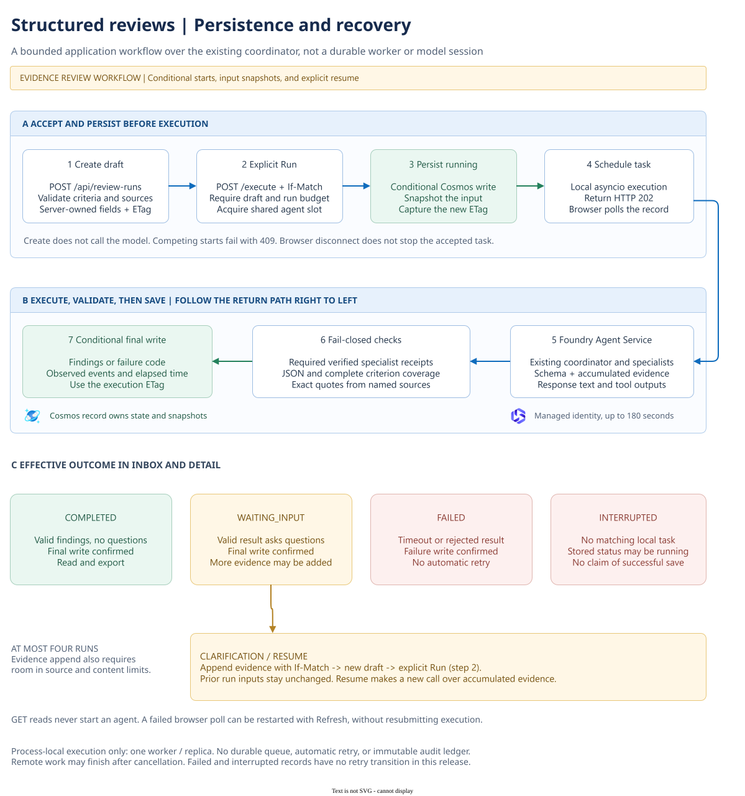

# Review workspace

[Overview](../README.md) / Review workspace

Status: implemented and locally tested; not yet deployed to Azure. Existing
private Lab deployment and Search capacity are unchanged. Local preview accepts
draft input but does not invoke agents or persist records.

## Workflow

1. Create a review with a title, up to 12 criteria and up to 12 source texts.
   The included example is synthetic. This release accepts pasted text, not file
   uploads, external URLs, or Search retrieval.
2. Create the shared record, then explicitly run it. The configured default
   coordinator selects its existing specialist tools. No new agents are deployed.
3. Inspect structured findings alongside the evidence. Each criterion has exactly
   one assessment: supported, gap, or conflict. Non-gap findings require citations;
   every cited quote must match its named submitted source exactly.
4. Answer clarification questions with additional evidence. Saving evidence creates
   a runnable revision; Resume review makes a new bounded call over the criteria
   and accumulated evidence. It is not a continuation of a persisted model session.
5. Reopen a review from the inbox or its URL fragment. Inspect earlier run snapshots
   and export the record as JSON. Chat remains a separate workspace view.

## Execution and persistence

**Scope: locally implemented review workflow; Azure rollout and live acceptance
are still pending.** This is distinct from the deployed chat request path in
the [architecture guide](architecture.md). The background task below lives inside
the FastAPI process; it is not a queue, separate worker service, or durable job.

[Open full-size SVG](images/review-lifecycle.svg) · [Editable draw.io source](images/review-lifecycle.drawio)

The numbered steps distinguish browser actions, server validation, Cosmos writes,
and the process-local task. In the diagram, `/execute` abbreviates
`POST /api/review-runs/{id}/execute`. Evidence is appended through
`POST /api/review-runs/{id}/evidence`. The server snapshots the complete input
before starting an attempt, then records validated findings or an error code.
No model text is allowed to supply the record's status, receipt flags, or events.

Precondition conflicts return HTTP 409 without scheduling another execution.
The final write uses the execution's ETag; the application does not blindly
overwrite a changed document. A failed status poll pauses browser updates, not
the server task. Refresh restarts polling without submitting another model call.

Implementation: [review API and task lifecycle](../workbench/review_runs.py),
[result validation](../workbench/reviews.py),
[browser polling and resume](../workbench/frontend/src/ReviewWorkspace.tsx).

## Review states

| State | Meaning | Allowed next action |
| --- | --- | --- |
| `draft` | Validated input, either newly created or extended with evidence | Explicit Run/Resume with a matching ETag and remaining run budget |
| `running` | Input snapshot saved and a matching local task exists | Poll or reopen; do not submit another start |
| `waiting_input` | A validated, saved result asks for more evidence | Append evidence with a matching ETag, fewer than four runs, and room within content limits; returns to `draft` |
| `completed` | Validated findings with no questions and a confirmed final write | Read or export |
| `failed` | A saved failure such as timeout or invalid agent output | Read or export; no retry transition in this release |
| `interrupted` | No matching local task, or a saved interruption; stored status may still be `running` | Inspect/export; no automatic retry or claim that remote work stopped |

Completed, failed, and interrupted records remain
readable and exportable until expiry. Earlier run inputs remain snapshots when
new evidence is appended. Each record allows at most four runs; correcting a
failed result does not silently reuse or restart a prior call.

## Execution and trust

- Work continues independently of a browser disconnect. The API persists the
  running state before returning HTTP 202. The browser polls the selected run.
   If a status request fails, Refresh restarts polling without starting another
   agent execution. Inbox counts describe loaded records, not the entire store.
- Execution is process-local, not a durable distributed worker. Keep one worker
  and one replica. A process restart or an unconfirmed final save exposes an
   interrupted run in both the inbox and detail view. No automatic model retry or
   recovery is attempted;
  an already accepted remote call may still complete and incur charges.
- ETag preconditions protect starts and evidence updates from competing tabs.
  After an uncertain create or update, refresh the inbox before repeating it.
  Creating a brand-new review is not idempotent across repeated requests.
- Each review permits at most four runs. Agent calls share chat's four in-flight
  slots and 20-request/minute admission budget, with a maximum 180-second timeout.
  Review record operations have separate four-request concurrency, 120/minute
  admission and 35-second deadlines. Input upload is limited to five seconds,
  64 KiB JSON, and 30,000 content characters; each source is at most 12,000 characters.
- A coordinator result is accepted only with checked, correlated specialist
  receipts matching configured targets. Receipt metadata is stored server-side;
  browsers cannot submit findings, success flags, or run events.
- Timeline entries are observed application milestones. Specialist receipt and
  citation checks happen after the response arrives, not streamed specialist
  start events. No hidden reasoning or simulated progress is displayed.
- Exact quotes establish source-reference integrity, not factual truth or a
  quality score. Model findings require human review. The system does not approve,
  deny, rank people, or execute external business actions.

## Persistence

Reviews use the existing `workbench/conversations` Cosmos container and shared
partition, under prefixed IDs and a separate record type. Chat routes reject review
IDs and chat lists exclude typed records. Conditional writes preserve prior run
input snapshots. The additive `/kind/?` index supports the separate lists.

All network-authorized workspace users can read reviews and submit evidence.
There is no end-user identity, owner authorization, or immutable audit ledger.
Use synthetic data only. Stored execution checks are historical records, not a
fresh verification of the current agent deployment. Each record expires 30 days
after its last write; backup retention is separate. This first release has no
review deletion or draft-edit endpoint, so export and retention are the available
record lifecycle controls.

Review details include observed elapsed time, but not full coordinator-plus-specialist
token accounting or invoiced cost. Neither is fabricated from the existing budget.

## Delivery checks

1. Run the workbench Python suite and frontend build, lint, and Playwright tests.
   Browser tests use controlled API responses; backend tests use an in-memory
   store and gateway doubles. They do not prove live Cosmos or model behavior.
2. Review a private Lab Terraform plan for the additive Cosmos index and intended
   image rollout. Keep platform state separate; do not publish root Terraform.
3. Build the immutable image using the existing private build process. The Docker
   and source-staging lists include both review backend modules.
4. Verify the index is ready and deploy the image. From authorized private access,
   create a synthetic review, check live specialist receipts and structured JSON,
   add evidence, resume, reopen, and inspect the prior snapshot. Reject malformed
   output without claiming successful findings. Record the result and recovery image.

Next extensions are authenticated ownership, durable worker recovery, evaluated
retrieval over approved sources, and approval-gated external actions. They are not
part of this first release.