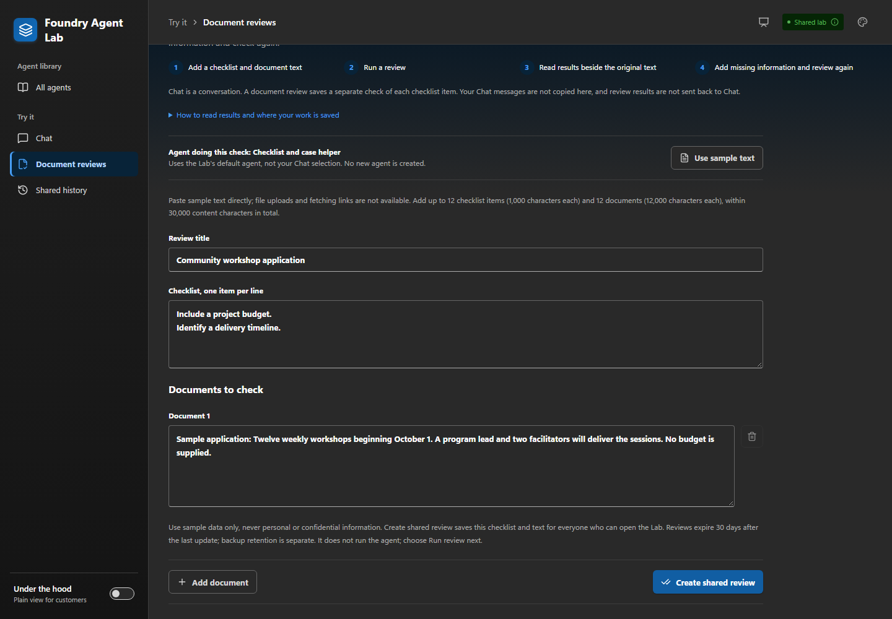
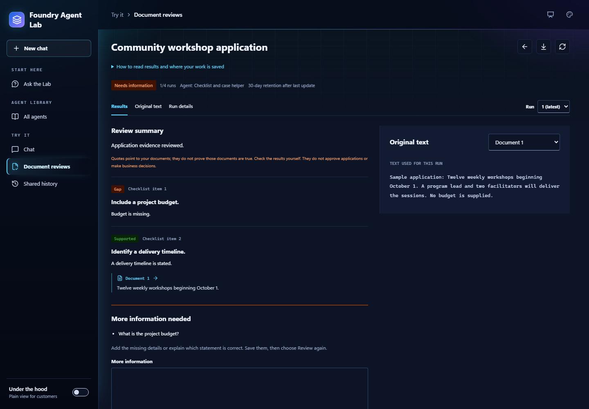

# Document reviews

[Home](../README.md) / [Docs](README.md) / Document reviews

**Document reviews** checks pasted document text against your own checklist. It
saves a result for each item, lets you add missing information, and checks
again. This guide is for reviewers and operators validating the workflow in the
Lab. The UI calls this **Document reviews**; earlier drafts called it Evidence
reviews.

## In this guide

- [When to use Document reviews](#when-to-use-document-reviews)
- [Workflow](#workflow)
- [Execution and persistence](#execution-and-persistence)
- [Recover an interrupted review](#recover-an-interrupted-review)
- [Review states](#review-states)
- [Execution and trust](#execution-and-trust)
- [Persistence](#persistence)
- [Delivery checks](#delivery-checks)
- [Related content](#related-content)

## When to use Document reviews

Use **Chat** when you want a conversation with the selected agent. Use
**Document reviews** when you want saved results for each checklist item, the
original text beside the results, and follow-up information recorded with the
review. Neither view copies messages or results to the other automatically.

| Term | Meaning in this workflow |
| --- | --- |
| `criteria` | Your checklist items. |
| `evidence` | The document text and additional information you supplied. |
| Finding | The result for one checklist item. |

It doesn't search external documents or fact-check anything.

This workflow requires a deployed Lab with Cosmos persistence and a compatible
agent. New reviews use the Lab's configured default agent, independently of the
**Chat** selection. An existing record keeps its saved agent ID. Creating a
review creates a shared **record**, not an agent. The local preview allows a
draft only: no model calls and no saved records.

For a customer-facing walkthrough, choose [one demonstration](demos.md).
Application completeness is available in source. Requirements and proposal
coverage is **Preview** and reuses this criteria-and-evidence contract. The
[fictional proposal input](demo-inputs/requirements-review.json) can be pasted into
the existing fields. There's no file import and no new agent requirement.
Ordinary **Chat** remains separate and doesn't require this JSON schema or
review receipts.

Engagements focus on demonstration and technical validation. Integration with
customer systems and production deployment require separate scoping and
agreement.

## Workflow

Before creating a shared record, the form explains that its text will be saved
for everyone with Lab access and that backup retention is separate:



1. Open the Lab's address with `#reviews` added (`/#reviews`), or follow a
   saved-review link. **Document reviews** has no sidebar link until you're on
   the page.
1. Choose **New review**.
1. Enter a title and **Checklist, one item per line**.
1. Paste text into **Documents to check**. **Use sample text** fills a
   small workshop application without saving or running it.
1. Supply up to 12 checklist items and 12 documents. A checklist item can run to
   1,000 characters, a source to 12,000, and the total content to 30,000. This
   release accepts pasted text only. It has no file uploads, fetched URLs, or
   Search retrieval.
1. Choose **Create shared review** to save the record, then **Run review** to
   call its agent. The form names the agent doing the check. The default
   **Checklist and case helper** selects its existing specialist tools. The
   review creates, configures, and deploys no agent.
1. Read **Results** beside **Original text**.
1. If **More information needed** appears, enter the requested details and choose
   **Save added information**. This saves a revision without invoking the agent.
1. Choose **Review again** to start a new bounded call over the checklist and
   all accumulated text. It doesn't continue a persisted model session.
   Until then, the UI labels the displayed results as belonging to the previous
   run.
1. Reopen a review from the inbox or its URL fragment. Inspect earlier run
   snapshots and export the record as JSON. **Chat** remains a separate
   workspace view.



[View full size](images/screenshots/lab-document-review-dark.png)

| Result label | In plain language |
| --- | --- |
| **Supported** | Your text backs up this checklist item. It doesn't prove the text is true. |
| **Gap** | There isn't enough information. It doesn't mean the application has failed. |
| **Conflict** | Statements disagree. A person needs to clarify which one applies. |

Each checklist item gets exactly one assessment: supported, gap, or conflict.
Findings that aren't gaps need citations. Every cited quote must match its named
submitted source exactly. A gap means the evidence isn't demonstrated. It isn't
automatic noncompliance. Product claims aren't independently verified
capabilities. A conflict needs clarification. The review doesn't invent a
resolution or make an approval decision.

A matching quote shows what a document says, not whether it is true. These
results don't approve applications or make business decisions. The UI puts this
explanation beside the results and keeps storage details in **How to read
results and where your work is saved**, so it doesn't repeat warning panels.

The structured-review prompt limits clarification to gaps or conflicts in the
supplied criteria and asks for no questions when every finding is supported.
Later evidence must be considered before asking again. A human review notice
doesn't add documentation or verification requirements. Model compliance still
needs live acceptance testing. The server doesn't discard returned questions to
force a completed status.

## Execution and persistence

This workflow runs separately from the chat request path in the
[architecture guide](architecture.md). The background task below lives inside
the FastAPI process. It isn't a queue, a separate worker service, or a durable
job.


[View full size](images/review-lifecycle-dark.svg) · [Edit the SVG template](images/review-lifecycle.template.svg)

1. **Create draft.** `POST /api/review-runs` validates the criteria and sources
   and saves a draft. No model is called.
2. **Start run.** `POST /api/review-runs/{id}/execute` with the current
   `If-Match` ETag uses one of the record's four runs.
3. **Save running snapshot.** A conditional Cosmos write saves the complete
   input before the server schedules work and returns HTTP 202.
4. **Run the agents.** The coordinator and specialists run in Foundry Agent
   Service for up to 180 seconds.
5. **Check the result.** Fail-closed checks verify specialist receipts, the JSON
   schema and criterion coverage, and exact quotes from the named sources.
6. **Save the final result.** The server records validated findings or an error
   code with the run's ETag.
7. **Add evidence.** For `waiting_input`, `POST /api/review-runs/{id}/evidence`
   appends evidence and returns the record to `draft` for a new run from step 2.
8. **Recover.** For `interrupted`, `POST /api/review-runs/{id}/resume` with
   `confirm_cost: true` starts a new run from the saved input.

In the diagram, `…/execute`, `…/evidence`, and `…/resume` abbreviate the full
routes above. Model text can't supply the record's status, receipt flags, or
events. Recovery starts a new call from the saved input. It doesn't continue a
remote model session.

Precondition conflicts return HTTP 409 without scheduling another execution.
The final write uses the execution's ETag, so the application never blindly
overwrites a changed document. A failed status poll pauses browser updates, not
the server task. Refresh restarts polling without submitting another model call.

Implementation: [review API and task lifecycle](../workbench/review_runs.py),
[result validation](../workbench/reviews.py),
[browser polling and resume](../workbench/frontend/src/ReviewWorkspace.tsx).

## Recover an interrupted review

After a restart, rollout, or unconfirmed final save, reopen the existing review
and choose **Refresh**. Reading the record never starts another agent call.
A recently started run remains `running` until its saved recovery window
expires. That window is the configured agent timeout plus 90 seconds for
admission, persistence, and shutdown. At the maximum timeout this is 270 seconds
from the start request. Older records without a saved window use 270 seconds
from their last update. A live task in the serving process still blocks recovery
even after that window. A confirmed shutdown interruption can be recovered
without waiting for expiry.

When the record is **Interrupted**, choose **Recover review** and confirm the
warning. Recovery uses the latest attempt's saved checklist, documents, title,
and agent ID. It appends a new attempt linked by `resumed_from`, marks the earlier
attempt interrupted if needed, and preserves earlier input snapshots and events.
The new call uses the currently configured deployment for that saved agent ID.
It doesn't pin or restore an earlier agent version. Each recovery uses one of
the record's four runs and the same shared admission limits as an ordinary run.
There's no recovery action after four runs or for `failed` records.

The API requires the current `If-Match` ETag, the usual
`X-Workbench-Request: 1` and origin checks, `Content-Type: application/json`, and
exactly `{"confirm_cost": true}`. The conditional Cosmos write saves both the
interrupted history and the new running attempt before scheduling work and
returning HTTP 202. Competing or stale submissions return HTTP 409, and no second
call is scheduled. A late result from an older worker can't overwrite the
recovered record because its ETag is stale.

**Recovery is a rerun, not exactly-once execution or remote-result retrieval.**
The earlier remote call may still complete and incur charges. Recovery can
therefore incur another model charge and produce different findings. If a
submission is uncertain, refresh instead of confirming recovery again. This
release adds no startup scan, automatic retry, durable queue, or distributed
admission control, so keep one worker and one replica.

## Review states

| State | Meaning | Allowed next action |
| --- | --- | --- |
| `draft` | Validated input, either newly created or extended with evidence | **Run review** or **Review again** with a matching ETag and remaining run budget |
| `running` | Input snapshot saved and a matching local task exists, or the saved recovery window has not expired | Poll or reopen. Don't submit another start |
| `waiting_input` (**Needs information**) | A validated, saved result asks for more information | Append evidence with a matching ETag, fewer than four runs, and room within content limits; returns to `draft` |
| `completed` (**Results saved**) | Validated findings with no questions and a confirmed final write | Read or export |
| `failed` | A saved failure such as timeout or invalid agent output | Read or export; no retry transition in this release |
| `interrupted` | No matching local task after the recovery window, or a saved interruption; stored status may still be `running` | Explicit **Recover review** with cost confirmation, a matching ETag, saved run input, and remaining run budget; otherwise inspect or export |

Completed, failed, and interrupted records remain readable and exportable until
expiry. Earlier run inputs remain snapshots when new evidence is appended. Each
record allows at most four runs, including recoveries. Correcting a failed
result doesn't silently reuse or restart a prior call.

## Execution and trust

| Area | Behavior |
| --- | --- |
| Browser disconnects | Work continues independently. The API persists the running state before returning HTTP 202. The browser polls the selected run. If a status request fails, **Refresh** restarts polling without starting another agent execution. Inbox counts describe loaded records, not the entire store. |
| Worker durability | Execution is process-local, not a durable distributed worker. Keep one worker and one replica. A process restart or an unconfirmed final save exposes an interrupted run after the recovery window in both inbox and detail. Recovery reruns the saved input, and only when you ask for it. The review never retries the model automatically. An already accepted remote call may still complete and incur charges. |
| Concurrency | ETag preconditions protect starts, recovery, and evidence updates from competing tabs. A persisted recovery window stops a new instance from immediately treating another instance's recent run as abandoned during rollout. It isn't a distributed lease or a guarantee that remote work stopped. After an uncertain create or update, refresh the inbox before repeating it. Creating a brand-new review isn't idempotent across repeated requests. |
| Run budget | Each review permits at most four runs. Agent calls share Chat's four in-flight slots and 20-request/minute admission budget, with a maximum 180-second timeout. Review record operations have separate four-request concurrency, 120/minute admission, and 35-second deadlines. Input upload is limited to five seconds, 64 KiB JSON, and 30,000 content characters. Each source is at most 12,000 characters. |
| Receipts | A coordinator result is accepted only with checked, correlated specialist receipts matching configured targets. Receipt metadata is stored server-side; browsers cannot submit findings, success flags, or run events. |
| Timeline | Timeline entries are observed application milestones. Specialist receipt and citation checks happen after the response arrives, not as streamed specialist start events. No hidden reasoning or simulated progress is displayed. |
| Human judgment | Exact quotes establish source-reference integrity, not factual truth or a quality score. Model findings require human review. The system does not approve, deny, rank people, or execute external business actions. |

## Persistence

Reviews use the existing `workbench/conversations` Cosmos container and shared
partition, under prefixed IDs and a separate record type. Chat routes reject
review IDs and chat lists exclude typed records. Conditional writes preserve
prior run input snapshots. The additive `/kind/?` index supports the separate
lists.

All network-authorized workspace users can read reviews and submit evidence.
There is no end-user identity, owner authorization, or immutable audit ledger.
Use fictional data only. Stored execution checks are historical records, not a
fresh verification of the current agent deployment. Each record expires 30 days
after its last write; backup retention is separate. This first release has no
review deletion or draft-edit endpoint, so export and retention are the
available record lifecycle controls.

Review details include observed elapsed time. They don't include full
coordinator-plus-specialist token accounting or invoiced cost, and the Lab
doesn't make either up from the existing budget.

## Delivery checks

### 1. Validate the source locally

Run the Lab Python suite and frontend build, lint, and Playwright tests from the
repository root using the [local validation commands](../workbench/README.md#local-development).
Browser tests use controlled API responses; backend tests use an in-memory store
and gateway doubles. They don't prove live Cosmos or model behavior.
Recovery coverage includes lost workers, graceful shutdown, legacy records,
recovery-window boundaries, competing submissions, stale-worker final writes,
cost acknowledgement, and the four-run limit.

### 2. Review and deploy the intended image

Follow the [Lab deployment steps](lab-deployment.md#deployment): configure
the correct state, build an immutable image, review a saved Terraform plan, then
apply and clean up that plan. Keep platform infrastructure and Lab state
separate. Normal root Terraform source is publishable; state, backups, secrets,
backend configuration, environment tfvars, saved plans, and private workaround
scripts are not. For initial review support, verify the additive Cosmos index is
ready before promoting the image. Record both the intended image and recovery
digest.

### 3. Start one synthetic review

Run from the repository root on authorized private-network access. Replace the
URL with the verified Lab output. This is a live model call that can incur
charges. It isn't an offline test. The script expects the sample
customer-review catalog.

```powershell
$baseUrl = '<verified-private-url>'
./workbench/test-review-private.ps1 -Mode Start -BaseUrl $baseUrl
```

Record `SYNTHETIC_REVIEW_ID` from the output. Start also verifies that a
competing start with the old ETag is rejected. Don't run Start again because a
status read fails or the first response is delayed.

### 4. Inspect the first result

Set the ID reported by step 3, then inspect after the execution reaches an
outcome:

```powershell
$reviewId = '<synthetic-review-id-from-step-3>'
./workbench/test-review-private.ps1 -Mode Inspect -ReviewId $reviewId -BaseUrl $baseUrl
```

Require verified specialist receipts, exact citations, and `waiting_input` for
this fixture's missing budget. If still running, the script reports that it has
not reached a result: inspect again later, without starting another execution.
For failed or interrupted output, investigate before continuing. An interrupted
run can be [recovered explicitly](#recover-an-interrupted-review), but that
consumes another run and changes this fixture's expected run counts. Don't use
recovery as evidence that the original call succeeded. An unexpected completed
first run doesn't establish that clarification/resume was tested.

### 5. Append evidence and resume explicitly

Only after step 4 confirms the first-run clarification:

```powershell
./workbench/test-review-private.ps1 -Mode Resume -ReviewId $reviewId -BaseUrl $baseUrl
```

This appends synthetic budget evidence and starts the second model call. The
script checks that the first run's evidence snapshot remains unchanged. If the
response is uncertain, inspect the record before repeating a mutating action.

### 6. Verify the final record

After the second run reaches an outcome:

```powershell
./workbench/test-review-private.ps1 -Mode Verify -ReviewId $reviewId -BaseUrl $baseUrl
```

Require a completed two-run review with preserved snapshots, verified receipts,
and exact citations. Reopen it in the UI and inspect both run versions. Record
the test outcome and deployed image; a successful Terraform apply alone is not
live acceptance. The synthetic review remains under normal 30-day TTL: this
release has no review deletion API. Don't delete shared storage to clean up a
test.

Next extensions are authenticated ownership, durable worker recovery, evaluated
retrieval over approved sources, and approval-gated external actions. They aren't
part of this first release.

## Related content

- [The Lab](../workbench/README.md)
- [Create and try a baseline Microsoft Foundry agent](agent-creation.md)
- [Architecture](architecture.md)
- [Demo guide](demos.md)
