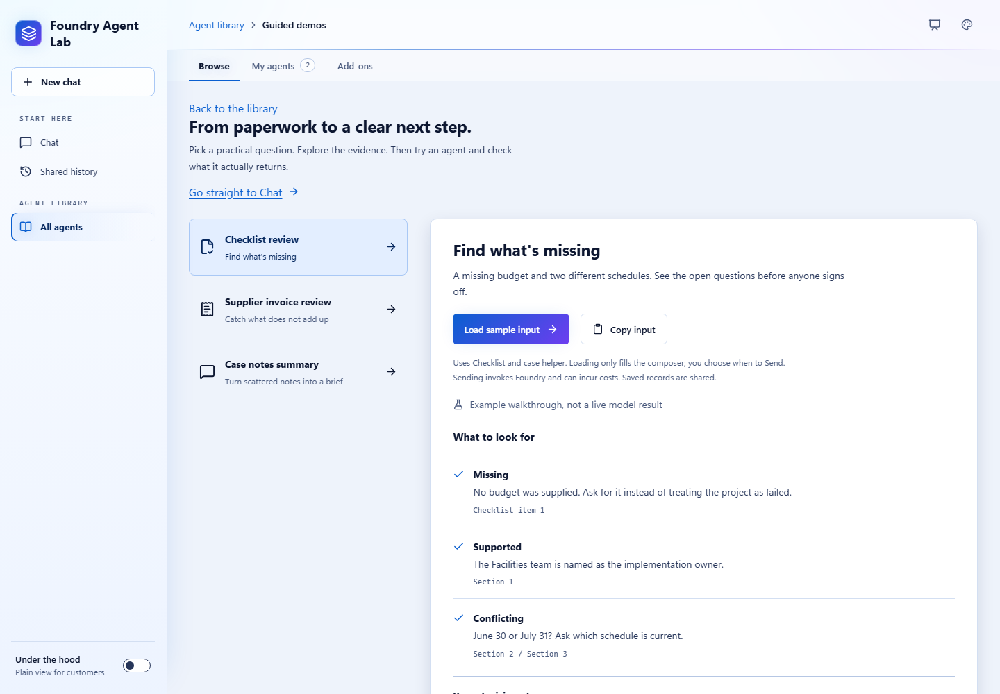
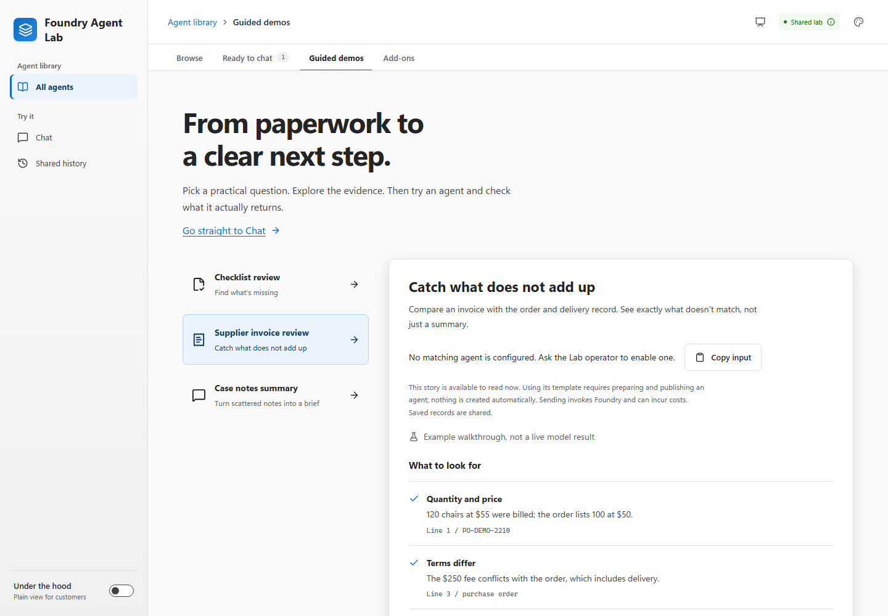
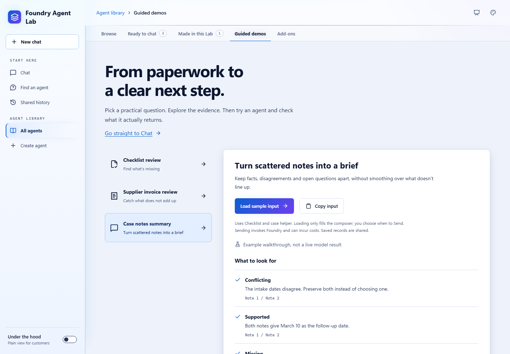
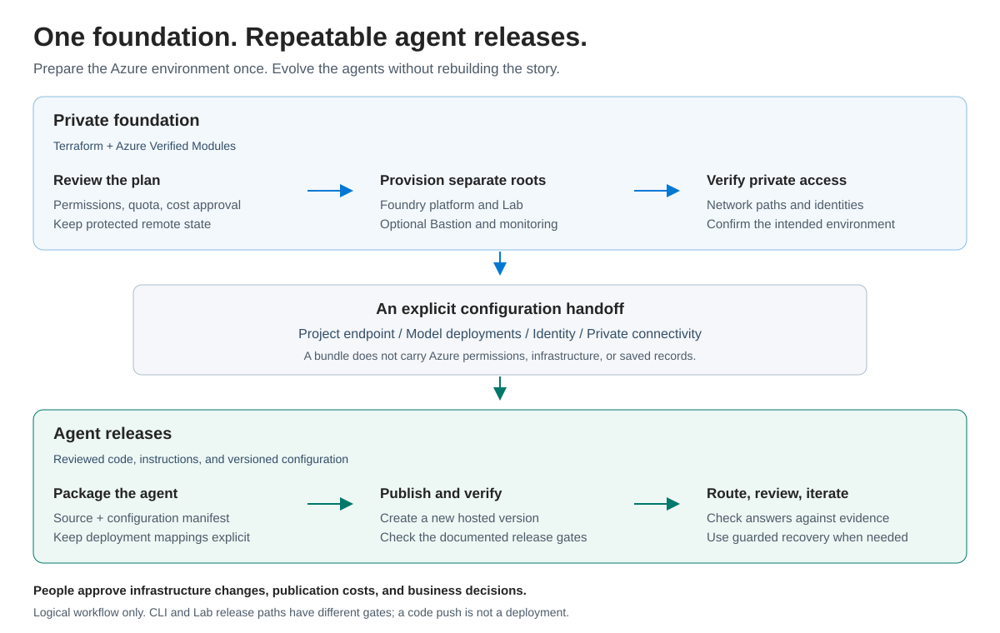

# Explore Foundry Agent Accelerator

[Home](../README.md) / [Docs](README.md) / Showcase

Start with a customer question, not a blank prompt. These three sample
stories show the input, findings to check, and decision that stays with a
person. They can be read without Azure.

## In this guide

- [Find what's missing](#find-whats-missing)
- [Catch what does not add up](#catch-what-does-not-add-up)
- [Turn scattered notes into a brief](#turn-scattered-notes-into-a-brief)
- [Present without hiding the boundaries](#present-without-hiding-the-boundaries)
- [One foundation. Repeatable agent releases.](#one-foundation-repeatable-agent-releases)
- [Related content](#related-content)

## Find what's missing

**Question:** Can a reviewer see which project details need clarification
before signing off?

<picture>
  <source media="(prefers-color-scheme: dark)" srcset="images/screenshots/lab-demo-application-dark.png">
  
</picture>

Use the [sample project and checklist](demo-inputs/application.txt).
In **Guided demos**, choose **Checklist review**, then **Load sample
input**. This chooses an enabled matching prebuilt agent, or a ready created
**Checklist gap finder**. It only fills the composer: inspect the text, then
explicitly Send.

| Source | Expected finding | Human follow-up |
| --- | --- | --- |
| Checklist item 1 | No budget was supplied | Obtain and verify the budget |
| Section 1 | The Facilities team is named as owner | Confirm the named responsibility |
| Section 2 / Section 3 | The completion dates disagree | Identify the current schedule |

The agent must not approve, deny, score, or rank the application. Missing
evidence is a question, not an automatic failure. Try the missing-information
and adversarial variations in the [demo guide](demos.md#application-completeness).

## Catch what does not add up

**Question:** Can an accounts-payable clerk find discrepancies across an invoice,
an order, and a delivery record without delegating the payment decision?

<picture>
  <source media="(prefers-color-scheme: dark)" srcset="images/screenshots/lab-demo-invoice-dark.png">
  
</picture>

Use the [sample supplier invoice](demo-inputs/supplier-invoice.txt).
This scenario requires a ready created **Supplier invoice reviewer**, whose
two fixed tools return the sample purchase order and delivery record for
`PO-DEMO-2210`. They do not contact a finance system.

Without a matching ready agent, **Guided demos** lets you read and copy the
example and points you to the appropriate template. Preparing the template does
not publish it. Publication still requires the operator key, explicit cost
approval, and the existing [creation prerequisites](agent-creation.md).

| Source | Expected finding | Human follow-up |
| --- | --- | --- |
| Line 1 / purchase order | 120 chairs at $55 were billed; 100 at $50 were ordered | Resolve quantity and price differences |
| Line 3 / order terms | A $250 delivery fee conflicts with delivery being included | Clarify the fee |
| Delivery record | Two received chairs have cracked seats | Decide how damage affects acceptance or payment |

The tables match at 10 units and $300 each. The agent should show arithmetic
and label any supplier email **UNSENT DRAFT**. It must not approve, hold, pay,
reject, send a message, or claim a system update. Do not silently treat damaged
chairs as accepted or rejected when presenting an amount.

## Turn scattered notes into a brief

**Question:** Can a caseworker separate reliable facts from conflicting records
and unanswered questions?

<picture>
  <source media="(prefers-color-scheme: dark)" srcset="images/screenshots/lab-demo-casework-dark.png">
  
</picture>

Use the [sample case notes](demo-inputs/casework.txt).
Choose **Case notes summary** in **Guided demos**, then load the sample
input into an enabled matching prebuilt agent or ready created
**Case summary writer**.

| Source | Expected finding | Human follow-up |
| --- | --- | --- |
| Note 1 / Note 2 | Intake dates disagree: August 15 and August 17 | Find the authoritative record |
| Note 1 / Note 2 | Both notes give August 22 as the follow-up date | Verify the appointment |
| Note 3 | Proof of address is still outstanding | Obtain the evidence and applicable policy |

No policy is supplied. The agent should not infer an eligibility consequence,
choose an unsupported date, or modify a system.

## Present without hiding the boundaries

1. Open **Guided demos** and choose one story. The displayed findings are
   what to look for, not an agent response.
2. Turn on **Presenter view** in the header for larger story and conversation
   text. The environment indicator and shared-record notices remain visible.
3. Load the sample input. Existing unsaved chat messages require confirmation
   before replacement. Nothing is automatically sent, saved, or published.
4. In a prepared private environment, explicitly Send and compare the real reply
   with the evidence. Calls can incur costs. In local preview, no agent is invoked.
5. Use the **Demo guide** in Chat to keep the expected findings and human decision
   nearby. It is separate from the model's answer.
6. Choose **Start fresh with this example** to reset local messages with
   confirmation. It never deletes shared history, changes infrastructure, or
   stops a deployed agent. Record failures rather than hiding them.

Presenter view is a browser-session display preference, not a different
security mode. The Lab still has no individual user sign-in; everyone with
access shares saved records. Use sample data only.

The root URL opens the **Agent library**. Presenters can bookmark `/#demos` to
open **Guided demos** directly, or `/#chat`
or `/#create`; the latter requires the creation capability. Valid saved-review
deep links continue to open their review directly.

## One foundation. Repeatable agent releases.

<picture>
  <source media="(prefers-color-scheme: dark)" srcset="images/agent-release-journey-dark.svg">
  
</picture>

**Foundation (steps 1 to 3):** review Terraform plans, deploy the Azure Verified Modules-based
platform and separate Lab root, then verify private access. Keep the existing
remote state boundaries. This is not a new landing-zone module or a one-click
deployment promise.

**Configuration handoff:** supply the actual Foundry project endpoint, existing
model deployment names, identities, and approved private connectivity. Portable
bundles carry source and configuration, not Azure permissions, infrastructure,
customer records, or saved conversations.

**Agent releases (steps 4 to 6):** prepare a reviewed bundle, publish a new version, verify
the appropriate runtime/route behavior, and check answers against the source.
When a release needs correction, follow the documented guarded recovery or
rollback path; never imply that Terraform automatically published it.

The prebuilt deployment CLI and operator-confirmed Lab publisher have different
ownership and verification semantics. This diagram is their logical relationship,
not a new universal pipeline or a guarantee of automatic rollback.

[View full size](images/agent-release-journey.svg) ·
[Edit the SVG template](images/agent-release-journey.template.svg)

## Related content

- [Demo guide and failure cases](demos.md)
- [Create and try an agent](agent-creation.md)
- [Private deployment runbook](private-deployment.md)
- [Portable agent bundles](../hosted-agents/README.md#portable-agent-bundles)
- [Architecture artwork sources](images/README.md)
- [Product purpose and naming](../PRODUCT.md)
