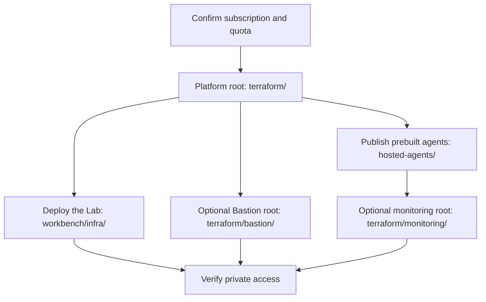

# Microsoft Foundry Terraform deployment

[Home](../README.md) / Infrastructure

This directory holds the platform infrastructure for the Microsoft Foundry
hosted agent samples. The `terraform/` root deploys Foundry and its shared
private services. The Lab, Azure Bastion, and agent monitoring each deploy from
their own Terraform roots, with their own protected state files.

The platform root uses the Azure Verified Modules (AVM)
[`Azure/avm-ptn-aiml-ai-foundry/azurerm`](https://registry.terraform.io/modules/Azure/avm-ptn-aiml-ai-foundry/azurerm/latest)
pattern module. The module deploys the Foundry account, Foundry project, model
deployment, Agent Service capability host, and the supporting services needed
by the standard Agent Service setup.

The optional client gateway uses the AVM
[`Azure/avm-res-apimanagement-service/azurerm`](https://registry.terraform.io/modules/Azure/avm-res-apimanagement-service/azurerm/latest)
resource module pinned to version 0.9.0.

The default names say what each resource is for. The account uses
`foundry-hosted-agents-<base>-<environment>-<unique>`, and the project uses
`hosted-agents-<environment>`.

For how this setup relates to Microsoft's baseline and landing-zone designs, see
the [Terraform-first architecture guide](../docs/architecture-assessment.md#terraform-first-deployment).
The design separates platform infrastructure from the Lab stack, existing shared
services, and application or agent releases. The official baseline chat sample
uses Bicep. This repository keeps its existing Terraform implementation instead
of deploying a second foundation.

## At a glance

| Area | Terraform root | State guidance | What it deploys |
| --- | --- | --- | --- |
| Platform infrastructure | `terraform/` | `ai-foundry/<environment>.tfstate` | Foundry account and project, model deployment, Agent Service capability host, private workload services, diagnostics, and optional jumpbox or Azure API Management (APIM). |
| The Lab | `workbench/infra/` | `ai-foundry/workbench-dev.tfstate` | The browser app, backend, registry integration, history storage, and alert delivery described in the Lab guide. |
| Bastion | `terraform/bastion/` | `ai-foundry/bastion-dev.tfstate` | The dedicated Standard Azure Bastion host, `AzureBastionSubnet`, and static public IP for browser-based private access. |
| Agent monitoring | `terraform/monitoring/` | `ai-foundry/monitoring-dev.tfstate` | Workspace-based Application Insights and private trace routing for metadata-only hosted agent monitoring. |

## In this guide

- [Deployment order](#deployment-order)
- [Prerequisites](#prerequisites)
- [Region preference](#region-preference)
- [Private access](#private-access)
- [Optional administration resources](#optional-administration-resources)
- [Existing deployments](#existing-deployments)
- [Coordinator agent access](#coordinator-agent-access)
- [API Management gateway](#api-management-gateway)
- [Local validation](#local-validation)
- [Deploy](#deploy)
- [State](#state)
- [Outputs](#outputs)
- [Separately scoped production considerations](#separately-scoped-production-considerations)
- [Related content](#related-content)

## Deployment order

Deploy each root from its own directory, with its own backend configuration and
state key. Don't reuse the platform state for the Lab, Bastion, or monitoring.



Follow this order for a new environment:

1. Deploy the platform root in `terraform/`.
2. Publish the prebuilt agents from `hosted-agents/` after the platform outputs
   are available.
3. Deploy the Lab from `workbench/infra/` with its separate state key.
4. Deploy `terraform/bastion/` only when operators need dedicated browser-based
   access through Azure Bastion.
5. Deploy `terraform/monitoring/` only after the metadata-only agent rollout is
   complete and the trace destination is approved.

## Prerequisites

See [tool versions and upgrades](../README.md#tool-versions-and-upgrades) for
version checks, lockfile expectations, and installation troubleshooting.

- Terraform 1.16.4 or a later 1.16 patch release.
- Azure CLI authenticated to the target tenant.
- Contributor and User Access Administrator, or equivalent permissions.
- Model availability and quota in the target region.
- Network connectivity to the deployed virtual network, such as VPN or
  ExpressRoute, for software development kit (SDK) access after public endpoints
  are disabled.
- A pre-created, secured Azure Storage account and blob container for remote
  state, with private access and Storage Blob Data Contributor for the operator
  on that container. This configuration doesn't bootstrap its own backend.

> [!IMPORTANT]
> This isn't a minimal-cost configuration. Applying it creates billable Azure
> resources. Review regional pricing, quota, and a saved plan before approving
> deployment. Agent publication and live model calls need separate approval.

Confirm the selected subscription before deployment:

```powershell
az account show --query "{name:name,id:id,tenantId:tenantId}" --output table
```

Set that subscription ID yourself. The configuration requires an ID in the
variables so a changed Azure CLI default can't redirect a deployment.

## Region preference

The tracked `region-preferences.tf` file defines the default deployment order.
North Central US is the default. Check model availability, Agent Service support,
Search capacity, provider registration, and Azure Policy in the target
subscription before choosing a region. The list is configuration only. It
doesn't guarantee capacity.

| Preference | Region | Cosmos DB paired region |
| --- | --- | --- |
| 1 | North Central US (`northcentralus`) | None for development |
| 2 | West US 3 (`westus3`) | None for development |
| 3 | South Central US (`southcentralus`) | North Central US |
| 4 | West US (`westus`) | None for development |

Azure AI Search physical capacity is dynamic, and its quota API can't guarantee
it. Override the default for a specific deployment with
`-var="location=westus3"`. Subscription-specific tfvars remain ignored.
The preference profile also selects region-compatible storage replication and
Cosmos DB topology. Cosmos uses the selected workload region as its primary
region.

Changing regions isn't an automatic migration. Review account topology changes
and resource replacements separately. Deletion protection blocks replacement of
protected accounts, so don't remove it just to make a plan succeed. Resource
groups keep their original location metadata to avoid cascading deletion.

## Private access

Use an authorized execution environment with private Domain Name System (DNS)
resolution and routing to the Foundry data plane and remote state backend. Azure
Resource Manager (ARM) connectivity alone isn't enough. Keep public access
disabled and use scoped managed identities.

Necessary secrets belong in Key Vault, not ordinary Terraform attributes. See
the [credential guidance](../docs/credentials.md) for runtime access, protected
state, and credential recovery requirements.

## Optional administration resources

For agent activity in the Foundry portal, use the separate
[private agent monitoring stack](monitoring/README.md). Account diagnostic
settings alone don't supply project-linked Application Insights traces.
Complete its metadata-only agent rollout before enabling the project connection.

The Windows admin virtual machine (VM) and its network address translation
(NAT) egress are disabled by default. Enabling `enable_jumpbox` adds them.
Foundry itself doesn't need them. The shared
management virtual network (VNet), subnet, peering, and DNS links are defined in
`management-network.tf` and remain enabled for the Lab. Set
`enable_management_network = false` only when you don't need that network.
Enabling the VM or APIM also enables the network.

> [!IMPORTANT]
> The VM adds two things that are reachable or credentialed outside the private
> network: a static public IP address for outbound NAT egress (the VM has no
> inbound public address) and a local Windows administrator account. Terraform
> refuses to plan with `enable_jumpbox = true` until you approve each with
> `approve_jumpbox_egress_public_ip = true` and
> `approve_jumpbox_admin_account = true`. Set them only after that approval.
> Existing deployments that already run the VM must set both once; doing so
> changes no resources.

An enabled VM shuts down and deallocates nightly at 03:00 UTC, without
notifications. Set `jumpbox_auto_shutdown = { time = "1900", timezone =
"Pacific Standard Time" }` to change the schedule, or `null` to remove it.
Start the VM again before using it as a private runner.

APIM can use the shared management network without enabling the VM. Its region
must match `jumpbox_location`, which selects that network's region. Existing
Terraform addresses and network names are retained for compatibility.

For dedicated browser-based access, the separate
[Standard Bastion stack](bastion/README.md) can adopt an existing Developer host
and upgrade it without changing the VM or platform resources. The Bastion root
uses its own protected state key and incurs continuous Bastion charges. Applying
this parent configuration doesn't enable Bastion. The Bastion root requires
`approve_bastion_public_ip = true` for the same reason: Standard Bastion needs a
static public IP.

For a new VM, pre-provision a strong Windows administrator password in an
accessible Key Vault. Set `jumpbox_admin_secret` to the vault resource ID, secret
name, and a specific secret version. Don't supply the password in tfvars, CLI
arguments, or ordinary Terraform data sources. The deployment identity needs
private DNS and routing to the vault and permission to read that secret.
Terraform reads it ephemerally and passes it only through AzAPI write-only
fields, without exporting secret responses.

Keep the pinned version unchanged during ordinary applies. A version change
requests a credential update in both the VM and access extension. This update
isn't atomic. Retain an independent recovery channel and the prior vault version
until login is verified. After a partial failure, inspect each consumer before
retrying. Use the same pinned version to avoid generating a different password
during recovery. Verify create, unchanged apply, rotation, and failure recovery
on disposable resources before using this path for a real deployment.

For an existing VM, set `enable_jumpbox = true` and preserve its disk ID, name,
size, and storage type in `jumpbox_existing_os_disk` in ignored deployment
inputs. The default `create_option = "FromImage"` preserves an image-provisioned
VM's configuration. Use `create_option = "Attach"` for a VM booting a retained
specialized Windows disk. This omits the image and OS provisioning profile and
retains the disk's existing login.

A new VM uses the newest Windows Server 2025 image, because `jumpbox_image_version`
defaults to `latest`. To stop a later image from changing what a rebuild produces,
set it to an exact version. For a VM that already exists, use the version it runs
now, which `az vm show --query storageProfile.imageReference.exactVersion` reads
without changing anything. Review a plan first. Azure can reject or replace a VM
whose image reference changes, and the VM has `prevent_destroy`, so stop if the
plan shows anything beyond that one value. The input is ignored for
`create_option = "Attach"`, which omits the image.

Leave `jumpbox_admin_secret` null to leave credentials under external Key Vault
administration and omit the VMAccessAgent extension. If an extension is already
tracked, reconcile its ownership before changing this input. Don't bypass its
destruction guard. Recreating a VM changes its system identity; reconcile role
assignments and Terraform state before the next apply.

## Existing deployments

Before adopting this configuration, preserve existing names with
`cosmosdb_account_name` and `agent_storage_account_name`. The storage override
also determines the Blob endpoint and connection names. Verify these match the
existing resources before applying. The naming defaults are for fresh
installations.

This is steady-state configuration, without one-time resource ownership scripts.
An existing state must already use the resource addresses declared here. Stop if
a plan attempts to recreate an existing service or destroy an older owner.
Resolve that installation's state separately. Preserve state and protected
backups.

Earlier versions gave the deployer Key Vault Secrets Officer on the Agent
Service Key Vault by default. To keep it, set
`deployer_key_vault_secrets_officer = true`. The plan then shows no change.
Otherwise the next apply deletes that role assignment. It doesn't delete any
secret. See [Deployer Key Vault access](../docs/permissions.md#deployer-key-vault-access).

Earlier versions didn't give the Foundry project's managed identity Foundry
User on the Foundry resource, which [live evaluation](../evaluations/README.md)
runs need. The next apply adds `azurerm_role_assignment.project_foundry_user`.
If you already granted that role by hand, the apply fails because the
assignment exists. Import it first with
`terraform import azurerm_role_assignment.project_foundry_user <role assignment ID>`,
or delete the manual assignment. Role assignments can't be updated in place, so
if the manual one has a description, the import plan replaces it. Clear the
description first to import without a change.

The next apply also updates the agent storage account in place to admit the
Foundry project as a resource instance, so live evaluation can store results.
It doesn't change public network access. A rule already added by hand for the
same project ID produces no change.

## Coordinator agent access

`coordinator_agent_access` is off by default. When set, Terraform assigns
Foundry Agent Consumer to the review coordinator's agent identity on each
specialist agent, not on the whole project. Foundry creates that identity when
the coordinator is first deployed, so Terraform can't look it up. Copy the
`Agent identity principal ID` that the hosted-agent deployer prints for the
coordinator:

```hcl
coordinator_agent_access = {
  principal_id = "<coordinator agent identity principal ID>"
  # Optional. Defaults to the two review specialists.
  specialist_agents = ["application-review-agent", "case-review-agent"]
}
```

List the specialists from your [coordinator profile](../docs/agent-profiles.md)
if you use one. The identity running Terraform needs permission to create role
assignments. The [prerequisites](#prerequisites) include User Access
Administrator, which per Microsoft Learn
[manages user access to Azure resources](https://learn.microsoft.com/azure/role-based-access-control/built-in-roles/privileged#user-access-administrator).
See
[coordinator agent access](../docs/permissions.md#coordinator-agent-access) for
the first-deployment order and what's still unconfirmed.

## Knowledge search access

`knowledge_search_access` is off by default. When set, Terraform assigns Search
Index Data Reader to the case-review agent's runtime identity on one index of
the Agent Service Search service, not on the service. Retrieval is off by
default, so an environment that doesn't use the
[knowledge-search pilot](../docs/knowledge-retrieval.md) doesn't need it. As with
the coordinator, Foundry creates the identity when the agent is first deployed,
so copy the `Agent identity principal ID` that the hosted-agent deployer prints
for `case-review-agent`:

```hcl
knowledge_search_access = {
  principal_id = "<case-review agent identity principal ID>"
  # Optional. Defaults to the pilot's index.
  index_name = "lab-sample-policy-guidance"
}
```

Terraform doesn't create the index. The
[index script](../docs/knowledge-retrieval.md#sample-documents-and-the-index-script)
does, so run it first. It needs `enable_agent_service = true`. An environment
that already has the grant made by hand must
[import it](../docs/permissions.md#adopt-the-knowledge-search-grant) before you
set the variable.

The [knowledge search add-on package](../addons/knowledge-search/DEPLOY.md) holds a draft module for the
same grant, with a plan check and a runbook. It isn't wired into this root. Don't use both for the same
index.

## API Management gateway

Set `enable_api_management = true` and provide
`api_management_publisher_email` to create a one-unit Standard v2 Azure API
Management service. Its region comes from `api_management_location`, which
defaults to West US (`westus`). The variable's validation in `variables.tf`
allows only West US (`westus`), West US 3 (`westus3`), South Central US
(`southcentralus`), and North Central US (`northcentralus`). The value must
also equal `jumpbox_location`; see
[Optional administration resources](#optional-administration-resources). APIM
uses a dedicated delegated subnet in the management virtual network and reaches
private agent backends across the global peering connection. Its
system-assigned managed identity receives Foundry User on the primary project,
so APIM policies can use Microsoft Entra ID authentication instead of storing
Foundry keys.

APIM is the governed client-facing entry point for APIs published there. It
provides a stable endpoint for authentication, quotas,
rate limits, policy, versioning, and observability. Trusted internal agents can
continue calling other agents directly with managed identity when gateway policy
isn't required. The configuration creates the service but doesn't publish a
placeholder API. The opt-in coordinator API and policy are implemented. Enable
them only after the backend and caller authorization are verified.

The gateway uses Standard v2 because it supports outbound virtual network integration to
the private backends. The gateway remains publicly reachable for clients, and
the integration subnet isn't an inbound private endpoint. Management-plane
public network access also remains enabled so Terraform and portal operations
work without a separate private management endpoint.

> [!IMPORTANT]
> Because the gateway is public, Terraform refuses to plan with
> `enable_api_management = true` until you also set
> `approve_public_api_management = true`. Set it only after approving public
> exposure for this gateway. Existing deployments that already run APIM must set
> it once; doing so changes no resources.

> [!IMPORTANT]
> Standard v2 is billed continuously, even with no API traffic. Set
> `enable_api_management = false` in environments that don't need the gateway.
> Azure Managed Redis and APIM semantic caching are deliberately excluded because
> they're separate recurring-cost resources and agent-to-agent communication
> doesn't need them.

After apply, inspect the deployed gateway with:

```powershell
terraform -chdir=terraform output -raw api_management_name
terraform -chdir=terraform output -raw api_management_id
terraform -chdir=terraform output -raw api_management_gateway_url
```

### Optional review API

After deploying and testing a coordinator, configure `review_api` to select its
named endpoint and a specific Microsoft Entra ID audience, caller object IDs, and
client app IDs. The default is null: no API is published. See the
[publication runbook and acceptance gates](../docs/apim-review-api.md).

Run `./terraform/test-review-api-validation.ps1` for isolated input validation
and rendered policy checks. These tests don't contact Azure or validate the
live gateway.

## Local validation

After initializing the providers and modules, run from the repository root:

```powershell
./terraform/test-platform-validation.ps1
./terraform/test-publisher-validation.ps1
./terraform/test-review-api-validation.ps1
```

Use `-TerraformCommand <path-to-terraform>` when the required version isn't on
PATH. The platform suite copies every root `*.tf` file and `policies/` into an
isolated directory, so it tests the real `main.tf`, `network.tf`, `apim.tf`, and
`review-api.tf`. It uses provider mocks and excludes deployment state, backend
settings, and tfvars. It checks region profiles, existing-name overrides,
credential input requirements, management networking, retained-disk bodies, and
credential-gated extension creation.

These checks don't test live secret retrieval, VM creation, or rotation. Run
full `terraform validate` as well, and use the credential guide's disposable
resource checks before relying on a new credential path.

Terraform's mock providers can't run ephemeral resources, so the runner swaps
three pieces in its temporary copy only. Your root files aren't edited:

- The Foundry registry module in `main.tf` becomes the stub in
  [`tests/fixtures/foundry`](tests/fixtures/foundry/main.tf).
- The API Management registry module in `apim.tf` becomes the stub in
  [`tests/fixtures/api-management`](tests/fixtures/api-management/main.tf).
- The ephemeral Key Vault secret read in `jumpbox-credentials.tf` becomes the
  literal `synthetic-offline-fixture-only`.

A swap that no longer matches its source fails the run, so a root file can't
drift out of coverage unnoticed. The runner also fails when a copied file
differs from its source, when a swap leaves an `ephemeral` block behind, when
`main.tf`, `network.tf`, `apim.tf`, or `review-api.tf` has no matching
`tests/<name>.tftest.hcl`, or when no test runs. Continuous integration (CI)
runs the same platform suite after initialization.

### Downloaded-module deprecation notices

Don't edit files under `.terraform/modules` to remove editor warnings. They're
downloaded dependencies, not repository source. Edits would be lost on a fresh
initialization and would make local validation differ from CI.

The pinned Foundry pattern module `0.11.3` includes storage module `0.6.9`, whose
customer-managed-key resource uses deprecated `key_name`, `key_vault_id`, and
`key_version` arguments. These can appear in the editor even though this
configuration passes an existing storage account ID and doesn't instantiate
that module's storage creation path. Terraform validation can also report the
upstream Cosmos module's deprecated `local_authentication_disabled` output.

Check the [Foundry module registry](https://registry.terraform.io/modules/Azure/avm-ptn-aiml-ai-foundry/azurerm/latest)
for releases that address these warnings. The fix belongs in the upstream
dependency, not the test fixture or a provider downgrade. Keep validation enabled
and review any module or provider upgrade with the offline tests and a deployment
plan. Don't change encryption, authentication, or resource ownership just to
silence warnings.

## Deploy

Run commands from the repository root in one PowerShell session, after checking
the [prerequisites](#prerequisites). Each command must succeed before you
continue. Terraform provisions infrastructure. Publishing agent code and
building the Lab image are separate operations. This operator walkthrough isn't
part of the [short demonstration](../docs/demos.md).

### 1. Configure inputs and state

Create or review the ignored `terraform.tfvars` file in this directory. For a
new environment, replace the placeholder and choose names and a supported region:

```hcl
subscription_id       = "<workload-subscription-id>"
base_name             = "aifnd"
environment           = "dev"
location              = "northcentralus"
enable_api_management = false
```

Leave the `approve_*` inputs at their `false` defaults unless you're enabling
the matching optional piece and have approved its public exposure.

Review [all input defaults](variables.tf), especially model capacity, network
ranges, and optional resources.

The platform deploys one model, `gpt-4.1`, by default. The prebuilt agents use
it. To let [agents created in the Lab](../docs/agent-creation.md#how-the-lab-picks-a-model)
use a different model for each kind of work, add deployments keyed by
deployment name. Check regional availability and quota first:

```hcl
additional_model_deployments = {
  "gpt-5.4"      = { name = "gpt-5.4", version = "2026-03-05", capacity = 10 }
  "gpt-5.4-mini" = { name = "gpt-5.4-mini", version = "2026-03-17", capacity = 10 }
}
```

Each entry defaults to the `OpenAI` format and the `GlobalStandard` SKU, which
bills per token rather than for idle capacity. Don't overwrite an existing environment's
values or reuse another deployment's names and state. Check other automatically
loaded variable files and remove unintended command-line overrides.

The default `gpt-4.1` capacity of 10 allows 10,000 tokens and 10 requests per
minute. That is enough for the agents, but too little to use the deployment as
the [live evaluation](../evaluations/README.md) judge. Foundry grades rows in
parallel, and throttled rows fail the run. To judge with it, raise
`model_deployment.capacity`, for example to 50. Because `GlobalStandard` bills
per token, more capacity adds no idle cost, but it uses more regional quota.
Set the value in the environment's variables, or the next apply reverts a
capacity raised by hand.

The Agent Service's AI Search service is the largest fixed cost. It runs one
replica by default (`ai_search_replica_count = 1`), which has no availability
SLA. Each extra replica is billed as a full search unit. Set it to 2 for a read
SLA or 3 for a read-write SLA. Changing it scales the service in place.

The service uses the `standard` tier by default. Set `ai_search_sku = "basic"`
to pay about a third as much when no agent uses knowledge search or vector
stores. Azure can't change the tier of an existing search service in place, so
changing `ai_search_sku` replaces the service, its private endpoint and its role
assignments, and it deletes any indexes. The service keeps its name, so the
project's connection and capability host stay valid. Before switching, confirm
the service has no indexes and the project has no vector stores. The service
stays private: public network access is off and it uses Microsoft Entra ID only.

Configure a pre-created backend as described in [State](#state). Authenticate
before running Terraform, and keep credentials out of configuration. Preserve
existing values and state ownership.

### 2. Initialize and validate

```powershell
terraform -chdir=terraform init
terraform -chdir=terraform validate
```

For a deliberate state migration, follow [State](#state) instead of plain init.
Never initialize empty state for resources already managed in another state.

### 3. Plan and review

```powershell
$plan = Join-Path $env:TEMP ("foundry-" + [guid]::NewGuid().ToString("N") + ".tfplan")
terraform -chdir=terraform plan -var-file=terraform.tfvars "-out=$plan"
terraform -chdir=terraform show "$plan"
```

Stop on any error. Confirm the subscription, names, regions, network ranges,
model capacity, expected costs, and every create, update, or delete action.
Investigate unexpected replacements or deletions before applying. Plans and
state can contain sensitive data. Don't commit them or upload them as build
artifacts. Keep this PowerShell session open for the apply step.

### 4. Apply the approved plan

A saved plan applies without another Terraform confirmation prompt. Run this
block only after review. Cleanup removes the disposable plan even if apply fails.

```powershell
try {
	terraform -chdir=terraform apply "$plan"
	if ($LASTEXITCODE -ne 0) { throw "Apply failed; inspect state before replanning" }
} finally {
	Remove-Item -LiteralPath $plan -Force -ErrorAction SilentlyContinue
}
```

If planning fails or the plan is abandoned, run
`Remove-Item -LiteralPath $plan -Force -ErrorAction SilentlyContinue` as well.
Preserve state and protected backups, and never keep plans as deployment history.
After configuration changes, generate and review a new plan rather than reusing
an earlier one.

### 5. Verify outputs

Use the [Outputs](#outputs) commands after a successful apply. Resource outputs
don't prove that agents or the Lab are healthy. Continue with
[hosted agent publication](../hosted-agents/README.md) and the
[private deployment runbook](../docs/private-deployment.md), then deploy the
separately managed [Lab](../workbench/README.md).

The configuration has no local-exec provisioners or hard-coded credentials.
Terraform authenticates through the AzureRM provider's normal credential chain.
For local use, that is typically Azure CLI authentication.

The workload is private by default. Foundry, AI Search, Cosmos DB, Key Vault,
the workload storage account, and Log Analytics disable public data-plane access
and use private endpoints in the workload virtual network. Hosted Agent Service
uses a separate delegated subnet. The remote Terraform state storage account is
external to this configuration and remains reachable according to its own
network settings.

Terraform resource management still uses ARM. After apply, run the hosted agent
deployment CLI and query Log Analytics only from a machine that can resolve the
private DNS zones and route to the workload virtual network. The default address
ranges can be overridden if they overlap with an existing landing zone.

## State

Without a backend configuration, Terraform defaults to local state. Configure a
secured remote backend before deploying infrastructure, including for
development. Local state is unsuitable for a team or production deployment.

For a team environment, create an ignored `backend.tf` file with the secured,
pre-created state account settings:

```hcl
terraform {
	backend "azurerm" {
		subscription_id      = "<state-subscription-id>"
		resource_group_name  = "<state-resource-group>"
		storage_account_name = "<state-storage-account>"
		container_name       = "<state-container>"
		key                  = "ai-foundry/<environment>.tfstate"
		use_azuread_auth     = true
		use_cli              = true
	}
}
```

Replace every placeholder. The backend subscription can differ from the workload
subscription. Use a unique state key for each independent deployment, and retain
the original key when updating an existing environment. Never put access keys or
passwords in these local settings. Use an authorized network path to the state
account, and don't reopen a private endpoint to public access.

```powershell
terraform -chdir=terraform init
```

If local state already contains resources, migrate it instead of initializing an
empty remote state:

```powershell
terraform -chdir=terraform init -migrate-state
```

Terraform prompts before copying local state. Confirm the destination account,
container, and key, and retain a protected backup before accepting. Never use
empty state for resources that already belong to another state.

`backend.tf` is ignored because backend settings vary by environment.
`use_cli` and `use_azuread_auth` make Terraform use the authenticated Azure CLI
session and authorize directly against the Blob Storage data plane. The user
needs the Storage Blob Data Contributor role on the state container.

The dependency lock file should be committed and updated deliberately with
`terraform init -upgrade` after reviewing provider and module changes.

## Outputs

After apply, retrieve the exact values consumed by the hosted agent deployer:

```powershell
terraform -chdir=terraform output -raw resource_group_name
terraform -chdir=terraform output -raw foundry_project_endpoint
terraform -chdir=terraform output -raw model_deployment_name
terraform -chdir=terraform output -json model_deployment_names
```

`model_deployment_name` is the primary deployment that the prebuilt agents use.
`model_deployment_names` lists it first, followed by any extra deployments.

## Separately scoped production considerations

These are future design considerations, not delivered production readiness.
Engagements focus on demonstration and technical validation. Integration with
customer systems and production deployment require separate scoping and
agreement.

The sample's private data-plane design, managed identities, and disabled local
key authentication are foundations. They don't prove production suitability. See the
[architecture and trust boundaries](../docs/architecture.md) for the existing
controls. Before production use:

- Decide which backing services should have a separate platform owner. The AVM
  bring-your-own-resources (BYOR) path is already enabled with Agent Service:
  this root owns Cosmos and agent storage, while the AVM creates Search and Key
  Vault.   Moving resources to another state requires an ownership
  migration, not another copy of the module.
- Integrate the workload virtual network and private DNS zones with the
  landing-zone hub, firewall, DNS resolver, and on-premises routing design.
- Send diagnostics to a centrally managed Log Analytics workspace.
- Configure and test alert notification delivery and backup/restore procedures.
  The Lab can [reuse notification groups or create an optional email group](../docs/lab-diagnostics.md#terraform-managed-alert-delivery)
  through its own Terraform stack.
- Add user authorization and owner-scoped history before using confidential data.
- Replace process-local limits with shared admission control before scaling out.
- Assign least-privilege data-plane roles to each hosted agent's dedicated
  Microsoft Entra identity.
- Pin model versions and test Responsible AI policies before promotion.
- Raise `ai_search_replica_count` to at least 2 for an AI Search availability SLA.
- Store Terraform state in an Azure Storage backend with Microsoft Entra ID
  authentication, locking, versioning, and restricted network access.

## Related content

- [Credentials and protected state](../docs/credentials.md)
- [Private deployment runbook](../docs/private-deployment.md)
- [The Lab](../workbench/README.md)
- [Bastion](bastion/README.md)
- [Agent monitoring](monitoring/README.md)
